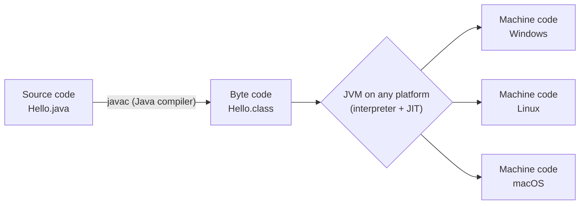

<div align="center">

# ☕ Chapter 01 · Introduction to OOP and Java

*Principles of OOP · Introduction to Java · Elementary concept of objects and classes*

[⬅ Back to Index](../README.md)

</div>

---

## 📑 Contents

1. [Programming paradigms: POP and OOP](#1-programming-paradigms-pop-and-oop)
2. [The four principles of OOP](#2-the-four-principles-of-oop)
3. [Introduction to Java](#3-introduction-to-java)
4. [Applets and applications](#4-java-applets-and-java-applications)
5. [The Java compilation process](#5-the-java-compilation-process)
6. [Features of Java](#6-features-of-java)
7. [Elementary concept of objects and classes](#7-elementary-concept-of-objects-and-classes)
8. [Structure of a simple Java program](#8-structure-of-a-simple-java-program)
9. [Differentiate between — quick table](#9-differentiate-between--quick-table)
10. [One-line facts](#10-one-line-facts)
11. [Test yourself](#-test-yourself)
12. [Programs in this chapter](#-programs-in-this-chapter)

---

## 1. Programming paradigms: POP and OOP

A **programming paradigm** is a style or approach of writing programs.

**Procedure Oriented Programming (POP)** is an approach in which a program is divided into a set of **functions (procedures)**. The emphasis is on *doing things* (algorithms). Data is mostly global and moves freely from function to function. *Examples:* C, FORTRAN, Pascal, BASIC.

**Object Oriented Programming (OOP)** is an approach in which a program is organised around **objects** — units that combine **data** and the **functions (methods)** that operate on that data. The emphasis is on *data* rather than procedure. *Examples:* Java, C++, Python, C#.

| Basis | Procedure Oriented Programming (POP) | Object Oriented Programming (OOP) |
|---|---|---|
| Emphasis | On functions / procedures (doing things) | On data (objects) |
| Division of program | Into functions | Into objects |
| Approach | Top-down | Bottom-up |
| Data security | Data moves freely between functions — less secure | Data is hidden inside objects — more secure |
| Access control | No access specifiers | Access specifiers (`private`, `protected`, `public`) |
| Adding new data/functions | Difficult | Easy |
| Reusability | Limited | High, through inheritance |
| Real-world modelling | Poor | Close to real-world entities |
| Examples | C, Pascal, FORTRAN | Java, C++, Python |

> [!NOTE]
> Java is called a **pure** object oriented language in ICSE books in the sense that every function must be written inside a class. (Strictly speaking it is not 100% pure because it has primitive data types such as `int` and `char`, which are not objects.)

---

## 2. The four principles of OOP

### 2.1 Data Abstraction
**Abstraction** is the act of representing the **essential features** of an entity **without including the background details** or explanations.

*Real-life example:* While driving a car we use the steering wheel, accelerator and brake. We do not need to know how the engine, fuel injection or gearbox work internally.
*Java example:* We call `Math.sqrt(25)` without knowing the algorithm used inside it.

### 2.2 Encapsulation
**Encapsulation** is the **wrapping up of data and the functions** that operate on the data **into a single unit** (called a class). The data is kept hidden from the outside world and can be accessed only through the functions of the class — this is called **data hiding**.

*Real-life example:* A medicine capsule wraps different medicines in one shell. A bank keeps your balance hidden; you can change it only through deposit and withdrawal counters.
*Java example:* A class with `private` data members and `public` methods.

### 2.3 Inheritance
**Inheritance** is the process by which **objects of one class acquire the properties and behaviour of objects of another class**. The class that is inherited from is the **base / super / parent class**; the class that inherits is the **derived / sub / child class**. It supports **reusability**.

*Real-life example:* A child inherits features from parents. A *Car* is a *Vehicle* — it inherits wheels, engine and speed from Vehicle and adds its own features such as air-conditioning.
*Java keyword:* `extends`.

### 2.4 Polymorphism
**Polymorphism** (Greek: *many forms*) is the ability of a function or an object to **take more than one form**, i.e. the same message produces different results in different situations.

*Real-life example:* A person behaves as a student in school, a son at home and a customer in a shop. The word "open" means different actions for a door, a file and a bank account.
*Java example:* **Method overloading** — several methods named `area()` that work on a circle, a square and a rectangle.

> [!TIP]
> **Exam pattern:** "Name the OOP principle shown below" is very common. Look for the key idea:
> *hiding details* → **Abstraction** · *binding data + methods / data hiding* → **Encapsulation** · *reusing an existing class* → **Inheritance** · *same name, many forms* → **Polymorphism**.

| Situation | Principle |
|---|---|
| A TV remote has buttons; the circuit inside is not shown | Abstraction |
| `private` data is reachable only through methods of the class | Encapsulation |
| `class Student extends Person` | Inheritance |
| `area(double r)` and `area(double l, double b)` in one class | Polymorphism |
| A class binds the properties and methods together | Encapsulation |
| A switch board shows only switches, not the wiring | Abstraction |

---

## 3. Introduction to Java

Java is a **high-level, object oriented, platform-independent** programming language developed by **James Gosling** and his team at **Sun Microsystems** in **1991**. It was first named **Oak** and renamed **Java** in **1995**. Sun Microsystems was later acquired by **Oracle Corporation** (2010).

**Some terms**

| Term | Meaning |
|---|---|
| **JDK** (Java Development Kit) | The package of tools needed to *develop* Java programs — compiler (`javac`), JVM, libraries, etc. |
| **JRE** (Java Runtime Environment) | The JVM + library classes needed only to *run* Java programs |
| **API** (Application Programming Interface) | The ready-made library of classes and packages supplied with Java (e.g. `java.lang`, `java.util`) |
| **BlueJ** | An IDE (Integrated Development Environment) designed for beginners, used in many ICSE schools |

---

## 4. Java applets and Java applications

There are two types of Java programs.

**Java application (stand-alone program):** A Java program that runs **independently** on a computer under the control of the operating system with the help of the JVM. It must contain a **`main()` method**, from where execution begins.
*Examples:* a program to calculate simple interest, a billing program, a desktop game.

**Java applet:** A **small Java program** that is designed to be **embedded in a web page (HTML document)** and run inside a **Java-enabled web browser** or an applet viewer. It does **not** need a `main()` method.
*Examples:* an animated clock or a small game displayed on a web page.

| Basis | Java Application | Java Applet |
|---|---|---|
| Execution | Runs independently on the OS through the JVM | Runs inside a web browser / applet viewer |
| `main()` method | Required | Not required |
| Size | Can be of any size | Small |
| Access to local files | Allowed | Restricted (for security) |
| Example | A banking program | An animation in a web page |

> [!WARNING]
> Applets are **obsolete** in real-world Java (browsers stopped supporting them and the Applet API is deprecated in modern JDKs). However, the **definition and differences are still in the ICSE syllabus**, so learn them for the exam.

---

## 5. The Java compilation process

| Term | Definition |
|---|---|
| **Source code** | The program written by the programmer in a high-level language (Java), saved with the extension **`.java`** |
| **Compiler** | A translator that converts the **whole** source program into another form in one go and lists all errors together. The Java compiler is **`javac`** |
| **Byte code** | The **intermediate code** produced by the Java compiler. It is **not** specific to any machine and is stored in a **`.class`** file |
| **Java Virtual Machine (JVM)** | A **virtual (software) machine** that **interprets / translates byte code into machine code** of the host computer and executes it. Every platform has its own JVM |
| **Object code / machine code** | Code in binary (0s and 1s) that the processor of a particular computer can execute directly |
| **Interpreter** | A translator that translates and executes a program **line by line** |
| **JIT compiler** (Just-In-Time) | A part of the JVM that converts frequently used byte code into machine code at run time to speed up execution |



**Steps involved**
1. The programmer writes the **source code** and saves it as `Hello.java`.
2. The **compiler** `javac Hello.java` checks the syntax and converts the source code into **byte code** (`Hello.class`).
3. The **JVM** (`java Hello`) loads the byte code, verifies it, and the interpreter/JIT compiler converts it into **machine code** for that computer.
4. The machine code is **executed** by the processor and the output is produced.

> [!IMPORTANT]
> Java is **both compiled and interpreted**: compiled from source code to byte code, then interpreted by the JVM from byte code to machine code. This two-step process is what makes Java **platform independent** — the *same* `.class` file runs on any computer that has a JVM. ("**Write Once, Run Anywhere**" — WORA.)

| Basis | Compiler | Interpreter |
|---|---|---|
| Translation | Whole program at once | Line by line |
| Errors | Listed together after compilation | Shown one at a time; stops at the first error |
| Speed of execution | Faster (translation done once) | Slower |
| Object file | Generated | Not generated |

| Basis | Source code | Byte code | Machine (object) code |
|---|---|---|---|
| Written/produced by | Programmer | `javac` compiler | JVM |
| Extension | `.java` | `.class` | — (in memory) |
| Machine dependent? | No | No | Yes |
| Understood by | Humans | JVM | Processor |

---

## 6. Features of Java

| Feature | Meaning |
|---|---|
| **Simple** | Syntax is similar to C/C++ but removes complex features such as pointers and operator overloading |
| **Object oriented** | Everything is written inside classes; supports abstraction, encapsulation, inheritance and polymorphism |
| **Platform independent** | Byte code runs on any machine that has a JVM (WORA) |
| **Portable** | Programs can be moved from one system to another without change; sizes of data types are fixed on all machines |
| **Robust** | Strong type checking, automatic memory management (garbage collection) and exception handling make programs reliable |
| **Secure** | No explicit pointers; byte code is verified; programs run inside the JVM (sandbox) |
| **Multithreaded** | Can perform several tasks at the same time |
| **Compiled and interpreted** | Two-stage translation through byte code |
| **Distributed** | Supports networking; programs can use resources across the internet |
| **Case sensitive** | `Total`, `total` and `TOTAL` are three different identifiers |
| **Automatic garbage collection** | Memory occupied by unused objects is freed automatically |

---

## 7. Elementary concept of objects and classes

### 7.1 Object
An **object** is an **identifiable entity** that has some **characteristics (state)** and **behaviour**.

- **State** = the values of its attributes (stored in **data members / instance variables**).
- **Behaviour** = what it can do (written as **member methods / functions**).

| Real-world object | State (attributes) | Behaviour (methods) |
|---|---|---|
| Car | colour, brand, speed | accelerate(), brake(), turn() |
| Student | name, roll number, marks | study(), writeExam() |
| Bank account | account number, balance | deposit(), withdraw() |
| Mobile phone | brand, battery level | call(), sendMessage() |

### 7.2 Class
A **class** is a **blueprint / template** that defines the **common attributes and behaviour** of a set of similar objects. Objects are **instances** of a class.

- **Class as a blueprint:** just as many houses are built from one architectural plan, many objects are created from one class.
- **Class as an object factory:** a class can produce any number of objects, each having its own copy of the data members. Hence a class is called an **object factory**.
- **Class as a user-defined data type:** once a class `Student` is defined, it can be used like a type to declare variables: `Student s1;`. Such a type is called a **composite / user-defined / reference** data type.

### 7.3 Message passing
Objects communicate with each other by **sending messages**, i.e. by **calling each other's methods**. A message = name of the object + name of the method + information (arguments) needed.

```java
car1.accelerate(60);   // the message "accelerate by 60" is sent to the object car1
```

### 7.4 Creating an object
```java
Box b1 = new Box();    // declares a reference b1 and creates an object using 'new'
```
- `new` allocates memory for the object and returns its reference (address).
- `b1` is a **reference variable** that refers to the object.

| Basis | Class | Object |
|---|---|---|
| Nature | Blueprint / template / logical entity | Instance of a class / physical (real) entity |
| Memory | No memory for data is allocated when a class is defined | Memory is allocated when an object is created |
| Number | Defined once | Many objects can be created from one class |
| Keyword | Declared using `class` | Created using `new` |
| Example | `Car` | `car1`, `car2` |

> [!TIP]
> In questions like "*A class is called an object factory. Why?*" write: **Because a class is a blueprint from which any number of objects having similar attributes and behaviour can be created.**

---

## 8. Structure of a simple Java program

```java
// Single-line comment: my first program
public class Hello                 // class header — file must be saved as Hello.java
{
    public static void main(String[] args)   // execution begins here
    {
        System.out.println("Hello, ICSE!");  // statement ends with a semicolon
    }
}
```

| Part | Meaning |
|---|---|
| `public` | Access specifier — the method/class is accessible from anywhere |
| `static` | `main()` can be called without creating an object |
| `void` | `main()` returns no value |
| `main` | Name of the method from which execution starts |
| `String[] args` | Array of strings that can receive command-line arguments |
| `System.out.println()` | Prints the output and moves the cursor to the next line |
| `System.out.print()` | Prints the output and keeps the cursor on the same line |

---

## 9. Differentiate between — quick table

| Pair | Key difference |
|---|---|
| POP vs OOP | Functions first vs data (objects) first |
| Class vs Object | Blueprint vs instance |
| Abstraction vs Encapsulation | Hiding *complexity* (showing essentials) vs *binding* data and methods together and hiding data |
| Applet vs Application | Runs in a browser, no `main()` vs stand-alone, has `main()` |
| Compiler vs Interpreter | Whole program at once vs line by line |
| Source code vs Byte code | `.java`, human-readable vs `.class`, read by the JVM |
| Byte code vs Machine code | Platform independent vs platform dependent |
| JDK vs JVM | Development kit (includes compiler) vs virtual machine that runs byte code |
| `print()` vs `println()` | Cursor stays on the same line vs moves to the next line |

---

## 10. One-line facts

- Java was developed by **James Gosling** at **Sun Microsystems**; its original name was **Oak**.
- The Java compiler is **`javac`**; the command to run a program is **`java`**.
- The extension of a source file is **`.java`**; of a byte code file, **`.class`**.
- **JVM** makes Java platform independent; the JVM itself is **platform dependent**.
- A class is a **user-defined data type**; an object is an **instance** of a class.
- The keyword used to create an object is **`new`**.
- The principle that supports **reusability** is **inheritance**.
- **Method overloading** is an example of **polymorphism**.
- **Data hiding** is achieved through **encapsulation**.
- Execution of a Java application begins from the **`main()`** method.

---

## 🧠 Test Yourself

### Part A — Multiple choice (choose the most appropriate option)

1. A `.class` file produced on Windows is copied to a Linux computer that has a JVM. What happens?
   <br>(a) It must be recompiled with `javac` on Linux (b) It runs without recompilation (c) It runs only if the source file is also copied (d) It cannot run because machine code differs
2. Which statement is **false**?
   <br>(a) Byte code is machine independent (b) The JVM is machine independent (c) `javac` produces byte code (d) The JIT compiler is part of the JVM
3. *Assertion (A):* Java is called both a compiled and an interpreted language.
   <br>*Reason (R):* The JVM converts source code directly into machine code.
   <br>(a) Both A and R are true and R explains A (b) Both true but R does not explain A (c) A is true, R is false (d) A is false, R is true
4. A class `Account` keeps `balance` as `private` and allows it to change only through `deposit()` and `withdraw()`. The best-matching principle is:
   <br>(a) Inheritance (b) Polymorphism (c) Encapsulation (d) Abstraction
5. A user operates an ATM by pressing buttons without knowing how the machine contacts the bank server. This best illustrates:
   <br>(a) Encapsulation (b) Abstraction (c) Inheritance (d) Polymorphism
6. Which of these is **not** needed to *run* a compiled Java application?
   <br>(a) JVM (b) Byte code (c) `javac` (d) Library classes
7. Why is a class called an *object factory*?
   <br>(a) It stores objects permanently (b) Many objects with similar attributes and behaviour can be produced from it (c) It manufactures methods (d) It allocates memory for itself
8. `Car c;` is written but no `new` is used. Which is correct?
   <br>(a) An object of Car is created (b) Only a reference variable is declared; no object exists yet (c) A compile-time error occurs (d) Memory for all data members is allocated
9. Which pair is correctly matched?
   <br>(a) Inheritance – `new` (b) Polymorphism – method overloading (c) Encapsulation – `extends` (d) Abstraction – `main()`
10. *Assertion (A):* An applet does not need a `main()` method.
    <br>*Reason (R):* An applet is executed by a browser or applet viewer which controls its life cycle.
    <br>(a) Both true and R explains A (b) Both true, R does not explain A (c) A true, R false (d) A false, R true
11. Which of the following is the **correct order**?
    <br>(a) Byte code → source code → machine code (b) Source code → machine code → byte code (c) Source code → byte code → machine code (d) Machine code → byte code → source code
12. What happens if you save `public class Marks` in a file named `marks.java` on a case-sensitive system and compile it?
    <br>(a) Compiles normally (b) Compile-time error — the public class name and file name must match exactly (c) Runtime error (d) The class is renamed automatically

### Part B — Short answer questions

1. State two differences between POP and OOP.
2. Define abstraction and give one real-life example.
3. Why is Java platform independent though the JVM is platform dependent?
4. What is byte code? Why is it called intermediate code?
5. Define encapsulation. How is data hiding related to it?
6. Write two differences between a Java applet and a Java application.
7. Why is a class called a user-defined data type?
8. Identify the object, its state and its behaviour: *"Riya's red bicycle with 21 gears can speed up and stop."*
9. What is meant by message passing? Give an example statement.
10. Name the principle: (i) A `SavingsAccount` class reuses `Account`; (ii) `print(int)` and `print(String)` in the same class.

<details>
<summary><b>✅ Answers — Part A</b></summary>

| Q | Ans | Reason |
|---|---|---|
| 1 | (b) | Byte code is platform independent; any JVM can run it |
| 2 | (b) | The JVM is **platform dependent** — each OS has its own JVM |
| 3 | (c) | R is false: the JVM converts **byte code** (not source code) into machine code |
| 4 | (c) | Binding data with methods and restricting access = encapsulation (data hiding) |
| 5 | (b) | Essential features shown, background details hidden |
| 6 | (c) | `javac` is needed only to compile, not to run |
| 7 | (b) | — |
| 8 | (b) | Only a reference is declared; it does not refer to any object yet |
| 9 | (b) | — |
| 10 | (a) | — |
| 11 | (c) | — |
| 12 | (b) | A `public` class must be saved in a file with exactly the same name |

</details>

<details>
<summary><b>✅ Answers — Part B</b></summary>

1. POP emphasises functions and follows a top-down approach; OOP emphasises data (objects) and follows a bottom-up approach. In POP data moves freely between functions; in OOP data is hidden inside objects.
2. Abstraction is representing the essential features without including the background details. Example: we drive a car using the steering and pedals without knowing how the engine works.
3. Because the compiler produces machine-independent **byte code**, and a JVM (written separately for each platform) is available for every platform to run that same byte code.
4. Byte code is the code produced by the Java compiler and stored in a `.class` file. It is called intermediate code because it lies between source code and machine code and is not tied to any machine.
5. Encapsulation is the wrapping up of data and the methods that operate on it into a single unit (class). Because the data is kept inside the class and accessed only through its methods, it is hidden from the outside — this is data hiding.
6. An application runs independently and needs `main()`; an applet runs inside a browser and needs no `main()`. Applets have restricted access to local files; applications do not.
7. Because the programmer creates it, and it can be used, like `int` or `char`, to declare variables (`Student s;`).
8. Object: Riya's bicycle; state: colour red, 21 gears; behaviour: speed up, stop.
9. Objects communicate by calling each other's methods. Example: `car1.accelerate(60);`
10. (i) Inheritance (ii) Polymorphism (method overloading).

</details>

---

## 💻 Programs in this chapter

<!-- PROGRAMS -->

| No. | Program | |
|:---:|---|:---:|
| **Q1** | [Display Student Details using print() and println()](Q_1.java) |  |
| **Q2** | [Marks Table using Tab and New-Line Escape Sequences](Q_2.java) |  |
| **Q3** | [Quotation and File Path using Escape Sequences](Q_3.java) |  |
| **Q4** | [Class Box: Creating an Object and Finding its Volume](Box.java) |  |
| **Q5** | [Class Car: Two Objects, Same Behaviour, Different States](Car.java) |  |

<!-- /PROGRAMS -->
