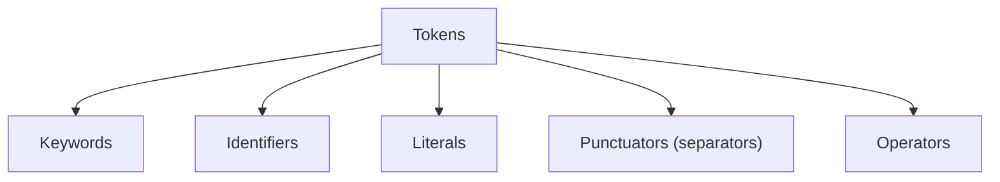
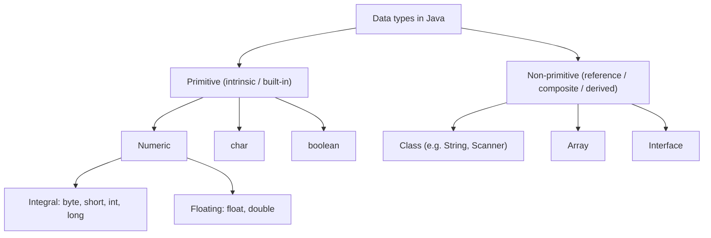
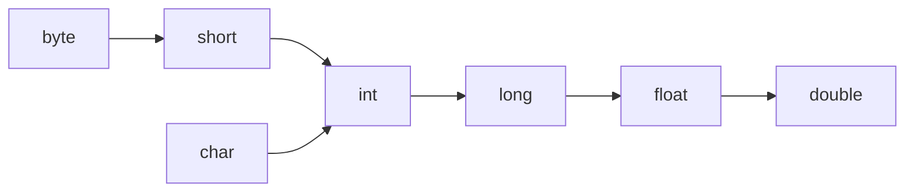

<div align="center">

# 🔢 Chapter 02 · Values and Data Types

*Character set · ASCII and Unicode · Escape sequences · Tokens · Constants and variables · Data types · Type conversion*

[⬅ Back to Index](../README.md)

</div>

---

## 📑 Contents

1. [Character set](#1-character-set)
2. [ASCII and Unicode](#2-ascii-and-unicode)
3. [Escape sequences](#3-escape-sequences)
4. [Tokens](#4-tokens)
5. [Constants and variables](#5-constants-and-variables)
6. [Data types](#6-data-types)
7. [Type conversion](#7-type-conversion)
8. [Evaluate the expression — solved examples](#8-evaluate-the-expression--solved-examples)
9. [Predict the output](#9-predict-the-output)
10. [Find the errors](#10-find-the-errors)
11. [One-line facts](#11-one-line-facts)
12. [Test yourself](#-test-yourself)
13. [Programs in this chapter](#-programs-in-this-chapter)

---

## 1. Character set

The **character set** is the set of valid characters that a language can recognise. Java uses the **Unicode** character set. The characters are grouped as:

| Group | Characters |
|---|---|
| Letters | `A`–`Z`, `a`–`z` |
| Digits | `0`–`9` |
| Special characters / delimiters | `+ - * / % = < > ! & \| ^ ~ ? : ; , . ' " ( ) [ ] { } @ # _ $ \` |
| White spaces | blank space, tab (`\t`), new line (`\n`), carriage return, form feed |

---

## 2. ASCII and Unicode

**ASCII** (American Standard Code for Information Interchange) is a **7-bit** code that represents **128** characters (codes **0 to 127**) — English letters, digits, punctuation and control characters.

**Unicode** is a **16-bit** (2-byte) code in Java's `char` type, able to represent **65,536** characters (codes 0 to 65535) covering the scripts of almost all the world's languages (Hindi, Bengali, Chinese, etc.). The first 128 Unicode characters are exactly the ASCII characters.

| Basis | ASCII | Unicode |
|---|---|---|
| Bits used | 7 bits (often stored in 8) | 16 bits in Java `char` |
| Number of characters | 128 | 65,536 (in a `char`) |
| Languages | English only | Almost all languages |
| Used by Java? | Subset of Unicode | Yes — Java's character set |

**ASCII codes you must remember**

| Character(s) | Codes |
|---|---|
| `'A'` – `'Z'` | **65 – 90** |
| `'a'` – `'z'` | **97 – 122** |
| `'0'` – `'9'` | **48 – 57** |
| Blank space `' '` | **32** |
| Difference between `'a'` and `'A'` | **32** |

> [!TIP]
> To convert a digit character to its value: `'7' - '0'` = 55 − 48 = **7**. To convert uppercase to lowercase without a library method: `(char)(ch + 32)`.

---

## 3. Escape sequences

An **escape sequence** is a **non-graphic character** represented by a **backslash (`\`) followed by a character**. It is used inside character or string literals to print characters that cannot be typed directly or that have a special meaning.

| Escape sequence | Meaning | Example | Output |
|---|---|---|---|
| `\n` | New line | `"Hi\nThere"` | Hi *(new line)* There |
| `\t` | Horizontal tab | `"A\tB"` | A&emsp;&emsp;B |
| `\\` | Backslash | `"C:\\Java"` | C:\Java |
| `\"` | Double quote | `"\"OK\""` | "OK" |
| `\'` | Single quote | `'\''` | ' |

> [!WARNING]
> `"C:\new"` does **not** print `C:\new` — `\n` is a new line! Write `"C:\\new"`. An escape sequence counts as **one** character: `"A\tB".length()` is **3**.

---

## 4. Tokens

A **token** is the **smallest individual unit** of a program that is meaningful to the compiler. Java has **five** types of tokens:



### 4.1 Keywords
**Keywords** are **reserved words** that have a **special meaning** for the compiler. They cannot be used as identifiers. All keywords are in **lowercase**.

Examples: `class`, `public`, `static`, `void`, `int`, `double`, `char`, `boolean`, `if`, `else`, `switch`, `case`, `default`, `break`, `continue`, `for`, `while`, `do`, `return`, `new`, `this`, `final`, `private`, `protected`, `import`, `package`, `extends`.

> [!NOTE]
> `true`, `false` and `null` are **literals**, not keywords, but they also cannot be used as identifiers. `main`, `String` and `System` are **not** keywords — they are identifiers.

### 4.2 Identifiers
**Identifiers** are the **names given** to the different parts of a program such as variables, methods, classes and arrays.

**Rules for naming identifiers**
1. It may contain letters, digits, underscore (`_`) and dollar sign (`$`).
2. It **must not begin with a digit**.
3. It **must not be a keyword** (or `true`, `false`, `null`).
4. **No blank spaces** or other special characters are allowed.
5. It is **case sensitive** (`sum` and `Sum` differ). There is no limit on the length.

| Identifier | Valid? | Reason |
|---|:---:|---|
| `total_marks` | ✅ | — |
| `$amount` | ✅ | `$` is allowed |
| `_count1` | ✅ | — |
| `2ndName` | ❌ | Starts with a digit |
| `net pay` | ❌ | Contains a space |
| `class` | ❌ | Keyword |
| `rate%` | ❌ | `%` not allowed |
| `Main` | ✅ | Not a keyword |
| `true` | ❌ | Reserved literal |

**Naming conventions** (not compulsory but followed): class names begin with a capital letter (`Student`); variable and method names begin with a small letter and use camelCase (`netSalary`, `findSum()`); constants are in capitals (`PI`, `MAX_MARKS`).

### 4.3 Literals (constants)
**Literals** are **fixed values** that do not change during the execution of a program.

| Type | Examples | Notes |
|---|---|---|
| Integer literal | `25`, `-108`, `0`, `50000L` | Whole numbers; `L` suffix = `long` |
| Real (floating-point) literal | `3.14`, `-0.5`, `2.5f`, `1.2E3` | `double` by default; `f` suffix = `float` |
| Character literal | `'A'`, `'7'`, `'$'`, `'\n'` | **One** character in single quotes |
| String literal | `"ICSE"`, `"7"`, `""` | Zero or more characters in double quotes |
| Boolean literal | `true`, `false` | Only two values |
| Null literal | `null` | Absence of a reference |

> [!IMPORTANT]
> `'A'` is a **character** literal; `"A"` is a **String** literal. `'AB'` is an **error** (more than one character in single quotes). `""` (empty string) is valid, but `''` (empty char) is **invalid**.

### 4.4 Punctuators (separators)
**Punctuators** are special symbols used to **separate** or **group** parts of a program: `;` `,` `.` `( )` `{ }` `[ ]`.

### 4.5 Operators
**Operators** are symbols that **perform operations** on operands: `+ - * / % = == < > && || ! ++ --` etc. (Chapter 03).

> [!TIP]
> **Counting tokens:** in `int sum = a + 10;` the tokens are `int`, `sum`, `=`, `a`, `+`, `10`, `;` — **7 tokens** (1 keyword, 2 identifiers, 2 operators, 1 literal, 1 punctuator).

---

## 5. Constants and variables

A **variable** is a **named memory location** that stores a value which **can change** during program execution.

```java
int marks;          // declaration
marks = 95;         // assignment (initialisation)
int age = 15;       // declaration with initialisation
int a = 5, b = 10;  // multiple declaration
```

| Term | Meaning | Example |
|---|---|---|
| **Declaration** | Telling the compiler the name and type of a variable | `double rate;` |
| **Static initialisation** | Initial value given directly as a literal | `int n = 10;` |
| **Dynamic initialisation** | Initial value computed at run time from an expression | `double area = l * b;` |

A **constant** (symbolic constant) is a variable whose value **cannot be changed** once assigned. It is declared using the keyword **`final`**.

```java
final double PI = 3.14159;
PI = 3.14;          // ❌ compile-time error: cannot assign a value to final variable PI
```

---

## 6. Data types

A **data type** specifies the **type of value** a variable can hold, the **memory** it occupies and the **operations** that can be performed on it.



### 6.1 Primitive data types

| Type | Size (bits) | Size (bytes) | Range | Default value |
|---|:---:|:---:|---|---|
| `byte` | 8 | 1 | −128 to 127 | `0` |
| `short` | 16 | 2 | −32,768 to 32,767 | `0` |
| `int` | 32 | 4 | −2³¹ to 2³¹ − 1 (about ±2.1 × 10⁹) | `0` |
| `long` | 64 | 8 | −2⁶³ to 2⁶³ − 1 (about ±9.2 × 10¹⁸) | `0L` |
| `float` | 32 | 4 | about ±3.4 × 10³⁸ (6–7 significant digits) | `0.0f` |
| `double` | 64 | 8 | about ±1.7 × 10³⁰⁸ (15–16 significant digits) | `0.0d` |
| `char` | 16 | 2 | 0 to 65,535 (`'\u0000'` to `'\uffff'`) | `'\u0000'` |
| `boolean` | 1 bit of information (JVM-dependent storage) | — | `true` / `false` | `false` |

> [!NOTE]
> Default values apply only to **instance/class variables** (data members) and array elements. **Local variables** have no default value — using one before assigning it gives a compile-time error.

### 6.2 Non-primitive (reference) data types
**Non-primitive** data types are built from primitive types or other classes. They store a **reference (address)** of the memory where the actual data is kept. Examples: **class** (e.g. `String`, `Scanner`, a user-defined `Student`), **array**, **interface**.

| Basis | Primitive data type | Non-primitive data type |
|---|---|---|
| Definition | Predefined (built-in) in Java | Created by the programmer or provided as classes |
| Stores | The actual value | A reference (address) to an object |
| Size | Fixed | Depends on the object |
| Default value | `0`, `0.0`, `false`, `'\u0000'` | `null` |
| Example | `int`, `char`, `double` | `String`, arrays, class `Student` |

---

## 7. Type conversion

**Type conversion** is the process of converting a value of one data type into another.

### 7.1 Implicit type conversion (coercion / widening / type promotion)
Done **automatically by the compiler** when a value of a **smaller** type is assigned to or used with a **larger** type. There is **no loss of data**.

**Hierarchy (lower → higher):**



**Type promotion in an expression:** in a mixed expression, all operands are promoted to the **highest type present** — and `byte`, `short` and `char` are always promoted to at least `int`.

| Expression (int i, long l, float f, double d, char c) | Result type |
|---|---|
| `i + d` | `double` |
| `c + i` | `int` |
| `c + c` | `int` (not `char`!) |
| `i * l` | `long` |
| `l + f` | `float` |
| `f * d` | `double` |
| `i / 2` | `int` |

### 7.2 Explicit type conversion (type casting / narrowing)
Done **by the programmer** using the **cast operator** `(type)`. It is needed when converting a **larger** type to a **smaller** type; data may be **lost**.

```java
double x = 9.87;
int n = (int) x;          // 9   — fractional part is truncated, not rounded
char ch = (char) 66;      // 'B'
double q = (double) 7 / 2; // 3.5 — 7 is cast first, then 7.0 / 2
double r = (double) (7 / 2); // 3.0 — 7 / 2 = 3 is computed first, then cast
```

| Basis | Implicit conversion | Explicit conversion |
|---|---|---|
| Done by | Compiler (automatically) | Programmer, using `(type)` |
| Direction | Smaller → larger type (widening) | Larger → smaller type (narrowing) |
| Data loss | No | Possible |
| Also called | Coercion, type promotion | Type casting |
| Example | `double d = 10;` | `int n = (int) 9.8;` |

> [!WARNING]
> `int n = 9.8;` is a **compile-time error** ("possible lossy conversion from double to int"). Also `float f = 2.5;` is an error, because `2.5` is a `double` literal — write `2.5f`. And `long big = 3000000000;` is an error — the literal is too large for `int`; write `3000000000L`.

---

## 8. Evaluate the expression — solved examples

**Q1.** `char c = 'B'; int x = c + 2;` → `'B'` is 66 → `x` = **68**.

**Q2.** `System.out.println('A' + 'B');` → 65 + 66 = **131** (char + char → int).

**Q3.** `System.out.println("" + 'A' + 'B');` → `"" + 'A'` = `"A"`, then `"A" + 'B'` = **AB**.

**Q4.** `System.out.println('A' + 1 + "B");` → `'A' + 1` = 66, then `66 + "B"` = **66B**.

**Q5.** `char ch = 'a'; ch += 2; System.out.println(ch);` → shorthand assignment includes an automatic cast → **c**.
(But `ch = ch + 2;` is a **compile-time error** because `ch + 2` is `int`.)

**Q6.** `double d = 17 / 4;` → integer division 17 / 4 = 4, then widened → **4.0**.

**Q7.** `int k = (int) 'z' - (int) 'a';` → 122 − 97 = **25**.

**Q8.** `System.out.println((char) ('a' + 25));` → 97 + 25 = 122 → **z**.

---

## 9. Predict the output

```java
int a = 7, b = 2;
double d = a / b;
double e = (double) a / b;
char c = (char) (a + 'A');
System.out.println(d + " " + e + " " + c);
System.out.println(1 + 2 + "3" + 4 + 5);
```

<details>
<summary><b>Show answer and dry run</b></summary>

| Step | Expression | Value |
|---|---|---|
| 1 | `a / b` (int ÷ int) | 3 → `d` = 3.0 |
| 2 | `(double) a / b` | 7.0 / 2 = 3.5 |
| 3 | `a + 'A'` | 7 + 65 = 72 → `(char)` 72 = `'H'` |
| 4 | `1 + 2` | 3 (numeric addition, left to right) |
| 5 | `3 + "3"` | `"33"` (string concatenation from here on) |
| 6 | `"33" + 4 + 5` | `"3345"` |

**Output**
```
3.0 3.5 H
3345
```
</details>

---

## 10. Find the errors

```java
int 1num = 10;          // (1)
char grade = "A";       // (2)
float rate = 7.5;       // (3)
long pop = 9000000000;  // (4)
boolean flag = 1;       // (5)
final int MAX = 50; MAX = 60;   // (6)
```

<details>
<summary><b>Show corrected code</b></summary>

```java
int num1 = 10;               // (1) identifier cannot start with a digit
char grade = 'A';            // (2) char needs single quotes
float rate = 7.5f;           // (3) 7.5 is double; use the suffix f
long pop = 9000000000L;      // (4) literal exceeds int range; use the suffix L
boolean flag = true;         // (5) boolean takes only true/false, not 1
final int MAX = 50;          // (6) a final variable cannot be reassigned
```
</details>

---

## 11. One-line facts

- Java uses the **Unicode** character set; a `char` occupies **2 bytes**.
- ASCII uses **7 bits** and has **128** characters.
- The smallest unit of a program is a **token**; there are **5** types of tokens.
- All keywords are in **lowercase**.
- An identifier cannot **begin with a digit**.
- The keyword used to declare a constant is **`final`**.
- The default type of a real literal is **`double`**; of an integer literal, **`int`**.
- `boolean` is the only primitive type that **cannot be converted** to or from any other type.
- **Casting a real number to `int` truncates** (it does not round).
- `char + char` gives an **`int`**.
- `String` is a **class**, hence a **non-primitive** (reference) type.

---

## 🧠 Test Yourself

### Part A — Multiple choice

1. What is the output of `System.out.println('a' + 'b' + "c");`?
   (a) abc (b) 195c (c) 195 (d) Error
2. Which declaration compiles **without error**?
   (a) `float f = 1.5;` (b) `char c = 65 + 1;` (c) `int i = 3.0;` (d) `byte b = 200;`
3. *Assertion (A):* `char ch = 'x'; ch = ch + 1;` gives a compile-time error.
   *Reason (R):* The expression `ch + 1` is of type `int`, which cannot be stored in a `char` without a cast.
   (a) Both true; R explains A (b) Both true; R does not explain A (c) A true, R false (d) A false, R true
4. Which of the following is **not** a valid identifier? (a) `_$x` (b) `Final` (c) `double` (d) `MAX_VALUE`
5. `int x = (int) -7.9;` stores:
   (a) −8 (b) −7 (c) −7.9 (d) Error
6. How many tokens are there in `if (a >= 10) b++;`?
   (a) 7 (b) 8 (c) 9 (d) 10
7. Which literal occupies the **most memory** when stored in its default type? (a) `'A'` (b) `100` (c) `100L` (d) `true`
8. `"A".length() + 'A'` evaluates to: (a) 66 (b) "1A" (c) 2 (d) 65
9. A local variable `int n;` is declared and immediately printed. The result is:
   (a) 0 (b) garbage value (c) compile-time error (d) runtime error
10. What is printed by `System.out.println((double) (5 / 2) + 5 / 2.0);`?
    (a) 5.0 (b) 4.5 (c) 5.5 (d) 4.0
11. Which statement is **true**?
    (a) Every Unicode character is an ASCII character (b) Every ASCII character is a Unicode character (c) ASCII is 16-bit (d) Unicode has 128 characters
12. `System.out.println("Tab:\t|" + "\\n|");` prints:
    (a) `Tab:<tab>|<newline>|` (b) `Tab:<tab>|\n|` (c) `Tab:\t|\n|` (d) Error

### Part B — Short answer questions

1. What are tokens? Name all five types with one example each.
2. Distinguish between `'7'`, `"7"` and `7`.
3. Why is `float f = 3.14;` an error? Give two ways to correct it.
4. Give the output: `char c = 'C'; int n = c; System.out.println(c + " " + n + " " + (char)(n + 3));`
5. Explain dynamic initialisation with an example.
6. State the default values of `int`, `double`, `char`, `boolean` and `String` data members.
7. What is type promotion? What will be the type of `b + s` where `b` is `byte` and `s` is `short`?
8. Name the escape sequences for: new line, tab, backslash, double quote.
9. Differentiate between a keyword and an identifier.
10. Evaluate: `int x = 'z' - 'a' + 1;` and `double y = 1 / 2 + 1.0 / 2;`

<details>
<summary><b>✅ Answers — Part A</b></summary>

| Q | Ans | Reason |
|---|---|---|
| 1 | (b) | `'a' + 'b'` = 97 + 98 = 195 (int addition), then `195 + "c"` = `"195c"` |
| 2 | (b) | `65 + 1` is a constant expression (66) within `char` range, so it is allowed |
| 3 | (a) | — |
| 4 | (c) | `double` is a keyword; `Final` (capital F) is valid |
| 5 | (b) | Casting truncates toward zero |
| 6 | (c) | `if` `(` `a` `>=` `10` `)` `b` `++` `;` = 9 |
| 7 | (c) | `long` = 8 bytes |
| 8 | (a) | 1 + 65 = 66 |
| 9 | (c) | Local variables are not given default values |
| 10 | (b) | `(double)(2)` = 2.0, plus 2.5 = 4.5 |
| 11 | (b) | — |
| 12 | (b) | `\t` becomes a tab; `\\n` is a backslash followed by `n` |

</details>

<details>
<summary><b>✅ Answers — Part B</b></summary>

1. A token is the smallest meaningful unit of a program. Keywords (`int`), identifiers (`sum`), literals (`25`), punctuators (`;`), operators (`+`).
2. `'7'` is a character literal (code 55, `char`); `"7"` is a String literal; `7` is an integer literal.
3. `3.14` is a `double` literal and cannot be stored in a `float` without loss. Correct: `float f = 3.14f;` or `float f = (float) 3.14;`
4. `C 67 F`
5. A variable is given its initial value at run time from an expression, e.g. `double area = length * breadth;`
6. `0`, `0.0`, `'\u0000'`, `false`, `null`.
7. Automatic conversion of operands to a higher type in an expression. `b + s` is of type `int`.
8. `\n`, `\t`, `\\`, `\"`.
9. A keyword is a reserved word with a fixed meaning (e.g. `while`) and cannot be used as a name; an identifier is a programmer-chosen name (e.g. `total`).
10. `x` = 122 − 97 + 1 = **26**; `y` = 0 + 0.5 = **0.5**.

</details>

---

## 💻 Programs in this chapter

<!-- PROGRAMS -->

| No. | Program | |
|:---:|---|:---:|
| **Q6** | [ASCII Code of an Entered Character](Q_6.java) |  |
| **Q7** | [Character for an Entered ASCII Code](Q_7.java) |  |
| **Q8** | [Implicit Type Conversion](Q_8.java) |  |
| **Q9** | [Explicit Type Casting](Q_9.java) |  |
| **Q10** | [Swap Two Numbers using a Third Variable](Q_10.java) |  |
| **Q11** | [Swap Two Numbers without a Third Variable](Q_11.java) |  |
| **Q12** | [Next and Previous Character](Q_12.java) |  |
| **Q13** | [Uppercase to Lowercase using ASCII Arithmetic](Q_13.java) |  |

<!-- /PROGRAMS -->
