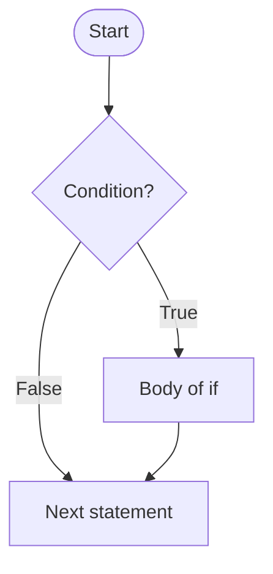
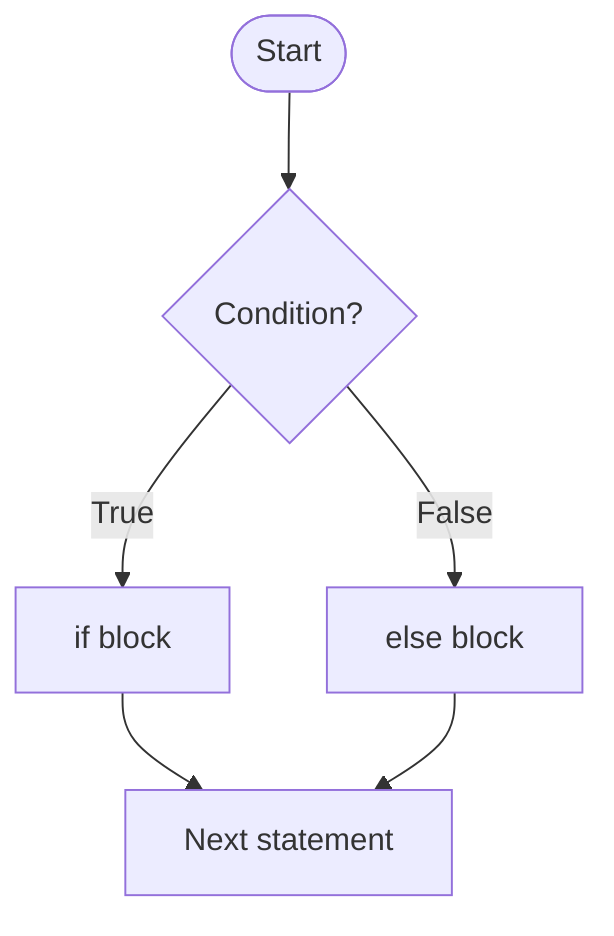
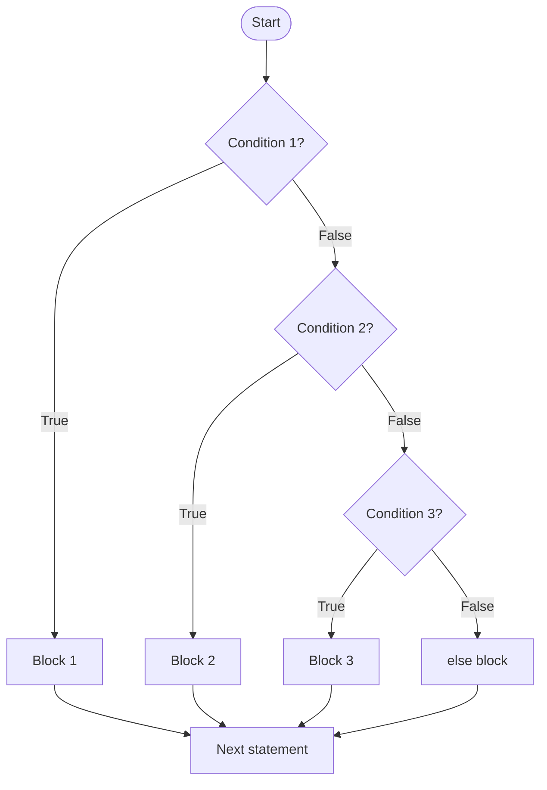
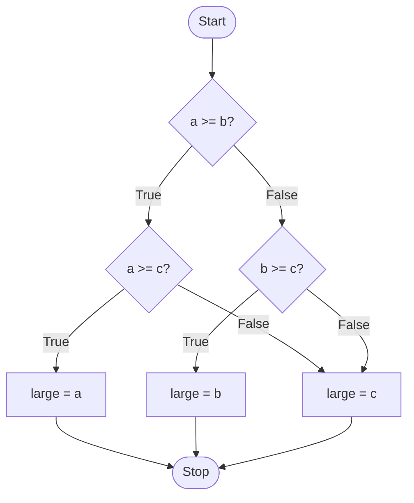
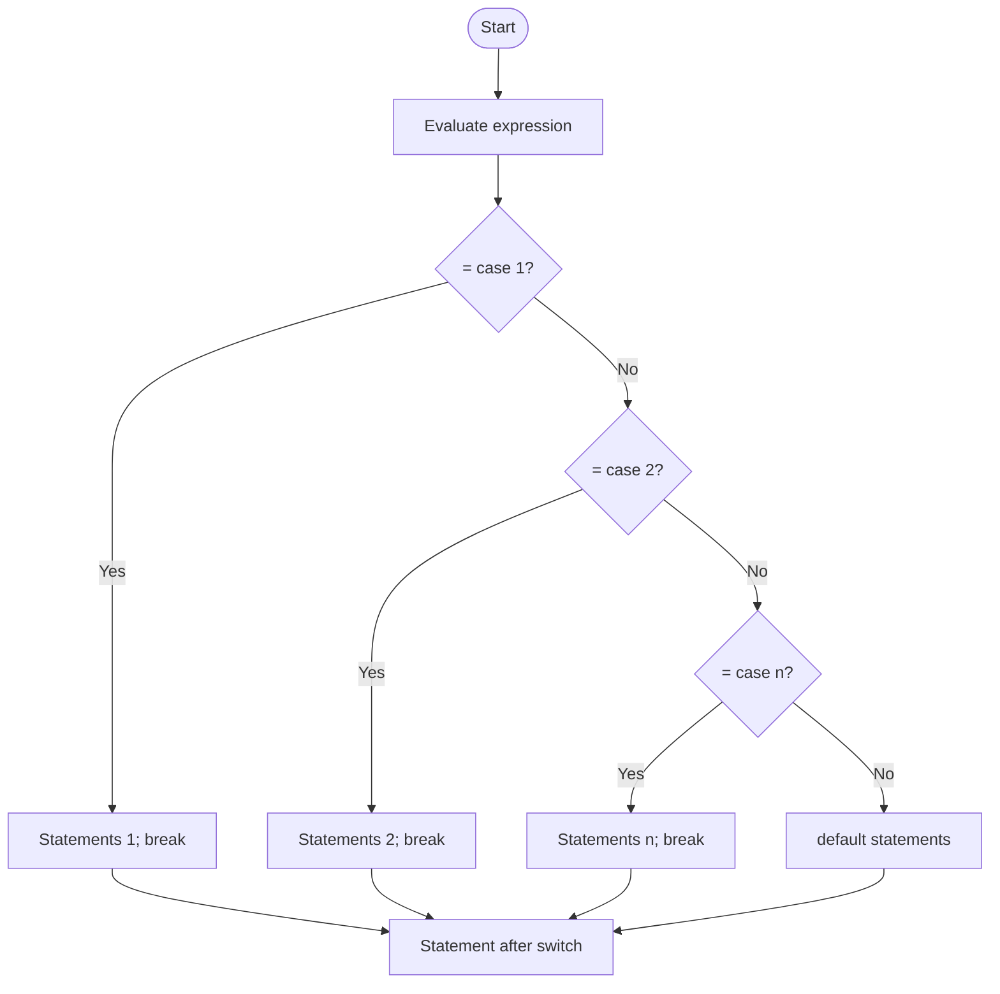

<div align="center">

# 🔀 Chapter 06 · Conditional Constructs in Java

*Flow of control · if · if-else · if-else-if ladder · nested if · switch-case · default · break · fall through · menu-driven programs · `System.exit(0)`*

[⬅ Back to Index](../README.md)

</div>

---

## 📑 Contents

1. [Flow of control](#1-flow-of-control)
2. [The `if` statement](#2-the-if-statement)
3. [The `if-else` statement](#3-the-if-else-statement)
4. [The `if-else-if` ladder](#4-the-if-else-if-ladder)
5. [Nested `if` and the dangling-else problem](#5-nested-if-and-the-dangling-else-problem)
6. [The `switch` statement](#6-the-switch-statement)
7. [Fall through](#7-fall-through)
8. [Menu-driven programs and `System.exit(0)`](#8-menu-driven-programs-and-systemexit0)
9. [Comparisons: if-else vs switch vs ternary](#9-comparisons)
10. [Conversions between if-else, switch and ternary](#10-conversions-between-if-else-switch-and-ternary)
11. [Predict the output — with dry runs](#11-predict-the-output)
12. [Find the errors](#12-find-the-errors)
13. [One-line facts](#13-one-line-facts)
14. [Test yourself](#-test-yourself)
15. [Programs in this chapter](#-programs-in-this-chapter)

---

## 1. Flow of control

The **flow of control** is the order in which the statements of a program are executed.

| Construct | Meaning | Statements |
|---|---|---|
| **Sequential** | Statements execute one after another, top to bottom | Ordinary statements |
| **Selection (conditional / decision-making)** | One of several blocks is executed depending on a condition | `if`, `if-else`, `if-else-if`, nested `if`, `switch`, `?:` |
| **Iteration (looping)** | A block is executed repeatedly while a condition holds | `for`, `while`, `do-while` (Chapter 07) |

A **compound statement (block)** is a group of statements enclosed in braces `{ }`, treated as a single statement.

---

## 2. The `if` statement

Executes a statement (or block) **only if** the condition is `true`; otherwise the statement is skipped.

```java
if (condition)
{
    statements;      // executed only when condition is true
}
```



```java
if (marks >= 40)
    System.out.println("Pass");
```

> [!WARNING]
> `if (x > 5);` — the **semicolon** ends the `if` with an empty statement. The next line then runs **always**. This is a logical error that the compiler does not catch.

---

## 3. The `if-else` statement

Executes one block if the condition is `true` and **another** block if it is `false`. Exactly **one** of the two blocks is executed.

```java
if (condition)
    statement1;
else
    statement2;
```



```java
if (n % 2 == 0)
    System.out.println("Even");
else
    System.out.println("Odd");
```

---

## 4. The `if-else-if` ladder

Used to test **several conditions one after another**. As soon as a condition is `true`, its block is executed and the **rest of the ladder is skipped**. The final `else` (optional) runs when **no** condition is true.

```java
if (condition1)
    block1;
else if (condition2)
    block2;
else if (condition3)
    block3;
else
    default_block;
```



> [!TIP]
> In **slab programs** (grades, discounts, bills), write the conditions in increasing (or decreasing) order. Because earlier conditions have already failed, you need **only one bound** in each `else if`:
> `if (p >= 90) … else if (p >= 80) … else if (p >= 70) …` — no need to write `p >= 80 && p < 90`.

**Two kinds of slab calculation**

| Flat rate on the whole amount | Cumulative (slab by slab) |
|---|---|
| The rate of the slab applies to the **entire** value | Each part of the value is charged at **its own** slab rate |
| `if (sales <= 25000) comm = sales * 5 / 100; else if …` | `if (u <= 100) bill = u * 2; else if (u <= 300) bill = 100 * 2 + (u - 100) * 3; …` |
| Discounts, commission | Electricity bill, telephone bill, taxi fare, income tax |

---

## 5. Nested `if` and the dangling-else problem

A **nested if** is an `if` (or `if-else`) statement placed **inside** another `if` or `else` block. The inner condition is tested only when the outer condition allows it.

```java
if (a >= b)
{
    if (a >= c)
        large = a;
    else
        large = c;
}
else
{
    if (b >= c)
        large = b;
    else
        large = c;
}
```



**Dangling else:** when there are more `if`s than `else`s and no braces, it is unclear which `if` an `else` belongs to. **Rule: an `else` is always paired with the nearest preceding unmatched `if`.**

```java
int x = 5, y = 10;
if (x > 10)
    if (y > 5)
        System.out.println("A");
else                          // belongs to if (y > 5), NOT if (x > 10)
    System.out.println("B");
// Output: nothing! (outer if is false, so the whole inner if-else is skipped)
```

> [!IMPORTANT]
> Indentation does **not** decide pairing — the compiler ignores it. Use braces `{ }` to make the outer `if` own the `else`.

---

## 6. The `switch` statement

A **multiple-branch selection** statement that compares the value of an expression with a list of **constant case labels** and executes the statements of the matching case.

```java
switch (expression)
{
    case constant1:
        statements;
        break;
    case constant2:
        statements;
        break;
    ...
    default:
        statements;
}
```



**Rules of `switch`**

| Rule | Detail |
|---|---|
| Type of the expression | `int`, `char`, `byte`, `short`, `String` (and their wrappers). **Not** `long`, `float`, `double` or `boolean` |
| Case labels | Must be **constants** (literals or `final` variables) of a compatible type — **no variables, no ranges, no conditions** |
| Duplicates | Two case labels cannot have the **same value** |
| `break` | Transfers control **out of** the switch. Without it, execution **falls through** to the next case |
| `default` | Optional; executed when no case matches; can be placed anywhere (usually last) |
| Last case | `break` after the last case/default is optional |

**Keywords used:** `switch`, `case`, `default`, `break`.

> [!NOTE]
> A **`String`** can be used in `switch`: `switch (day) { case "Mon": … }`. The comparison is **case sensitive**.

---

## 7. Fall through

**Fall through** is the situation in a `switch` where, in the **absence of a `break`** statement, control **continues into the next case(s)** and executes their statements too, until a `break` or the end of the switch is reached.

**Useful fall through** — several cases sharing one action:
```java
switch (ch)
{
    case 'a': case 'e': case 'i': case 'o': case 'u':
        System.out.println("Vowel");
        break;
    default:
        System.out.println("Not a vowel");
}
```

**Accidental fall through:**
```java
int n = 2;
switch (n)
{
    case 1: System.out.print("One ");
    case 2: System.out.print("Two ");
    case 3: System.out.print("Three ");
            break;
    case 4: System.out.print("Four ");
}
// Output: Two Three
```

---

## 8. Menu-driven programs and `System.exit(0)`

A **menu-driven program** displays a **list of choices (menu)** to the user, accepts a choice and performs the corresponding task — usually using a `switch` statement.

**`System.exit(0)`** terminates the program **immediately**. The argument **0** indicates **normal termination**; a non-zero value indicates abnormal termination.

| Basis | `break` | `System.exit(0)` |
|---|---|---|
| Effect | Exits from the **switch / loop** only | Terminates the **whole program** |
| Statements after the switch | Executed | Not executed |

---

## 9. Comparisons

| Basis | `if-else` | `switch` |
|---|---|---|
| Conditions tested | Any boolean expression — relational and logical | Only **equality** with constant values |
| Data types | Any type | `int`, `char`, `byte`, `short`, `String` |
| Ranges | Can test ranges (`m >= 40 && m < 60`) | Cannot test ranges |
| Multiple conditions | Combined with `&&`, `\|\|` | Not possible |
| Readability for many fixed values | Lengthy | Neat and readable |
| Default | `else` | `default` |

| Basis | Ternary operator | `if-else` |
|---|---|---|
| Nature | An **operator** — produces a value | A **statement** |
| Suitable for | Simple, single-value decisions | Complex decisions, multiple statements |
| Example | `max = (a > b) ? a : b;` | `if (a > b) max = a; else max = b;` |

| Basis | `if-else-if` ladder | Nested `if` |
|---|---|---|
| Structure | Conditions tested one after another at the same level | An `if` placed inside another `if` / `else` |
| Use | Choosing one out of many mutually exclusive options | Testing a condition only after another one is satisfied |

---

## 10. Conversions between if-else, switch and ternary

**(a) switch → if-else**
```java
switch (code)
{
    case 1: rate = 5; break;
    case 2: rate = 8; break;
    default: rate = 0;
}
```
```java
if (code == 1)
    rate = 5;
else if (code == 2)
    rate = 8;
else
    rate = 0;
```

**(b) if-else → switch** (possible only when each condition is an equality test on one variable)
```java
if (ch == 'A' || ch == 'a')
    System.out.println("Apple");
else if (ch == 'B' || ch == 'b')
    System.out.println("Ball");
else
    System.out.println("Unknown");
```
```java
switch (ch)
{
    case 'A':
    case 'a':
        System.out.println("Apple");
        break;
    case 'B':
    case 'b':
        System.out.println("Ball");
        break;
    default:
        System.out.println("Unknown");
}
```

**(c) if-else → ternary**
```java
if (age >= 18) status = "Adult"; else if (age >= 13) status = "Teen"; else status = "Child";
status = (age >= 18) ? "Adult" : (age >= 13) ? "Teen" : "Child";
```

---

## 11. Predict the output

**Example 1**
```java
int a = 10, b = 20;
if (a > 5 && b++ < 20)
    a = a + b;
else
    a = a - b;
System.out.println(a + " " + b);
```

<details>
<summary><b>Show dry run</b></summary>

| Step | Evaluation | Values |
|---|---|---|
| 1 | `a > 5` → true, so `b++ < 20` is evaluated | uses b = 20 → `20 < 20` false; b becomes 21 |
| 2 | Condition false → else block | a = 10 − 21 = −11 |

**Output:** `-11 21`
</details>

**Example 2**
```java
int x = 3;
switch (x * 2)
{
    case 4:  System.out.print("Four ");
    case 6:  System.out.print("Six ");
    case 8:  System.out.print("Eight ");
             break;
    default: System.out.print("Other ");
}
```

<details>
<summary><b>Show answer</b></summary>

`x * 2` = 6 → enters `case 6`, falls through to `case 8`, then `break`.
**Output:** `Six Eight`
</details>

**Example 3**
```java
char c = 'm';
switch (c)
{
    default:  System.out.print("D ");
    case 'a': System.out.print("A ");
              break;
    case 'b': System.out.print("B ");
}
```

<details>
<summary><b>Show answer</b></summary>

No case matches, so `default` runs. It has no `break`, so control falls through into `case 'a'`, then `break`.
**Output:** `D A`
</details>

**Example 4**
```java
int n = 0;
if (n = 0)
    System.out.println("Zero");
```

<details>
<summary><b>Show answer</b></summary>

**Compile-time error** — `n = 0` is an assignment producing an `int`, but `if` needs a `boolean`. Correct: `if (n == 0)`.
</details>

**Example 5**
```java
int p = 7, q = 7;
String r = (p > q) ? "P" : (p < q) ? "Q" : (p + q > 10) ? "EQ-BIG" : "EQ-SMALL";
System.out.println(r);
```

<details>
<summary><b>Show answer</b></summary>

`p > q` false → `p < q` false → `14 > 10` true → **`EQ-BIG`**
</details>

---

## 12. Find the errors

```java
double d = 2.0;
switch (d)                       // (1)
{
    case 1.0: System.out.println("One"); break;
}

int a = 5, b = 3;
switch (a)
{
    case b:  System.out.println("B");   // (2)
    case 5:  System.out.println("Five");
    case 5:  System.out.println("Again"); // (3)
    case a > 3: System.out.println("Big"); // (4)
}
```

<details>
<summary><b>Show corrections</b></summary>

1. `switch` cannot work on `double` → use an `int`, `char`, `String` etc.
2. `b` is a variable — case labels must be **constants** (use `final int B = 3;` or a literal).
3. Duplicate case label `5`.
4. A condition cannot be a case label — use `if`.

</details>

---

## 13. One-line facts

- `if` and `switch` are **selection** (decision-making) statements.
- An `else` pairs with the **nearest unmatched `if`**.
- `switch` tests only for **equality**.
- `switch` does **not** accept `long`, `float`, `double` or `boolean`.
- **Fall through** occurs when `break` is missing.
- `default` is **optional** and may appear anywhere in the switch.
- `System.exit(0)` terminates the program; `0` means normal termination.
- The **ternary** operator is a compact form of `if-else` that returns a value.

---

## 🧠 Test Yourself

### Part A — Multiple choice

1. What is printed?
   ```java
   int k = 5;
   if (k++ > 5 || ++k > 6) k += 10;
   System.out.println(k);
   ```
   (a) 5 (b) 7 (c) 17 (d) 16
2. Which can **never** be the type of a switch expression? (a) `char` (b) `String` (c) `boolean` (d) `short`
3. *Assertion (A):* In a `switch`, the `default` label must be the last label.
   *Reason (R):* Control goes to `default` only when no case matches.
   (a) Both true; R explains A (b) Both true; R doesn't explain A (c) A false, R true (d) Both false
4. What is printed?
   ```java
   int n = 3;
   switch (n)
   {
       case 1: case 3: n *= 2;
       case 4: n += 1; break;
       case 7: n = 0;
   }
   System.out.println(n);
   ```
   (a) 6 (b) 7 (c) 0 (d) 4
5. ```java
   int x = 15;
   if (x > 10)
       if (x > 20)
           System.out.print("A");
       else
           System.out.print("B");
   else
       System.out.print("C");
   ```
   prints (a) A (b) B (c) C (d) BC
6. Which `if` condition correctly tests that `ch` is **not** a vowel (lowercase only)?
   (a) `ch != 'a' || ch != 'e' || …` (b) `!(ch == 'a' || ch == 'e' || ch == 'i' || ch == 'o' || ch == 'u')` (c) `ch != "aeiou"` (d) `!ch == 'a'`
7. What happens when this runs? `int a = 4; switch (a) { case 4: System.out.print("X"); System.exit(0); default: System.out.print("Y"); } System.out.print("Z");`
   (a) XYZ (b) XZ (c) X (d) XY
8. *Assertion (A):* `if (a > b) ; else System.out.println(a);` compiles.
   *Reason (R):* A lone semicolon is a valid empty statement.
   (a) Both true; R explains A (b) Both true; R doesn't explain A (c) A true, R false (d) A false, R true
9. Which slab condition is **redundant** in a correctly ordered ladder `if (u <= 100) … else if (u > 100 && u <= 300) … else …`?
   (a) `u <= 100` (b) `u > 100` (c) `u <= 300` (d) none
10. `int m = 85; String g = m >= 90 ? "A" : m >= 80 ? "B" : "C";` gives (a) A (b) B (c) C (d) Error

### Part B — Short answer questions

1. What is fall through? Write a program segment where fall through is useful.
2. Give two differences between `if-else` and `switch`.
3. Convert into `switch`: `if (n == 1) s = "Red"; else if (n == 2) s = "Green"; else s = "Blue";`
4. Convert into a ternary statement: `if (a % 2 == 0) b = a / 2; else b = 3 * a + 1;`
5. Explain the dangling-else problem with an example. How is it resolved?
6. What is the use of `System.exit(0)`? How is it different from `break`?
7. Rewrite with a single `if` and logical operators:
   `if (x > 0) { if (x < 100) System.out.println("OK"); }`
8. Why can't `switch` be used to check `marks >= 90`?
9. Give the output: `int a = 2; switch (a + 1) { case 1: a = 10; case 3: a = a * 3; case 6: a++; break; default: a = 0; } System.out.println(a);`

<details>
<summary><b>✅ Answers — Part A</b></summary>

| Q | Ans | Working |
|---|---|---|
| 1 | (c) | `k++ > 5` → 5 > 5 false, k = 6; `++k > 6` → 7 > 6 true; k = 7 + 10 = 17 |
| 2 | (c) | — |
| 3 | (c) | `default` can be placed anywhere; R is true |
| 4 | (b) | case 3 → n = 6, falls into case 4 → n = 7, break |
| 5 | (b) | Inner `else` pairs with `if (x > 20)`; outer `else` with `if (x > 10)` |
| 6 | (b) | Option (a) is always true |
| 7 | (c) | The program ends at `System.exit(0)` |
| 8 | (a) | — |
| 9 | (b) | It is already known that `u > 100` when the first test fails |
| 10 | (b) | — |

</details>

<details>
<summary><b>✅ Answers — Part B</b></summary>

1. Execution continuing into the next case when `break` is missing. Useful for grouping: `case 'a': case 'e': case 'i': case 'o': case 'u': System.out.println("Vowel"); break;`
2. `if-else` can test any condition (ranges, logical combinations) on any type; `switch` tests only equality against constants of int/char/String types. `switch` is more readable when there are many fixed values.
3. ```java
   switch (n)
   {
       case 1: s = "Red"; break;
       case 2: s = "Green"; break;
       default: s = "Blue";
   }
   ```
4. `b = (a % 2 == 0) ? a / 2 : 3 * a + 1;`
5. When an `if` without braces contains another `if`, an `else` might seem to belong to either. Java pairs it with the nearest unmatched `if`. Use braces to attach it to the outer `if`.
6. It terminates the program immediately. `break` exits only the switch/loop, after which the following statements still execute.
7. `if (x > 0 && x < 100) System.out.println("OK");`
8. Case labels must be constant values; `switch` cannot test ranges or relational conditions.
9. `a + 1` = 3 → `a = 2 * 3 = 6` → falls into case 6 → `a = 7` → break. Output: **7**

</details>

---

## 💻 Programs in this chapter

<!-- PROGRAMS -->

| No. | Program | |
|:---:|---|:---:|
| **Q46** | [Electricity Bill (Slab System)](Q_46.java) |  |
| **Q47** | [Income Tax by Age, Gender and Slab](Q_47.java) |  |
| **Q48** | [Discount on Laptop or Desktop Purchase](Q_48.java) |  |
| **Q49** | [Menu-Driven Program: Area of Circle, Square or Rectangle](Q_49.java) |  |
| **Q50** | [Simple Calculator using switch](Q_50.java) |  |
| **Q51** | [Menu-Driven Temperature Conversion](Q_51.java) |  |
| **Q52** | [Day of the Week using switch](Q_52.java) |  |
| **Q53** | [Name of the Month and Number of Days](Q_53.java) |  |
| **Q54** | [Season of the Year using Fall-Through in switch](Q_54.java) |  |
| **Q55** | [Vowel or Consonant using switch](Q_55.java) |  |
| **Q56** | [Grade from Percentage](Q_56.java) |  |
| **Q57** | [Courier Charges by Weight and Type](Q_57.java) |  |
| **Q58** | [Telephone Bill with Monthly Rent](Q_58.java) |  |
| **Q59** | [Commission on Sales](Q_59.java) |  |
| **Q60** | [Fixed Deposit Interest by Period](Q_60.java) |  |
| **Q61** | [Taxi Fare by Distance](Q_61.java) |  |
| **Q62** | [Leap Year Check](Q_62.java) |  |
| **Q63** | [Largest of Three Numbers using Nested if](Q_63.java) |  |
| **Q64** | [Triangle Validity and Type by Sides](Q_64.java) |  |
| **Q65** | [Odd or Even Number](Q_65.java) |  |
| **Q66** | [Positive, Negative or Zero](Q_66.java) |  |
| **Q67** | [Eligibility to Vote](Q_67.java) |  |
| **Q68** | [Uppercase, Lowercase, Digit or Special Character](Q_68.java) |  |
| **Q69** | [Buzz Number](Q_69.java) |  |
| **Q70** | [Divisibility by 5 and 11](Q_70.java) |  |
| **Q71** | [Profit or Loss and its Percentage](Q_71.java) |  |
| **Q72** | [Quadrant of a Point](Q_72.java) |  |
| **Q73** | [Menu with an Exit Option using System.exit(0)](Q_73.java) |  |
| **Q74** | [Rock, Paper, Scissors against the Computer](Q_74.java) | 🌟 *Extra* |
| **Q75** | [Zodiac Sign from Date of Birth](Q_75.java) | 🌟 *Extra* |
| **Q76** | [Valid Date Checker](Q_76.java) | 🌟 *Extra* |
| **Q77** | [BMI Calculator with Category](Q_77.java) | 🌟 *Extra* |

<!-- /PROGRAMS -->
