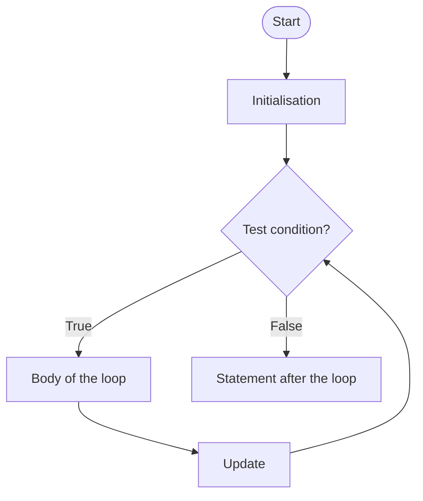
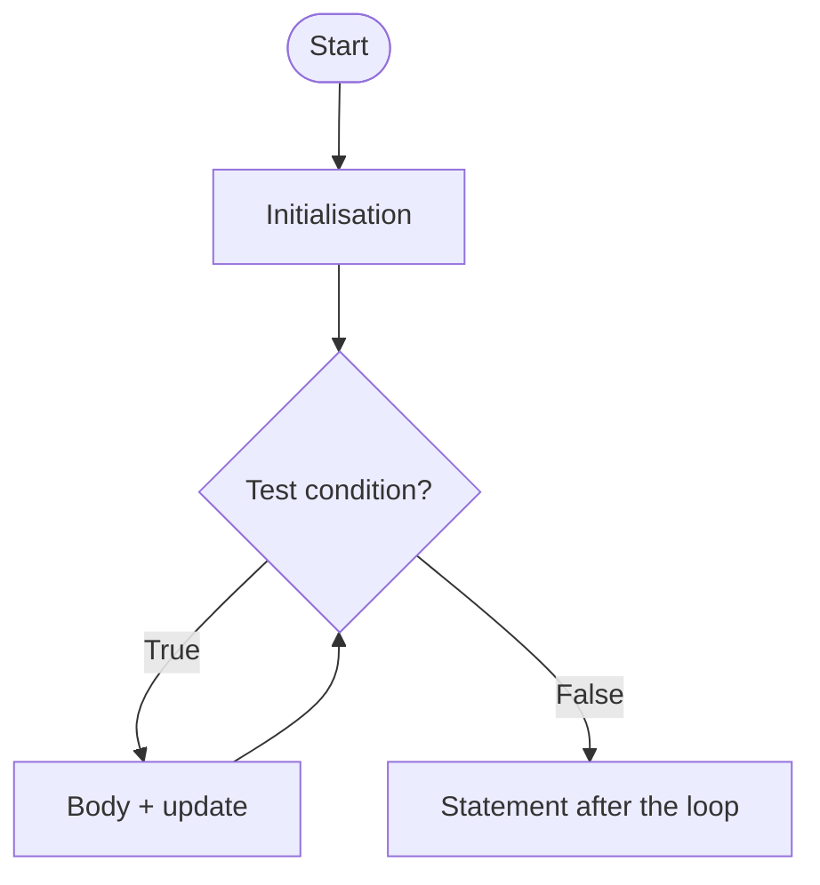
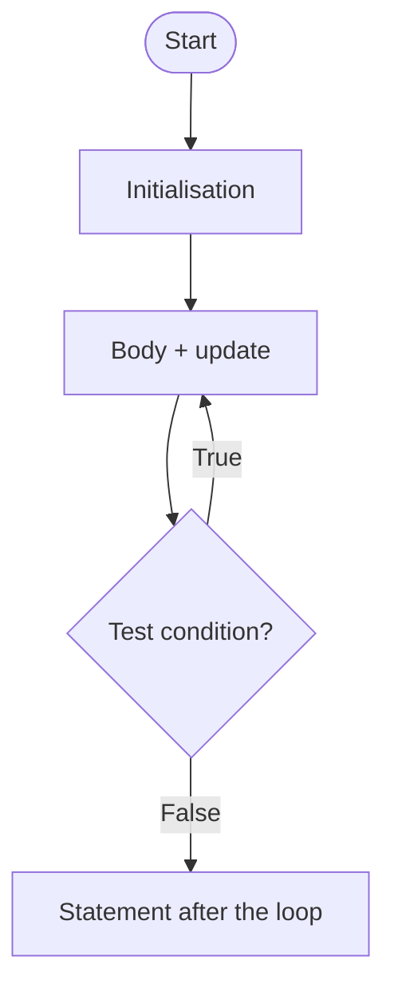
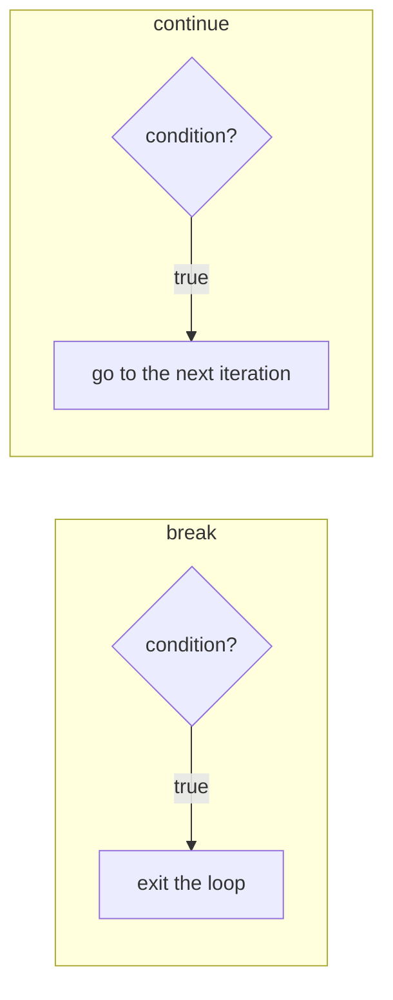

<div align="center">

# 🔁 Chapter 07 · Iterative Constructs in Java

*Need for loops · Entry and exit controlled loops · `for` · `while` · `do-while` · Variations · `break` and `continue` · Inter-conversion · Number programs*

[⬅ Back to Index](../README.md)

</div>

---

## 📑 Contents

1. [What is a loop?](#1-what-is-a-loop)
2. [Parts of a loop](#2-parts-of-a-loop)
3. [The `for` loop](#3-the-for-loop)
4. [The `while` loop](#4-the-while-loop)
5. [The `do-while` loop](#5-the-do-while-loop)
6. [Entry-controlled vs exit-controlled loops](#6-entry-controlled-vs-exit-controlled-loops)
7. [Variations in looping statements](#7-variations-in-looping-statements)
8. [Jump statements: `break` and `continue`](#8-jump-statements-break-and-continue)
9. [Inter-conversion of loops](#9-inter-conversion-of-loops)
10. [Counting iterations and dry runs](#10-counting-iterations-and-dry-runs)
11. [Digit extraction — the heart of number programs](#11-digit-extraction--the-heart-of-number-programs)
12. [Special numbers — definitions table](#12-special-numbers--definitions-table)
13. [Predict the output](#13-predict-the-output)
14. [Find the errors](#14-find-the-errors)
15. [Differentiate between](#15-differentiate-between)
16. [One-line facts](#16-one-line-facts)
17. [Test yourself](#-test-yourself)
18. [Programs in this chapter](#-programs-in-this-chapter)

---

## 1. What is a loop?

An **iterative construct (loop)** is a statement that **executes a set of statements repeatedly** as long as a given condition is true. Each execution of the loop body is called an **iteration**.

**Why loops are needed:** to print the numbers 1 to 1000 without a loop, 1000 `println` statements would be needed. A loop does it in three lines:

```java
for (int i = 1; i <= 1000; i++)
    System.out.println(i);
```

Java has three looping statements: **`for`**, **`while`** and **`do-while`**.

---

## 2. Parts of a loop

| Part | Purpose | In `for (int i = 1; i <= 10; i++)` |
|---|---|---|
| **Initialisation** | Gives the starting value to the **control variable** (loop counter) — executed **once** | `int i = 1` |
| **Test condition** | A boolean expression checked before/after every iteration; the loop continues while it is `true` | `i <= 10` |
| **Body of the loop** | The statement(s) executed repeatedly | the statement after the `for` |
| **Update expression** | Changes the control variable so that the condition eventually becomes `false` | `i++` |

---

## 3. The `for` loop

An **entry-controlled** loop in which initialisation, test condition and update are written **together in one line**. It is used when the **number of iterations is known** in advance.

```java
for (initialisation; test condition; update)
{
    body;
}
```



**Order of execution:** initialisation (once) → condition → body → update → condition → body → update → … → condition false → exit.

```java
int sum = 0;
for (int i = 1; i <= 5; i++)
    sum = sum + i;          // sum = 15
```

> [!NOTE]
> A variable declared inside the `for` header (`int i`) is **local to the loop** — it cannot be used after the loop ends.

---

## 4. The `while` loop

An **entry-controlled** loop that tests the condition **before** each iteration. It is generally used when the **number of iterations is not known** in advance (e.g. "repeat while the number is greater than 0").

```java
initialisation;
while (test condition)
{
    body;
    update;
}
```



```java
int n = 4072, count = 0;
while (n > 0)
{
    count++;
    n = n / 10;
}                            // count = 4
```

---

## 5. The `do-while` loop

An **exit-controlled** loop: the body is executed **first** and the condition is tested **afterwards**. Hence the body executes **at least once**, even if the condition is false at the start. Note the **semicolon** after `while (…)`.

```java
initialisation;
do
{
    body;
    update;
} while (test condition);
```



```java
int i = 10;
do
{
    System.out.println(i);   // prints 10 once, although 10 > 5
    i++;
} while (i <= 5);
```

> [!TIP]
> `do-while` is the natural choice for **menu-driven programs** — the menu must be shown at least once, then repeated until the user chooses Exit.

---

## 6. Entry-controlled vs exit-controlled loops

| Basis | Entry-controlled (`for`, `while`) | Exit-controlled (`do-while`) |
|---|---|---|
| Condition tested | **Before** executing the body | **After** executing the body |
| Minimum executions | **0** (if the condition is false at the start) | **1** |
| Semicolon after condition | Not used | Required: `while (cond);` |
| Example use | Counting loops, digit extraction | Menus, input validation |

| Basis | `for` loop | `while` loop |
|---|---|---|
| Structure | Initialisation, condition and update in one line | Written separately |
| Usually used when | The number of iterations is **known** | The number of iterations is **not known** |
| Missing condition | `for (;;)` is an infinite loop | `while ()` is a **syntax error** |

---

## 7. Variations in looping statements

| Variation | Example | Notes |
|---|---|---|
| **Multiple initialisations and updates** (comma-separated) | `for (int i = 1, j = 10; i < j; i++, j--)` | Only **one** condition allowed (combine with `&&`) |
| **Omitting parts** | `int i = 1; for ( ; i <= 5; ) { …; i++; }` | Semicolons must remain |
| **Infinite loop** | `for ( ; ; )`, `while (true)`, `do { } while (true);` | Ends only with `break`, `return` or `System.exit()` |
| **Accidental infinite loop** | `for (int i = 1; i <= 10; i--)` | Update moves away from the condition |
| **Empty loop** (null loop) | `for (i = 1; i <= 5; i++);` | Semicolon makes the body empty |
| **Delay (time-delay) loop** | `for (long k = 1; k <= 100000000L; k++);` | Used to pause the program for a while |
| **Finite loop** | `for (i = 10; i >= 1; i--)` | Terminates after a fixed number of iterations |
| **Step value other than 1** | `for (i = 2; i <= 20; i += 2)` | Even numbers |
| **Real control variable** | `for (double x = 0.0; x < 1.0; x += 0.25)` | Allowed, but beware of rounding |

> [!WARNING]
> ```java
> int i;
> for (i = 1; i <= 5; i++);     // ← stray semicolon: empty loop
>     System.out.println(i);    // runs ONCE, prints 6
> ```

---

## 8. Jump statements: `break` and `continue`

**Jump statements** transfer control unconditionally to another part of the program.

- **`break`** — **terminates the loop** (or switch) immediately; control passes to the statement **after the loop**.
- **`continue`** — **skips the rest of the current iteration** and moves to the **next iteration** (to the update in a `for` loop, to the condition in `while`/`do-while`).

```java
for (int i = 1; i <= 10; i++)
{
    if (i == 6)
        break;
    System.out.print(i + " ");      // 1 2 3 4 5
}

for (int i = 1; i <= 10; i++)
{
    if (i % 3 == 0)
        continue;
    System.out.print(i + " ");      // 1 2 4 5 7 8 10
}
```



| Basis | `break` | `continue` |
|---|---|---|
| Effect | Terminates the loop | Skips the remaining statements of the current iteration |
| Control goes to | First statement after the loop | Next iteration (update/condition) |
| Used in | Loops and `switch` | Loops only |

> [!WARNING]
> In a `while` loop, put the update **before** `continue`, otherwise the loop may become infinite:
> ```java
> int i = 0;
> while (i < 10) { if (i % 2 == 0) continue; i++; }   // infinite: i stays 0
> ```

---

## 9. Inter-conversion of loops

**Program segment:** sum of the even numbers from 2 to 20.

<table>
<tr><th><code>for</code></th><th><code>while</code></th><th><code>do-while</code></th></tr>
<tr><td>

```java
int s = 0;
for (int i = 2; i <= 20; i += 2)
{
    s = s + i;
}
```

</td><td>

```java
int s = 0, i = 2;
while (i <= 20)
{
    s = s + i;
    i += 2;
}
```

</td><td>

```java
int s = 0, i = 2;
do
{
    s = s + i;
    i += 2;
} while (i <= 20);
```

</td></tr>
</table>

> [!IMPORTANT]
> A `while` loop and its `do-while` version give **different results** when the condition is false at the start (`do-while` still runs once). When converting, check the first iteration.

**Convert into `for`:**
```java
int x = 100;
while (x > 0)
{
    System.out.print(x % 10);
    x /= 10;
}
```
```java
for (int x = 100; x > 0; x /= 10)
    System.out.print(x % 10);      // prints 001
```

---

## 10. Counting iterations and dry runs

| Loop | Iterations |
|---|---|
| `for (i = 1; i <= 10; i++)` | 10 |
| `for (i = 0; i < 10; i++)` | 10 |
| `for (i = 10; i >= 1; i -= 3)` | 4 (10, 7, 4, 1) |
| `for (i = 1; i <= 100; i *= 2)` | 7 (1, 2, 4, 8, 16, 32, 64) |
| `for (i = 5; i < 5; i++)` | 0 |
| `int i = 5; do { … } while (i < 5);` | 1 |
| `while (n > 0) n /= 10;` with n = 98765 | 5 |

**Dry run:** `int n = 1234, s = 0; while (n > 0) { s = s * 10 + n % 10; n /= 10; }`

| Iteration | `n % 10` | `s` | `n` after |
|:---:|:---:|:---:|:---:|
| 1 | 4 | 4 | 123 |
| 2 | 3 | 43 | 12 |
| 3 | 2 | 432 | 1 |
| 4 | 1 | 4321 | 0 |

---

## 11. Digit extraction — the heart of number programs

```java
while (n > 0)
{
    int d = n % 10;     // extract the LAST digit
    // ... use d ...
    n = n / 10;         // remove the last digit
}
```

| Task | Statement inside the loop | Initial value |
|---|---|---|
| Count the digits | `count++;` | `count = 0` |
| Sum of digits | `sum = sum + d;` | `sum = 0` |
| Product of digits | `prod = prod * d;` | `prod = 1` |
| Reverse | `rev = rev * 10 + d;` | `rev = 0` |
| Largest digit | `if (d > max) max = d;` | `max = 0` |
| Count a digit | `if (d == key) c++;` | `c = 0` |

> [!TIP]
> **Always work on a copy** (`int copy = n;`) when the original number is needed later for comparison (palindrome, Armstrong, etc.). Use **`long`** when squares or large reverses are involved, to avoid overflow.

**Other useful techniques**
- **First digit:** divide by 10 until `n < 10`. **Number of digits:** `count` loop above.
- **Factors:** `for (i = 1; i <= n; i++) if (n % i == 0) …`
- **Prime test:** count factors = 2, or check divisors from 2 to $\sqrt{n}$ with a flag and `break`.
- **Binary digits:** `n % 2` and `n / 2` repeatedly.

---

## 12. Special numbers — definitions table

| Number | Definition | Example |
|---|---|---|
| **Prime** | Exactly two factors: 1 and itself | 2, 13, 97 |
| **Composite** | More than two factors | 4, 15 |
| **Perfect** | Sum of factors (excluding itself) = number | 6, 28, 496 |
| **Palindrome** | Same when reversed | 121, 4554 |
| **Armstrong** | Sum of digits each raised to the number of digits = number | 153, 1634 |
| **Spy** | Sum of digits = product of digits | 1124, 22 |
| **Niven / Harshad** | Divisible by the sum of its digits | 126, 18 |
| **Neon** | Sum of digits of its square = number | 9 (81) |
| **Automorphic** | Square ends with the number | 25 (625), 76 (5776) |
| **Special / Krishnamurthy** | Sum of factorials of digits = number | 145, 40585 |
| **Special two-digit** | (sum of digits) + (product of digits) = number | 59 |
| **Duck** | Contains a zero, but not as the first digit | 3210, 7056 |
| **Pronic** | Product of two consecutive integers | 12 (3 × 4), 42 |
| **Disarium** | Sum of digits raised to their positions = number | 135, 175 |
| **Kaprekar** | Square split into two parts that add up to the number | 45 (20 + 25), 297 |
| **Tech** | Even digits; (sum of the two halves)² = number | 2025, 3025 |
| **Magic** | Repeated digit sum ends in 1 | 19, 199 |
| **Happy** | Repeated sum of squares of digits ends in 1 | 7, 19 |
| **Buzz** | Divisible by 7 or ends with 7 | 63, 107 |
| **Emirp** | Number and its reverse are both prime | 13, 107 |
| **Sunny** | n + 1 is a perfect square | 8, 24 |
| **Evil** | Binary form has an even number of 1s | 9 (1001) |
| **Unique** | No digit repeats | 3412 |
| **Abundant / Deficient** | Sum of proper factors > / < number | 12 / 8 |
| **Twin primes** | Two primes differing by 2 | (11, 13) |
| **Smith** *(extra)* | Composite; digit sum = digit sum of prime factors | 666, 22 |

---

## 13. Predict the output

**Example 1**
```java
int i, s = 0;
for (i = 1; i <= 10; i += 3)
    s += i;
System.out.println(i + " " + s);
```

<details>
<summary><b>Show dry run</b></summary>

| i | s |
|:---:|:---:|
| 1 | 1 |
| 4 | 5 |
| 7 | 12 |
| 10 | 22 |
| 13 | loop ends |

**Output:** `13 22`
</details>

**Example 2**
```java
int n = 10;
do
{
    n -= 3;
    System.out.print(n + " ");
} while (n > 0);
```

<details>
<summary><b>Show answer</b></summary>

`7 4 1 -2` (the condition is tested after printing −2)
</details>

**Example 3**
```java
int x = 5, y = 0;
while (x-- > 0)
    y += x;
System.out.println(x + " " + y);
```

<details>
<summary><b>Show dry run</b></summary>

| test (`x--` value) | x after test | y |
|:---:|:---:|:---:|
| 5 > 0 ✔ | 4 | 4 |
| 4 > 0 ✔ | 3 | 7 |
| 3 > 0 ✔ | 2 | 9 |
| 2 > 0 ✔ | 1 | 10 |
| 1 > 0 ✔ | 0 | 10 |
| 0 > 0 ✘ | −1 | — |

**Output:** `-1 10`
</details>

**Example 4**
```java
for (int a = 1, b = 10; a < b; a += 2, b -= 2)
    System.out.print(a * b + " ");
```

<details>
<summary><b>Show answer</b></summary>

(1,10) → 10; (3,8) → 24; (5,6) → 30; (7,4) stop. **Output:** `10 24 30`
</details>

**Example 5**
```java
int k = 1;
while (k <= 20)
{
    k *= 3;
    if (k % 2 == 0) continue;
    System.out.print(k + " ");
}
```

<details>
<summary><b>Show answer</b></summary>

k = 3, 9, 27 (all odd). After 27 the loop ends. **Output:** `3 9 27`
</details>

---

## 14. Find the errors

```java
int i = 1, sum = 0
while (i <= 10);
{
    sum = sum + i;
}
for (int j = 1, j <= 5, j++)
    System.out.println(j);
do
    System.out.println(i++);
while (i < 15)
```

<details>
<summary><b>Show corrected code</b></summary>

```java
int i = 1, sum = 0;              // missing semicolon
while (i <= 10)                  // stray semicolon caused an infinite empty loop
{
    sum = sum + i;
    i++;                         // update was missing: infinite loop
}
for (int j = 1; j <= 5; j++)     // semicolons, not commas, separate the three parts
    System.out.println(j);
do
    System.out.println(i++);
while (i < 15);                  // do-while needs a semicolon
```
</details>

---

## 15. Differentiate between

| Pair | Difference |
|---|---|
| `for` vs `while` | Known vs unknown number of iterations; all three parts in one line vs separate |
| `while` vs `do-while` | Entry vs exit controlled; minimum 0 vs 1 execution |
| `break` vs `continue` | Ends the loop vs skips to the next iteration |
| Finite vs infinite loop | Terminates after some iterations vs never terminates on its own |
| Counter vs accumulator | Counts by a fixed step vs adds varying values |
| Empty loop vs infinite loop | Has no body but ends vs has a body/no body and never ends |

---

## 16. One-line facts

- `for` and `while` are **entry-controlled**; `do-while` is **exit-controlled**.
- The body of a `do-while` loop executes **at least once**.
- A `do-while` statement ends with a **semicolon**.
- `for( ; ; )` is an **infinite** loop.
- `break` takes control **out of the loop**; `continue` takes it to the **next iteration**.
- In a `for` loop, `continue` jumps to the **update** expression.
- The control variable of a `for` loop declared in its header is **local** to the loop.
- `n % 10` gives the **last digit**; `n / 10` **removes** it.

---

## 🧠 Test Yourself

### Part A — Multiple choice

1. How many times does `Hello` print? `for (int i = 10; i > 0; i -= 4) System.out.println("Hello");`
   <br>(a) 2 (b) 3 (c) 4 (d) 10
2. ```java
   int s = 0;
   for (int i = 1; i <= 5; i++)
   {
       if (i == 3) continue;
       if (i == 5) break;
       s += i;
   }
   ```
   `s` = (a) 15 (b) 7 (c) 10 (d) 12
3. *Assertion (A):* `int x = 9; do { x++; } while (x < 5);` leaves `x` as 10.
   *Reason (R):* A `do-while` loop executes its body at least once.
   (a) Both true; R explains A (b) Both true; R doesn't explain A (c) A true, R false (d) A false, R true
4. What is the output? `int n = 0; while (n < 5) n += 2; System.out.print(n);`
   (a) 4 (b) 5 (c) 6 (d) 8
5. Which loop is **infinite**?
   (a) `for (int i = 0; i < 5; i += 2);` (b) `for (int i = 1; i != 10; i += 2)` (c) `int i = 5; while (i > 0) i--;` (d) `int i = 1; do i *= 2; while (i < 100);`
6. What does this print? `int a = 3; for (a += 2; a < 10; a += 3) System.out.print(a);`
   (a) 58 (b) 3 6 9 (c) 5 8 (d) 47
7. `int c = 0; for (int i = 1; i <= 4; i++) for (int j = i; j <= 4; j++) c++;` — `c` = (a) 16 (b) 10 (c) 4 (d) 6
8. The digit loop `while (n != 0) { d = n % 10; n = n / 10; }` is run with `n = -425`. Which is correct?
   (a) Infinite loop (b) The digits obtained are −5, −2, −4 (c) Runtime error (d) No digit is extracted
9. *Assertion (A):* In `for (int i = 1; i <= 5; i++) { … } System.out.println(i);` the last statement prints 6.
   *Reason (R):* After the loop ends, `i` holds the value that made the condition false.
   (a) Both true; R explains A (b) Both true; R doesn't explain A (c) A false, R true (d) Both false
10. Which pair of numbers are both Armstrong numbers? (a) 153, 370 (b) 145, 153 (c) 135, 371 (d) 407, 409

### Part B — Short answer questions

1. Name the three loops of Java and classify them as entry or exit controlled.
2. Convert into a `do-while` loop: `for (int i = 5; i <= 25; i += 5) System.out.print(i + " ");`
3. Give the output and the number of iterations: `int x = 1; while (x < 50) x = x * 3 + 1; System.out.println(x);`
4. What is an infinite loop? Write one using each of the three loops.
5. What is the difference between `break` and `continue`?
6. Write a statement to extract the first digit of a positive integer `n` using a loop.
7. Give the output: `int i = 0; do { i += 2; System.out.print(i * i + " "); } while (i <= 4);`
8. What is a delay loop? Give an example.
9. Why is `long` used for the reverse of a large number?

<details>
<summary><b>✅ Answers — Part A</b></summary>

| Q | Ans | Working |
|---|---|---|
| 1 | (b) | i = 10, 6, 2 |
| 2 | (b) | 1 + 2 + 4 = 7 (3 skipped, loop broken at 5) |
| 3 | (a) | — |
| 4 | (c) | 0 → 2 → 4 → 6 |
| 5 | (b) | `i` is always odd, so it can never be equal to 10 |
| 6 | (a) | a = 5, 8 → prints `58` |
| 7 | (b) | 4 + 3 + 2 + 1 |
| 8 | (b) | `-425 % 10` = −5, etc.; the loop ends at 0 |
| 9 | (c) | **A is false** — `i` is declared inside the `for` header, so `System.out.println(i)` is a compile-time error. R is true in general |
| 10 | (a) | 153 and 370; 145 is a Special number; 135 is Disarium |

</details>

<details>
<summary><b>✅ Answers — Part B</b></summary>

1. `for` and `while` — entry controlled; `do-while` — exit controlled.
2. ```java
   int i = 5;
   do
   {
       System.out.print(i + " ");
       i += 5;
   } while (i <= 25);
   ```
3. x: 1 → 4 → 13 → 40 → 121. Output `121`; 4 iterations.
4. A loop whose condition never becomes false. `for (;;) { }`, `while (true) { }`, `do { } while (true);`
5. `break` terminates the loop; `continue` skips the rest of the current iteration and starts the next one.
6. `while (n >= 10) n = n / 10;` — `n` is now the first digit.
7. `4 16 36` (i = 2, 4, 6; the condition is checked after printing).
8. A loop with an empty body used to create a time gap: `for (long k = 1; k <= 500000000L; k++);`
9. Because the reverse (or square) of a large `int` may exceed the range of `int`, causing overflow.

</details>

---

## 💻 Programs in this chapter

<!-- PROGRAMS -->

| No. | Program | |
|:---:|---|:---:|
| **Q78** | [Prime Number](Q_78.java) |  |
| **Q79** | [Palindrome Number](Q_79.java) |  |
| **Q80** | [Armstrong Number](Q_80.java) |  |
| **Q81** | [Perfect Number](Q_81.java) |  |
| **Q82** | [Spy Number](Q_82.java) | 📝 ICSE 2017 |
| **Q83** | [Niven (Harshad) Number](Q_83.java) |  |
| **Q84** | [Neon Number](Q_84.java) |  |
| **Q85** | [Automorphic Number](Q_85.java) |  |
| **Q86** | [Special Number (Krishnamurthy Number)](Q_86.java) |  |
| **Q87** | [Special Two-Digit Number](Q_87.java) | 📝 ICSE 2014 |
| **Q88** | [Duck Number](Q_88.java) |  |
| **Q89** | [Pronic Number](Q_89.java) |  |
| **Q90** | [Disarium Number](Q_90.java) |  |
| **Q91** | [Kaprekar Number](Q_91.java) |  |
| **Q92** | [Tech Number](Q_92.java) |  |
| **Q93** | [Magic Number](Q_93.java) |  |
| **Q94** | [Happy Number](Q_94.java) |  |
| **Q95** | [Composite Number](Q_95.java) |  |
| **Q96** | [Emirp Number](Q_96.java) |  |
| **Q97** | [Sunny Number](Q_97.java) |  |
| **Q98** | [Evil Number](Q_98.java) |  |
| **Q99** | [Unique Number](Q_99.java) |  |
| **Q100** | [Abundant, Deficient or Perfect Number](Q_100.java) |  |
| **Q101** | [Fibonacci Series](Q_101.java) |  |
| **Q102** | [HCF and LCM of Two Numbers](Q_102.java) |  |
| **Q103** | [Factorial of a Number](Q_103.java) |  |
| **Q104** | [Sum and Product of Digits](Q_104.java) |  |
| **Q105** | [Reverse a Number and Count its Digits](Q_105.java) |  |
| **Q106** | [Largest and Smallest Digit of a Number](Q_106.java) |  |
| **Q107** | [Frequency of a Given Digit in a Number](Q_107.java) |  |
| **Q108** | [Count of Even and Odd Digits](Q_108.java) |  |
| **Q109** | [Factors of a Number and their Count](Q_109.java) |  |
| **Q110** | [Prime Factors of a Number](Q_110.java) |  |
| **Q111** | [Largest and Smallest of n Numbers](Q_111.java) |  |
| **Q112** | [Sum of Numbers until 0 is Entered](Q_112.java) |  |
| **Q113** | [Numbers from 1 to 50 not Divisible by 3 or 5 (continue)](Q_113.java) |  |
| **Q114** | [Sum of First n Natural Numbers and their Squares](Q_114.java) |  |
| **Q115** | [Sum of the Series 1 + 1/2 + 1/3 + ... + 1/n](Q_115.java) |  |
| **Q116** | [Sum of the Series x/1 + x^2/2 + x^3/3 + ... + x^n/n](Q_116.java) |  |
| **Q117** | [Sum of the Series 1 - 2 + 3 - 4 + ... n](Q_117.java) |  |
| **Q118** | [Sum of the Series a/2 + a/5 + a/8 + ... n Terms](Q_118.java) |  |
| **Q119** | [Series 1, 4, 9, 16, ... and 2, 5, 10, 17, 26, ...](Q_119.java) |  |
| **Q120** | [Series 0, 7, 26, 63, ...](Q_120.java) |  |
| **Q121** | [Series 1, 11, 111, 1111, ... and its Sum](Q_121.java) |  |
| **Q122** | [Series 1, -3, 5, -7, 9, ... and its Sum](Q_122.java) |  |
| **Q123** | [Looping Menu: Sum of Digits, Reverse, Count of Digits](Q_123.java) |  |
| **Q124** | [Decimal to Binary Conversion](Q_124.java) | 🌟 *Extra* |
| **Q125** | [Decimal to Octal Conversion](Q_125.java) | 🌟 *Extra* |
| **Q126** | [Decimal to Hexadecimal Conversion](Q_126.java) | 🌟 *Extra* |
| **Q127** | [Binary to Decimal Conversion](Q_127.java) | 🌟 *Extra* |
| **Q128** | [Collatz (Hailstone) Sequence](Q_128.java) | 🌟 *Extra* |
| **Q129** | [Number Guessing Game](Q_129.java) | 🌟 *Extra* |
| **Q130** | [Reverse-and-Add until a Palindrome](Q_130.java) | 🌟 *Extra* |
| **Q131** | [Smith Number](Q_131.java) | 🌟 *Extra* |

<!-- /PROGRAMS -->
