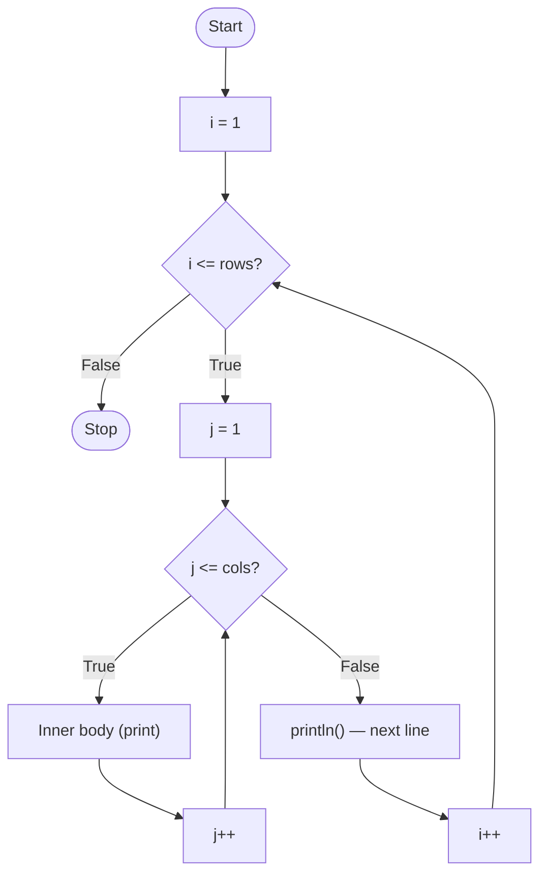

<div align="center">

# 🔲 Chapter 08 · Nested for Loops

*Nested loops · Working and number of iterations · break and continue in nested loops · Rectangular and right-angled triangle patterns · Series using nested loops*

[⬅ Back to Index](../README.md)

</div>

---

## 📑 Contents

1. [What is a nested loop?](#1-what-is-a-nested-loop)
2. [How a nested `for` loop works](#2-how-a-nested-for-loop-works)
3. [Counting iterations](#3-counting-iterations)
4. [`break` and `continue` in nested loops](#4-break-and-continue-in-nested-loops)
5. [Building patterns — the method](#5-building-patterns--the-method)
6. [Pattern relationships at a glance](#6-pattern-relationships-at-a-glance)
7. [Series using nested loops](#7-series-using-nested-loops)
8. [Predict the output](#8-predict-the-output)
9. [Find the errors](#9-find-the-errors)
10. [One-line facts](#10-one-line-facts)
11. [Test yourself](#-test-yourself)
12. [Programs in this chapter](#-programs-in-this-chapter)

---

## 1. What is a nested loop?

A **nested loop** is a loop placed **inside the body of another loop**. The enclosing loop is the **outer loop** and the enclosed one is the **inner loop**.

```java
for (int i = 1; i <= 3; i++)          // outer loop
{
    for (int j = 1; j <= 4; j++)      // inner loop
    {
        System.out.print("* ");
    }
    System.out.println();
}
```

> [!NOTE]
> The ICSE syllabus covers **nested `for` loops** only. Nested `while` and nested `do-while` loops are **not included**.

---

## 2. How a nested `for` loop works

For **every single iteration** of the outer loop, the inner loop runs **completely** — from its initialisation until its condition becomes false. Then the outer loop's update is performed and the process repeats.



**Analogy:** a clock — the minute hand (inner loop) completes a full round of 60 for every single step of the hour hand (outer loop).

**Trace of the example above**

| i | j values | Printed |
|:---:|---|---|
| 1 | 1, 2, 3, 4 | `* * * *` |
| 2 | 1, 2, 3, 4 | `* * * *` |
| 3 | 1, 2, 3, 4 | `* * * *` |

---

## 3. Counting iterations

| Outer | Inner | Total executions of the inner body |
|---|---|---|
| `for (i = 1; i <= 3; i++)` | `for (j = 1; j <= 4; j++)` | 3 × 4 = **12** |
| `for (i = 1; i <= 5; i++)` | `for (j = 1; j <= i; j++)` | 1 + 2 + 3 + 4 + 5 = **15** |
| `for (i = 5; i >= 1; i--)` | `for (j = 1; j <= i; j++)` | 5 + 4 + 3 + 2 + 1 = **15** |
| `for (i = 1; i <= 4; i++)` | `for (j = i; j <= 4; j++)` | 4 + 3 + 2 + 1 = **10** |
| `for (i = 1; i <= n; i++)` | `for (j = 1; j <= n; j++)` | $n^2$ |
| `for (i = 1; i <= n; i++)` | `for (j = 1; j <= i; j++)` | $\frac{n(n+1)}{2}$ |

---

## 4. `break` and `continue` in nested loops

A `break` or `continue` affects **only the loop in which it is written (the innermost enclosing loop)**.

- `break` inside the inner loop ends **only the inner loop**; the outer loop continues with its next iteration.
- `continue` inside the inner loop skips to the **next iteration of the inner loop**.

```java
for (int i = 1; i <= 3; i++)
{
    for (int j = 1; j <= 3; j++)
    {
        if (j == 2)
            break;               // ends only the inner loop
        System.out.print(i + "" + j + " ");
    }
}
// Output: 11 21 31
```

```java
for (int i = 1; i <= 3; i++)
{
    for (int j = 1; j <= 3; j++)
    {
        if (j == 2)
            continue;            // skips j = 2 only
        System.out.print(i + "" + j + " ");
    }
}
// Output: 11 13 21 23 31 33
```

> [!TIP]
> To stop **both** loops at once, use a boolean **flag**: set it in the inner loop, `break`, and test it in the outer loop to `break` again.

---

## 5. Building patterns — the method

1. **Outer loop = rows.** Count the rows; decide whether the row number increases or decreases.
2. **Inner loop = columns.** Find how many items are printed in row `i` — e.g. `i` items, `5 − i + 1` items, or a fixed number (rectangle).
3. **What is printed?** Write the item in terms of `i` (row), `j` (column) or a separate counter (`k`). Make a small table of `i`, `j` and the printed value.
4. **After the inner loop**, call `System.out.println()` to move to the next row.

**Worked example:**
```
1
2 4
3 6 9
4 8 12 16
```

| Row i | Items in row | Item in column j |
|:---:|:---:|:---:|
| 1 | 1 | 1 × 1 |
| 2 | 2 | 2 × j |
| 3 | 3 | 3 × j |
| i | i | **i × j** |

```java
for (int i = 1; i <= 4; i++)
{
    for (int j = 1; j <= i; j++)
        System.out.print(i * j + " ");
    System.out.println();
}
```

---

## 6. Pattern relationships at a glance

| Pattern (first rows) | Outer loop | Inner loop | Print |
|---|---|---|---|
| `1` / `1 2` / `1 2 3` | `i = 1 → 5` | `j = 1 → i` | `j` |
| `1` / `2 2` / `3 3 3` | `i = 1 → 5` | `j = 1 → i` | `i` |
| `1 2 3 4 5` / `1 2 3 4` | `i = 5 → 1` | `j = 1 → i` | `j` |
| `5` / `5 4` / `5 4 3` | `i = 5 → 1` | `j = 5 → i` (decreasing) | `j` |
| `1` / `2 1` / `3 2 1` | `i = 1 → 5` | `j = i → 1` (decreasing) | `j` |
| Floyd: `1` / `2 3` / `4 5 6` | `i = 1 → 5` | `j = 1 → i` | counter `k++` |
| `1` / `0 1` / `1 0 1` | `i = 1 → 5` | `j = 1 → i` | `(i + j) % 2 == 0 ? 1 : 0` |
| `A` / `A B` / `A B C` | `i = 1 → 5` | `j = 1 → i` | `(char) ('A' + j - 1)` |
| `A` / `B B` / `C C C` | `i = 1 → 5` | `j = 1 → i` | `(char) ('A' + i - 1)` |
| Rectangle `1 2 3 4 5` ×4 | `i = 1 → 4` | `j = 1 → 5` | `j` |
| Hollow rectangle | `i = 1 → r` | `j = 1 → c` | `*` on the border (`i == 1 \|\| i == r \|\| j == 1 \|\| j == c`), else space |

> [!WARNING]
> `System.out.print('A' + j)` prints a **number** (e.g. 66), because `char + int` is `int`. Cast it: `System.out.print((char) ('A' + j))`. Similarly `System.out.print('*' + ' ')` prints `74`, not `* ` — use the String `"* "`.

---

## 7. Series using nested loops

When each **term** of a series itself needs a loop (a factorial or a running sum), the **outer loop** moves from term to term and the **inner loop** computes the term.

$S = 1! + 2! + 3! + \dots + n!$
```java
long s = 0;
for (int i = 1; i <= n; i++)
{
    long f = 1;                     // reset for every term!
    for (int j = 1; j <= i; j++)
        f = f * j;
    s = s + f;
}
```

$S = \frac{x}{1!} + \frac{x^2}{2!} + \dots + \frac{x^n}{n!}$ → inner loop for the factorial, `Math.pow(x, i)` for the numerator.

> [!IMPORTANT]
> The most common mistake in nested series is **forgetting to reset** the inner accumulator (`f = 1` or `term = 0`) inside the outer loop.

---

## 8. Predict the output

**Example 1**
```java
for (int i = 1; i <= 3; i++)
{
    for (int j = 3; j >= i; j--)
        System.out.print(j);
    System.out.println();
}
```

<details>
<summary><b>Show answer</b></summary>

| i | j runs | Printed |
|:---:|---|---|
| 1 | 3, 2, 1 | `321` |
| 2 | 3, 2 | `32` |
| 3 | 3 | `3` |
</details>

**Example 2**
```java
int c = 0;
for (int i = 1; i <= 4; i++)
    for (int j = 1; j <= 4; j++)
        if ((i + j) % 3 == 0)
            c++;
System.out.println(c);
```

<details>
<summary><b>Show answer</b></summary>

Pairs with `i + j` = 3 or 6: (1,2), (2,1), (2,4), (3,3), (4,2) → **5**
</details>

**Example 3**
```java
for (int i = 1; i <= 3; i++)
{
    for (int j = 1; j <= 3; j++)
    {
        if (i == j) continue;
        if (i + j == 5) break;
        System.out.print(i * j + " ");
    }
}
```

<details>
<summary><b>Show dry run</b></summary>

| i | j | Action |
|:---:|:---:|---|
| 1 | 1 | continue |
| 1 | 2 | print 2 |
| 1 | 3 | print 3 |
| 2 | 1 | print 2 |
| 2 | 2 | continue |
| 2 | 3 | 2 + 3 = 5 → break |
| 3 | 1 | print 3 |
| 3 | 2 | 3 + 2 = 5 → break |

**Output:** `2 3 2 3`
</details>

**Example 4**
```java
for (char ch = 'a'; ch <= 'c'; ch++)
{
    for (int k = 1; k <= 2; k++)
        System.out.print(ch);
    System.out.print(" ");
}
```

<details>
<summary><b>Show answer</b></summary>

`aa bb cc`
</details>

---

## 9. Find the errors

The program should print
```
* * *
* * *
```

```java
for (int i = 1; i <= 2; i++);
{
    for (int j = 1, j <= 3, j++)
        System.out.print('*' + ' ');
    System.out.println;
}
```

<details>
<summary><b>Show corrected code</b></summary>

```java
for (int i = 1; i <= 2; i++)            // stray semicolon removed (and i was out of scope in the block)
{
    for (int j = 1; j <= 3; j++)        // semicolons, not commas
        System.out.print("* ");         // '*' + ' ' adds the codes (42 + 32 = 74)
    System.out.println();               // method call needs ()
}
```
</details>

---

## 10. One-line facts

- In a nested loop, the inner loop completes **all** its iterations for **each** iteration of the outer loop.
- Total inner iterations of an `m × n` rectangle pattern = **m × n**.
- `break` in an inner loop terminates **only the inner loop**.
- The outer loop usually decides the **rows**; the inner loop decides the **columns**.
- `System.out.println()` after the inner loop moves the cursor to the **next row**.
- Reset inner accumulators **inside** the outer loop for series.

---

## 🧠 Test Yourself

### Part A — Multiple choice

1. How many times is `x++` executed? `for (i = 0; i < 5; i++) for (j = i; j < 5; j++) x++;`
   <br>(a) 25 (b) 15 (c) 10 (d) 5
2. Which code prints
   ```
   1
   1 2
   1 2 3
   ```
   (a) `for (i=1;i<=3;i++){for(j=1;j<=3;j++) print(j+" ");println();}` (b) `for (i=1;i<=3;i++){for(j=1;j<=i;j++) print(j+" ");println();}` (c) `for (i=1;i<=3;i++){for(j=1;j<=i;j++) print(i+" ");println();}` (d) `for (i=3;i>=1;i--){for(j=1;j<=i;j++) print(j+" ");println();}`
3. *Assertion (A):* A `break` in the inner loop of a nested loop terminates both loops.
   <br>*Reason (R):* `break` transfers control out of the innermost loop that contains it.
   <br>(a) Both true; R explains A (b) Both true; R doesn't explain A (c) A false, R true (d) Both false
4. What is printed? `for (int i = 1; i <= 2; i++) for (int j = 1; j <= 2; j++) System.out.print(i + j);`
   <br>(a) 2334 (b) 1212 (c) 1122 (d) 2343
5. `System.out.print((char) (65 + 2) + "" + (char) 97);` prints (a) 67a (b) Ca (c) C97 (d) 6797
6. A hollow 5 × 5 square of `*` is printed. How many stars appear? (a) 25 (b) 20 (c) 16 (d) 9
7. In the code for $S = 1! + 2! + \dots + n!$, `f = 1` was written **before** the outer loop instead of inside it. For n = 3 the output becomes
   <br>(a) 9 (b) 15 (c) 33 (d) 6
8. What is printed?
   ```java
   for (int i = 3; i >= 1; i--)
   {
       for (int j = 1; j <= i; j++)
           System.out.print((char) ('A' + i - 1));
       System.out.print(" ");
   }
   ```
   (a) `AAA BB C` (b) `CCC BB A` (c) `ABC AB A` (d) `CBA CB C`

### Part B — Short answer questions

1. What is a nested loop? Give a real-life analogy.
2. How many times will the inner body run? `for (i = 2; i <= 10; i += 2) for (j = 1; j < i; j++)`
3. Write the code for the pattern:
   ```
   5 4 3 2 1
   5 4 3 2
   5 4 3
   5 4
   5
   ```
4. Write the output: `for (int i = 1; i <= 3; i++) { for (int j = 1; j <= i; j++) System.out.print(j * j + " "); System.out.println(); }`
5. Explain how `continue` behaves inside the inner loop of a nested loop.
6. Why must the factorial variable be reset inside the outer loop in a series program?

<details>
<summary><b>✅ Answers — Part A</b></summary>

| Q | Ans | Working |
|---|---|---|
| 1 | (b) | 5 + 4 + 3 + 2 + 1 |
| 2 | (b) | — |
| 3 | (c) | Only the inner loop ends |
| 4 | (a) | (1,1)=2, (1,2)=3, (2,1)=3, (2,2)=4 |
| 5 | (b) | — |
| 6 | (c) | 25 − 9 inner positions |
| 7 | (b) | f = 1·1 = 1, then 1·1·2 = 2, then 2·1·2·3 = 12 → 1 + 2 + 12 = 15 |
| 8 | (b) | — |

</details>

<details>
<summary><b>✅ Answers — Part B</b></summary>

1. A loop inside another loop. Analogy: a clock — the minute hand completes a full round for each step of the hour hand.
2. 1 + 3 + 5 + 7 + 9 = **25** (for i = 2, 4, 6, 8, 10 the inner loop runs i − 1 times).
3. ```java
   for (int i = 1; i <= 5; i++)
   {
       for (int j = 5; j >= i; j--)
           System.out.print(j + " ");
       System.out.println();
   }
   ```
4. ```
   1
   1 4
   1 4 9
   ```
5. It skips the remaining statements of the current inner iteration and moves to the next value of the inner loop variable; the outer loop is unaffected.
6. Each term needs its own factorial starting from 1; otherwise the previous factorial keeps being multiplied, giving wrong terms.

</details>

---

## 💻 Programs in this chapter

<!-- PROGRAMS -->

| No. | Program | |
|:---:|---|:---:|
| **Q132** | [Pattern: 1, 1 2, 1 2 3, ...](Q_132.java) |  |
| **Q133** | [Pattern: 1, 2 2, 3 3 3, ...](Q_133.java) |  |
| **Q134** | [Pattern: 1 2 3 4 5, 1 2 3 4, ...](Q_134.java) |  |
| **Q135** | [Pattern: 5, 5 4, 5 4 3, ...](Q_135.java) |  |
| **Q136** | [Pattern: 5 4 3 2 1, 4 3 2 1, ...](Q_136.java) |  |
| **Q137** | [Pattern: 1, 2 1, 3 2 1, ...](Q_137.java) |  |
| **Q138** | [Pattern: 5 5 5 5 5, 4 4 4 4, ...](Q_138.java) |  |
| **Q139** | [Floyd's Triangle](Q_139.java) |  |
| **Q140** | [Pattern: 1, 0 1, 1 0 1, ...](Q_140.java) |  |
| **Q141** | [Pattern: 1, 2 4, 3 6 9, ...](Q_141.java) |  |
| **Q142** | [Pattern: 1, 1 3, 1 3 5, ...](Q_142.java) |  |
| **Q143** | [Pattern: Right-Angled Triangle of Stars](Q_143.java) |  |
| **Q144** | [Pattern: Inverted Triangle of Stars](Q_144.java) |  |
| **Q145** | [Pattern: Alternating # and * Triangle](Q_145.java) |  |
| **Q146** | [Pattern: A, A B, A B C, ...](Q_146.java) |  |
| **Q147** | [Pattern: A, B B, C C C, ...](Q_147.java) |  |
| **Q148** | [Pattern: A B C D E, A B C D, ...](Q_148.java) |  |
| **Q149** | [Pattern: E, D E, C D E, ...](Q_149.java) |  |
| **Q150** | [Floyd's Triangle of Letters](Q_150.java) |  |
| **Q151** | [Pattern: Rows of Numbers and Letters Alternately](Q_151.java) |  |
| **Q152** | [Rectangular Pattern: 1 2 3 4 5 in Every Row](Q_152.java) |  |
| **Q153** | [Rectangular Pattern: Row Number Repeated](Q_153.java) |  |
| **Q154** | [Rectangular Pattern: 1 2 3 4 5, 2 3 4 5 6, ...](Q_154.java) |  |
| **Q155** | [Hollow Rectangle of Stars](Q_155.java) |  |
| **Q156** | [Rectangle with Alternate Rows of * and #](Q_156.java) |  |
| **Q157** | [Pyramid of Stars](Q_157.java) | 🌟 *Extra* |
| **Q158** | [Diamond of Stars](Q_158.java) | 🌟 *Extra* |
| **Q159** | [Number Pyramid: 1, 1 2 1, 1 2 3 2 1, ...](Q_159.java) | 🌟 *Extra* |
| **Q160** | [Pascal's Triangle](Q_160.java) | 🌟 *Extra* |
| **Q161** | [Hourglass of Stars](Q_161.java) | 🌟 *Extra* |
| **Q162** | [First n Multiples of Each Number from 1 to a Limit](Q_162.java) |  |
| **Q163** | [Multiplication Tables from 1 to 10 in a Grid](Q_163.java) |  |
| **Q164** | [Prime Numbers between Two Limits](Q_164.java) |  |
| **Q165** | [Perfect Numbers from 1 to n](Q_165.java) |  |
| **Q166** | [Armstrong Numbers in a Range](Q_166.java) |  |
| **Q167** | [Palindrome Numbers in a Range](Q_167.java) |  |
| **Q168** | [Twin Primes up to n](Q_168.java) |  |
| **Q169** | [Sum of the Series 1! + 2! + 3! + ... + n!](Q_169.java) |  |
| **Q170** | [Sum of the Series 1 + (1+2) + (1+2+3) + ...](Q_170.java) |  |
| **Q171** | [Sum of the Series x/1! + x^2/2! + ... + x^n/n!](Q_171.java) |  |
| **Q172** | [Sum of the Series 1 - x^2/2! + x^4/4! - ...](Q_172.java) |  |
| **Q173** | [Disarium Numbers between Two Limits](Q_173.java) |  |
| **Q174** | [break and continue in Nested Loops](Q_174.java) |  |
| **Q175** | [Pythagorean Triplets up to n](Q_175.java) | 🌟 *Extra* |

<!-- /PROGRAMS -->
