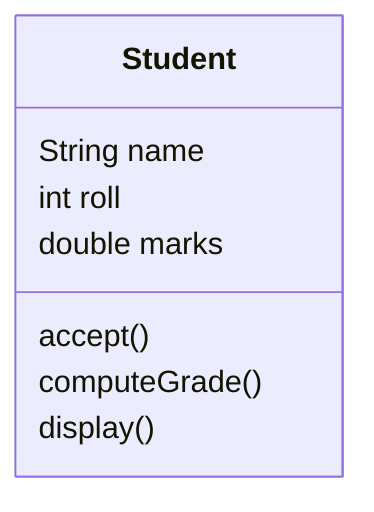
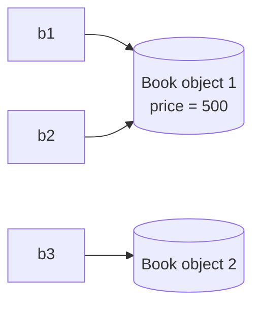

<div align="center">

# 🏛️ Chapter 09 · Class as the Basis of all Computation

*Objects encapsulate state and behaviour · Member variables and methods · Class as an abstraction and object factory · Primitive and composite data types · Objects as instances*

[⬅ Back to Index](../README.md)

</div>

---

## 📑 Contents

1. [Objects: state and behaviour](#1-objects-state-and-behaviour)
2. [Class: the basis of all computation](#2-class-the-basis-of-all-computation)
3. [Members of a class](#3-members-of-a-class)
4. [Creating objects — instances of a class](#4-creating-objects--instances-of-a-class)
5. [Primitive vs composite data types](#5-primitive-vs-composite-data-types)
6. [Reference variables: `=`, `==` and `null`](#6-reference-variables---and-null)
7. [Writing a class — a complete example](#7-writing-a-class--a-complete-example)
8. [Predict the output](#8-predict-the-output)
9. [Find the errors](#9-find-the-errors)
10. [Differentiate between](#10-differentiate-between)
11. [One-line facts](#11-one-line-facts)
12. [Test yourself](#-test-yourself)
13. [Programs in this chapter](#-programs-in-this-chapter)

---

## 1. Objects: state and behaviour

An **object** is an entity that has a **state** and a **behaviour**.

- The **state** of an object is given by the **values of its attributes (characteristics / features)**. In Java, attributes are represented by **member variables** (data members / instance variables). *Variables define state.*
- The **behaviour** of an object is what it can **do**. In Java, behaviour is represented by **member methods** (functions / operations / messages). *Methods define behaviour.*

| Object | Attributes → member variables | Behaviour → member methods |
|---|---|---|
| Fan | speed, colour, isOn | switchOn(), switchOff(), changeSpeed() |
| Student | name, roll, marks | readBook(), writeExam(), computeGrade() |
| Mobile phone | brand, model, battery | call(), charge(), sendSMS() |
| Bank account | accNo, holder, balance | deposit(), withdraw(), showBalance() |

An object **encapsulates** (wraps together) its state and behaviour, and the methods operate on the object's own data.

---

## 2. Class: the basis of all computation

A **class** is a **template / blueprint** that describes the **common attributes and behaviour** of a group of similar objects. In Java **every** computation happens inside methods of classes — even `main()` lives in a class — hence the class is called the **basis of all computation**.

| View of a class | Meaning |
|---|---|
| **Class as an abstraction** | A class captures only the **essential** features of a set of objects (e.g. every Car has a brand and speed) and leaves out details of any particular object |
| **Class as an object factory** | Any number of objects with similar features can be **produced** from one class |
| **Class as a user-defined data type** | Once defined, a class name can be used to declare variables, just like `int`: `Student s1;` |



Objects `s1`, `s2`, `s3` created from this class each have their **own** `name`, `roll` and `marks`, but share the **same** methods.

---

## 3. Members of a class

```java
class Student                       // class header
{
    String name;                    // ─┐
    int roll;                       //  ├─ data members (instance variables) → STATE
    double marks;                   // ─┘

    void accept() { … }             // ─┐
    char grade() { … }              //  ├─ member methods → BEHAVIOUR
    void display() { … }            // ─┘
}
```

| Term | Meaning |
|---|---|
| **Data members / instance variables / attributes** | Variables declared inside the class but outside every method; each object gets its own copy |
| **Member methods / functions** | Methods defined inside the class that describe its behaviour |
| **Members** | Data members + member methods |

> [!NOTE]
> Instance variables get **default values** automatically (`0`, `0.0`, `false`, `'\u0000'`, `null`) when an object is created; local variables inside methods do not.

---

## 4. Creating objects — instances of a class

An object is an **instance** of a class. Creating an object is called **instantiation**.

```java
Student s1;                 // (1) declaration of a reference variable
s1 = new Student();         // (2) instantiation using new + (3) initialisation by the constructor
Student s2 = new Student(); // all three steps in one statement
```

| Step | What happens |
|---|---|
| **Declaration** | A reference variable `s1` of type `Student` is created; it does not yet point to any object (`null` if it is a data member) |
| **Instantiation** | The **`new`** operator allocates memory for a new object (in the **heap**) and returns its address |
| **Initialisation** | The **constructor** `Student()` initialises the object; the address is stored in `s1` |

**Accessing members** — use the **dot operator**:
```java
s1.name = "Riya";       // data member
s1.display();           // member method → "sending the message display() to s1"
```

> [!IMPORTANT]
> **Computation as message passing:** calling a method of an object is called **sending a message** to it. `acc1.withdraw(500)` sends the message *withdraw 500* to the object `acc1`, which changes only **its own** balance.

---

## 5. Primitive vs composite data types

**Primitive (intrinsic) data types** are built into Java and hold a **single value**: `byte`, `short`, `int`, `long`, `float`, `double`, `char`, `boolean`.

**Composite (non-primitive / reference / user-defined) data types** are made up of **one or more primitive and/or other composite types**. A class is a composite type. Arrays and `String` are also composite types.

```java
int age = 15;                 // primitive variable — stores the value 15 itself
Student s = new Student();    // composite variable — stores a reference (address) of an object
```

| Basis | Primitive data type | Composite data type (class) |
|---|---|---|
| Defined by | Java language | The programmer / Java library |
| Contains | A single value | Several values (data members) and methods |
| Variable stores | The **value** | The **reference (address)** of an object |
| Size | Fixed (e.g. `int` = 4 bytes) | Depends on its members |
| Memory | Allocated when declared | Object allocated when created using `new` |
| Default value (as a data member) | `0`, `0.0`, `false`, `'\u0000'` | `null` |
| Example | `int`, `double`, `char` | `String`, arrays, `Student`, `Scanner` |

---

## 6. Reference variables: `=`, `==` and `null`

```java
Book b1 = new Book();
Book b2 = b1;           // b2 now refers to the SAME object as b1 — no new object is created
b2.price = 500;         // changes the object, so b1.price is also 500
Book b3 = new Book();   // a different object
```



- `b1 == b2` is `true` — both references hold the **same address**.
- `b1 == b3` is `false` even if all their data members are equal — **`==` compares references, not contents**.
- A reference that does not refer to any object has the value **`null`**. Calling a method through a `null` reference causes a **`NullPointerException`** at run time.

---

## 7. Writing a class — a complete example

```java
public class Circle
{
    double radius;                          // state

    void setRadius(double r)                // behaviour
    {
        radius = r;
    }

    double area()
    {
        return Math.PI * radius * radius;
    }

    public static void main(String[] args)
    {
        Circle c1 = new Circle();           // object 1
        Circle c2 = new Circle();           // object 2
        c1.setRadius(7);
        c2.setRadius(3.5);
        System.out.println(c1.area());      // 153.93804002589985
        System.out.println(c2.area());      // 38.48451000647496
    }
}
```

> [!TIP]
> In ICSE class-based questions, follow the specification **exactly**: same class name, same member names and types, same method signatures. Marks are given for each correctly defined member.

---

## 8. Predict the output

```java
class Counter
{
    int count;
    void up() { count++; }

    public static void main(String[] args)
    {
        Counter a = new Counter();
        Counter b = new Counter();
        Counter c = a;
        a.up(); a.up(); b.up(); c.up();
        System.out.println(a.count + " " + b.count + " " + c.count);
    }
}
```

<details>
<summary><b>Show answer</b></summary>

`a` and `c` refer to the same object, which is incremented three times (`a.up()` twice and `c.up()` once). `b` is a separate object incremented once.
**Output:** `3 1 3`
</details>

---

## 9. Find the errors

```java
class Box
{
    double side;
    double volume()
    {
        return side * side * side;
    }
    public static void main(String[] args)
    {
        Box b;
        b.side = 4;
        System.out.println(volume());
    }
}
```

<details>
<summary><b>Show corrected code</b></summary>

```java
Box b = new Box();                   // a local reference must refer to an object before use
b.side = 4;
System.out.println(b.volume());      // a non-static method must be called through an object
```
</details>

---

## 10. Differentiate between

| Pair | Difference |
|---|---|
| Class vs object | Blueprint (logical) vs instance (physical, occupies memory) |
| Data member vs member method | Represents state vs represents behaviour |
| Primitive vs composite type | Single built-in value vs user-defined type made of other types |
| Reference vs object | Variable holding an address vs the actual memory block created by `new` |
| `b1 == b2` vs equal data | Same object vs different objects with the same values |

---

## 11. One-line facts

- An object's **state** is given by its **data members**; its **behaviour** by its **member methods**.
- A class is called an **object factory** because many objects can be created from it.
- A class is a **user-defined / composite** data type.
- An object is an **instance** of a class; creating it is **instantiation**.
- The `new` operator allocates memory for an object and returns its **reference**.
- Assigning one reference to another (`b2 = b1`) does **not** create a new object.
- The default value of a reference data member is **`null`**.

---

## 🧠 Test Yourself

### Part A — Multiple choice

1. `Student s1 = new Student(), s2 = new Student(); s2 = s1;` How many `Student` objects exist and how many can still be reached?
   <br>(a) 2 created, 2 reachable (b) 2 created, 1 reachable (c) 1 created (d) 3 created
2. Which statement about a class is **false**?
   <br>(a) It is a user-defined data type (b) It occupies memory for its data members as soon as it is defined (c) It is a blueprint for objects (d) It can be used to declare variables
3. *Assertion (A):* Two objects of the same class can have different states.
   <br>*Reason (R):* Each object gets its own copy of the instance variables.
   <br>(a) Both true; R explains A (b) Both true; R doesn't explain A (c) A true, R false (d) A false, R true
4. `Point p = new Point(); Point q = new Point(); p.x = 5; q.x = 5; System.out.println(p == q);` prints
   <br>(a) true (b) false (c) 5 (d) Error
5. What happens? `Point p = null; p.x = 3;`
   <br>(a) Compile-time error (b) `NullPointerException` at run time (c) p.x becomes 3 (d) A new object is created
6. Which is a composite data type? (a) `char` (b) `boolean` (c) `int[]` (d) `long`
7. The behaviour of an object is defined by its (a) data members (b) constructor only (c) member methods (d) class name

### Part B — Short answer questions

1. Why is a class called the basis of all computation?
2. "A class is an abstraction for a set of objects." Explain.
3. Give two differences between primitive and composite data types.
4. Write a statement to create an object `m1` of class `Mobile`. Name the operator used and state its function.
5. Identify the state and behaviour: a `Lamp` that can be switched on or off and has a wattage and colour.
6. What is meant by "objects as instances of a class"?
7. What is printed? `Lamp a = new Lamp(); Lamp b = a; b.watt = 60; a.watt = a.watt + 40; System.out.println(b.watt);`

<details>
<summary><b>✅ Answers — Part A</b></summary>

| Q | Ans | Reason |
|---|---|---|
| 1 | (b) | The object first referred to by `s2` has no reference now |
| 2 | (b) | Memory is allocated only when an object is created |
| 3 | (a) | — |
| 4 | (b) | Different objects, so different references |
| 5 | (b) | — |
| 6 | (c) | Arrays are composite types |
| 7 | (c) | — |

</details>

<details>
<summary><b>✅ Answers — Part B</b></summary>

1. Because in Java all data and all operations (methods) must be written inside classes; every computation is performed by objects of classes calling methods.
2. A class captures only the essential, common attributes and behaviour of all its objects, leaving out the specific details of individual objects.
3. A primitive type is built-in and stores a single value; a composite type is user-defined, can contain many values and methods, and its variable stores a reference.
4. `Mobile m1 = new Mobile();` — the `new` operator allocates memory for the object and returns its reference.
5. State: wattage, colour, on/off status. Behaviour: switchOn(), switchOff().
6. Each object is a concrete example (instance) created from the class template, having its own values for the attributes defined by the class.
7. `100` — `a` and `b` refer to the same object.

</details>

---

## 💻 Programs in this chapter

<!-- PROGRAMS -->

| No. | Program | |
|:---:|---|:---:|
| **Q176** | [Class Rectangle with input(), area() and display()](Rectangle.java) |  |
| **Q177** | [Class Student: Average and Grade](Student.java) |  |
| **Q178** | [Class BankAccount: Two Objects with Deposit and Withdraw](BankAccount.java) |  |
| **Q179** | [Class Point: Distance from the Origin](Point.java) |  |
| **Q180** | [Class Temperature with Conversion Methods](Temperature.java) |  |
| **Q181** | [Class Book as a Composite Data Type: References and Objects](Book.java) |  |

<!-- /PROGRAMS -->
