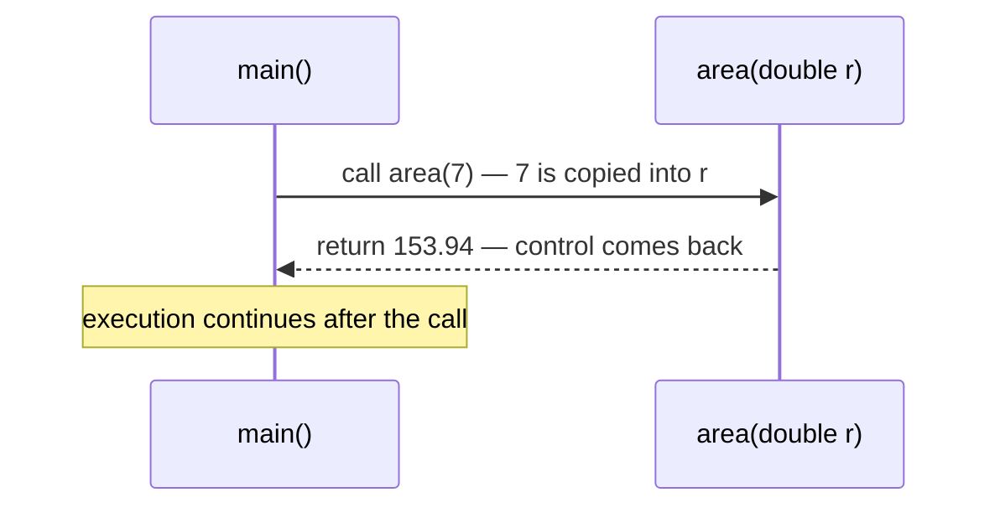

<div align="center">

# 🧩 Chapter 10 · User-Defined Methods

*Need and syntax of methods · Prototype and signature · Calling methods · Actual and formal parameters · Call by value and reference · Pure and impure methods · Static and non-static methods · Method overloading*

[⬅ Back to Index](../README.md)

</div>

---

## 📑 Contents

1. [What is a method and why do we need it?](#1-what-is-a-method-and-why-do-we-need-it)
2. [Syntax of a method](#2-syntax-of-a-method)
3. [Method prototype and method signature](#3-method-prototype-and-method-signature)
4. [The `return` statement](#4-the-return-statement)
5. [Forms of methods](#5-forms-of-methods)
6. [Calling (invoking) a method](#6-calling-invoking-a-method)
7. [Actual and formal parameters](#7-actual-and-formal-parameters)
8. [Call by value and call by reference](#8-call-by-value-and-call-by-reference)
9. [Pure and impure methods](#9-pure-and-impure-methods)
10. [Static and non-static methods](#10-static-and-non-static-methods)
11. [Method overloading (polymorphism)](#11-method-overloading-polymorphism)
12. [Predict the output](#12-predict-the-output)
13. [Find the errors](#13-find-the-errors)
14. [Differentiate between](#14-differentiate-between)
15. [One-line facts](#15-one-line-facts)
16. [Test yourself](#-test-yourself)
17. [Programs in this chapter](#-programs-in-this-chapter)

---

## 1. What is a method and why do we need it?

A **method** (function) is a **named block of code** inside a class that performs a **specific task**, and can be **called (invoked)** whenever that task is needed.

**Need for methods (advantages):**
1. **Modular programming** — a large program is divided into small, manageable modules.
2. **Reusability** — a method written once can be called many times; code is not repeated.
3. **Easier debugging and maintenance** — errors are confined to one small module.
4. **Abstraction** — the caller only needs to know *what* the method does, not *how*.
5. **Reduced program size.**

---

## 2. Syntax of a method

```java
access_specifier  modifier  return_type  method_name ( parameter list )   // header
{
    // body: local variables and statements
    return value;     // if return_type is not void
}
```

```java
public static int sum(int a, int b)
{
    int s = a + b;
    return s;
}
```

| Part | Meaning | In the example |
|---|---|---|
| Access specifier | Where the method can be accessed from (`public`, `private`, `protected`, default) | `public` |
| Modifier | Optional keyword such as `static`, `final` | `static` |
| Return type | Data type of the value returned; **`void`** if nothing is returned | `int` |
| Method name | An identifier (verb-like, camelCase) | `sum` |
| Parameter list | Variables (with types) that receive values; may be empty `()` | `int a, int b` |
| Body | Statements enclosed in `{ }` | — |

---

## 3. Method prototype and method signature

- **Method prototype** = the **first line (header)** of the method: access specifier, modifier, return type, name and parameter list.
  `public static int sum(int a, int b)`
- **Method signature** = the **method name + the number, types and order of its parameters**. The return type and access specifier are **not** part of the signature.
  `sum(int, int)`

> [!IMPORTANT]
> The compiler distinguishes overloaded methods **only by their signatures**. Two methods with the same name and the same parameter list but different return types **cannot** coexist.

---

## 4. The `return` statement

`return` sends control (and a value, if any) **back to the calling statement** and **terminates** the method.

- A method can return **at most one value**.
- A `void` method may use `return;` (without a value) to exit early.
- Any statement written directly after `return` in the same block is **unreachable** — a compile-time error.
- A non-void method must return a value on **every** path:

```java
int sign(int n)
{
    if (n > 0) return 1;
    else if (n < 0) return -1;
    return 0;                 // without this line → "missing return statement"
}
```

---

## 5. Forms of methods

| Form | Example prototype | Typical call |
|---|---|---|
| No arguments, no return value | `void line()` | `line();` |
| Arguments, no return value | `void table(int n)` | `table(7);` |
| No arguments, returns a value | `double readRadius()` | `double r = readRadius();` |
| Arguments and a return value | `int max(int a, int b)` | `int m = max(x, y);` |

---

## 6. Calling (invoking) a method

| Method type | Called from | Syntax |
|---|---|---|
| Non-static (instance) | `main()` or another static method | `objectName.method(args);` |
| Non-static | another non-static method of the same class | `method(args);` |
| Static | anywhere in the same class | `method(args);` or `ClassName.method(args);` |
| Static of another class | — | `ClassName.method(args);` e.g. `Math.sqrt(9)` |



---

## 7. Actual and formal parameters

- **Actual parameters (arguments):** the values/variables written in the **method call**. They can be literals, variables or expressions.
- **Formal parameters:** the variables written in the **method header** that **receive** the values of the actual parameters.

```java
double si(double p, double r, double t)   // p, r, t → formal parameters
{
    return p * r * t / 100;
}
...
double interest = si(5000, rate, 2 * time);   // 5000, rate, 2 * time → actual parameters
```

| Basis | Actual parameters | Formal parameters |
|---|---|---|
| Appear in | The calling statement | The method header |
| Can be | Literals, variables, expressions | Only variables (with types) |
| Data type written? | No | Yes |
| Memory | Belong to the caller | Created when the method is called, destroyed when it ends |

> [!NOTE]
> The actual and formal parameters must match in **number, type (or be convertible) and order**. Their **names need not** be the same.

---

## 8. Call by value and call by reference

**Call by value (pass by value):** a **copy** of the actual parameter's value is passed to the formal parameter. Changes made to the formal parameter inside the method **do not affect** the actual parameter. In Java, **all primitive types** (`int`, `double`, `char`, …) are passed by value.

```java
void change(int x) { x = 100; }
...
int a = 5;
change(a);
System.out.println(a);      // 5 — unchanged
```

**Call by reference (pass by reference):** the **reference (address)** of the actual parameter is passed, so the method works on the **same** memory location; changes made inside the method **are reflected** in the caller. In Java, **objects and arrays** behave this way, since a copy of their **reference** is passed.

```java
void doubleAll(int arr[])
{
    for (int i = 0; i < arr.length; i++)
        arr[i] = arr[i] * 2;
}
...
int a[] = {1, 2, 3};
doubleAll(a);               // a is now {2, 4, 6}
```

| Basis | Call by value | Call by reference |
|---|---|---|
| What is passed | A copy of the value | The reference (address) |
| Changes inside method | Not reflected in the caller | Reflected in the caller |
| Used for (Java) | Primitive types | Objects, arrays |
| Memory | Separate copies | Same memory shared |

> [!WARNING]
> Strictly speaking, Java passes **everything by value** — for objects, the *value* passed is a copy of the reference. That is why the object's contents can be changed, but **making the formal parameter refer to a new object** does not affect the caller. For ICSE, write the definitions above.

---

## 9. Pure and impure methods

| Basis | Pure method (accessor / getter) | Impure method (mutator / modifier) |
|---|---|---|
| Changes the state of the object (data members)? | **No** | **Yes** |
| Side effects | None — same arguments always give the same result | Has side effects |
| Usually | Returns a value | May or may not return a value |
| Example | `int getMarks() { return marks; }` | `void setMarks(int m) { marks = m; }` |

---

## 10. Static and non-static methods

| Basis | Static method (class method) | Non-static method (instance method) |
|---|---|---|
| Keyword | Declared with `static` | No `static` keyword |
| Belongs to | The **class** | Each **object** |
| Called using | Class name or directly (no object needed) | An **object** |
| Can access | Only static members directly | Both static and instance members |
| Example | `Math.sqrt()`, `main()` | `sc.nextInt()`, `s1.display()` |

> [!IMPORTANT]
> `main()` is static, so it **cannot call a non-static method directly** — it must first create an object: `Q ob = new Q(); ob.display();`. Calling `display();` directly from `main()` gives "non-static method cannot be referenced from a static context".

---

## 11. Method overloading (polymorphism)

**Method overloading** is defining **two or more methods with the same name in the same class** that differ in their **parameter lists** (number, type or order of parameters). It is an example of **polymorphism** (compile-time / static polymorphism).

```java
double area(double r)               { return Math.PI * r * r; }   // circle
double area(double l, double b)     { return l * b; }             // rectangle
double area(double a, double b, double c) { … }                   // triangle
```

**Rules**

| Valid overloading | Not valid overloading |
|---|---|
| Different **number** of parameters: `f(int)`, `f(int, int)` | Only the **return type** differs: `int f(int)` and `double f(int)` |
| Different **types**: `f(int)`, `f(double)` | Only **parameter names** differ: `f(int a)` and `f(int b)` |
| Different **order** of types: `f(int, char)`, `f(char, int)` | Only the **access specifier** differs |

**How Java chooses the method (overload resolution):**
1. An **exact match** of parameter types is chosen first.
2. If none, Java uses **automatic widening** (`byte → short → int → long → float → double`, `char → int`) and picks the closest match.
3. If two methods match equally well → **ambiguity error** at compile time.

```java
void show(int x)    { System.out.println("int"); }
void show(double x) { System.out.println("double"); }
...
show(5);      // int     (exact)
show(5.0);    // double  (exact)
show('A');    // int     (char widened to int — closer than double)
show(5L);     // double  (long widened to double; no long version)
```

**Advantages:** one meaningful name for related tasks; programs are easier to read; it implements polymorphism.

---

## 12. Predict the output

**Example 1**
```java
static int fun(int a, int b)
{
    a = a + b;
    b = a - b;
    return a * b;
}
public static void main(String[] args)
{
    int x = 3, y = 4;
    int z = fun(x, y);
    System.out.println(x + " " + y + " " + z);
}
```

<details>
<summary><b>Show answer</b></summary>

Inside: a = 7, b = 3, returns 21. `x` and `y` are unchanged (call by value). **Output:** `3 4 21`
</details>

**Example 2**
```java
static void f(int a[], int n)
{
    a[0] = a[0] + 10;
    n = n + 10;
}
public static void main(String[] args)
{
    int arr[] = {1, 2};
    int n = 1;
    f(arr, n);
    System.out.println(arr[0] + " " + n);
}
```

<details>
<summary><b>Show answer</b></summary>

The array reference is shared, so `arr[0]` becomes 11; `n` is a primitive copy. **Output:** `11 1`
</details>

**Example 3**
```java
static void p(long x)   { System.out.print("L "); }
static void p(double x) { System.out.print("D "); }
public static void main(String[] args)
{
    p(7);  p('c');  p(7.0f);
}
```

<details>
<summary><b>Show answer</b></summary>

`7` (int) → widens to `long` (closer than double) → L; `'c'` → int → long → L; `7.0f` (float) → double → D. **Output:** `L L D`
</details>

---

## 13. Find the errors

```java
class Calc
{
    int add(int a, int b) { return a + b; }
    double add(int x, int y) { return x + y; }        // (1)
    void show(int n) { return n * 2; }                // (2)
    int square(int n) { return n * n; System.out.println(n); }   // (3)
    public static void main(String args[])
    {
        System.out.println(square(5));                // (4)
    }
}
```

<details>
<summary><b>Show corrections</b></summary>

1. Same signature `add(int, int)` — differing only in return type is not overloading. Remove it or change its parameters.
2. A `void` method cannot return a value → `int show(int n)` or remove the value.
3. Unreachable statement after `return` → move the `println` before `return`.
4. A non-static method cannot be called from static `main()` directly → `Calc ob = new Calc(); System.out.println(ob.square(5));`

</details>

---

## 14. Differentiate between

| Pair | Difference |
|---|---|
| Prototype vs signature | Full header vs name + parameter types only |
| Actual vs formal parameters | In the call vs in the header |
| Call by value vs call by reference | Copy passed, original safe vs reference passed, original changes |
| Pure vs impure method | Doesn't change object state vs changes it |
| Static vs non-static method | Called with class name vs called with an object |
| `void` vs non-void method | Returns nothing vs returns one value |
| Method overloading vs a different method | Same name, different parameters vs different name |

---

## 15. One-line facts

- A method can return **only one value**.
- The keyword for "no return value" is **`void`**.
- Method signature = **name + parameter list** (not the return type).
- Primitive arguments are passed **by value**; objects and arrays **by reference**.
- An **impure** method changes the state of the object.
- A **static** method is called using the **class name**.
- Method overloading is **compile-time polymorphism**.
- Recursion (a method calling itself) is **not** in the ICSE Class 10 syllabus.

---

## 🧠 Test Yourself

### Part A — Multiple choice

1. Which pair of methods can **legally** exist together in one class?
   (a) `int f(int a)` and `int f(int b)` (b) `void f(int a, double b)` and `void f(double a, int b)` (c) `int f()` and `double f()` (d) `public void f(int a)` and `private void f(int a)`
2. Given `void m(int x)` and `void m(double x)`, the call `m('A')` invokes
   (a) `m(int)` (b) `m(double)` (c) compile-time ambiguity error (d) runtime error
3. *Assertion (A):* A method that only returns `n * n` for its parameter `n` is a pure method.
   *Reason (R):* It does not change the state of any object.
   (a) Both true; R explains A (b) Both true; R doesn't explain A (c) A true, R false (d) A false, R true
4. What is printed?
   ```java
   static int f(int n) { n = n * 2; return n + 1; }
   ...
   int k = 4; int r = f(f(k)); System.out.println(k + " " + r);
   ```
   (a) 4 19 (b) 19 19 (c) 4 9 (d) 9 19
5. The signature of `public static double power(double b, int e)` is
   (a) `public static double power` (b) `power(double, int)` (c) `double power(double, int)` (d) `power(b, e)`
6. Which statement is **true**?
   (a) Formal parameters can be literals (b) A `void` method can contain `return;` (c) A method can return two values using `return a, b;` (d) The return type is part of the signature
7. *Assertion (A):* Calling `display()` directly inside `main()` is an error if `display()` is non-static.
   *Reason (R):* Static methods cannot access instance members without an object.
   (a) Both true; R explains A (b) Both true; R doesn't explain A (c) A true, R false (d) A false, R true
8. Which overloaded method is chosen for `f(10L)` if only `f(int)` and `f(float)` exist?
   (a) `f(int)` (b) `f(float)` (c) Error (d) Runtime decision

### Part B — Short answer questions

1. State two advantages of using methods.
2. Write the prototype of a method `check` that takes a `String` and a `char` and returns `true`/`false`.
3. Differentiate between actual and formal parameters with an example.
4. What is method overloading? Why is it called polymorphism?
5. What is the output? `static void s(int a, int b) { int t = a; a = b; b = t; } … int x = 1, y = 2; s(x, y); System.out.println(x + "," + y);`
6. Give one example each of a pure and an impure method.
7. Why can't two methods differ only in their return type?
8. What is the difference between `return` and `System.exit(0)`?

<details>
<summary><b>✅ Answers — Part A</b></summary>

| Q | Ans | Reason |
|---|---|---|
| 1 | (b) | Order of parameter types differs |
| 2 | (a) | `char` widens to `int` first |
| 3 | (a) | — |
| 4 | (a) | f(4) = 9, f(9) = 19; k unchanged |
| 5 | (b) | — |
| 6 | (b) | — |
| 7 | (a) | — |
| 8 | (b) | `long` cannot narrow to `int`, but widens to `float` |

</details>

<details>
<summary><b>✅ Answers — Part B</b></summary>

1. Reusability of code; modular programs that are easier to debug and maintain.
2. `boolean check(String s, char ch)`
3. Actual parameters are in the call, formal parameters in the header. In `area(5)` → `double area(double r)`, 5 is actual and `r` is formal.
4. Defining several methods with the same name but different parameter lists in one class. The same name behaves in many forms depending on the arguments — "one name, many forms".
5. `1,2` — primitives are passed by value.
6. Pure: `int getAge() { return age; }`. Impure: `void setAge(int a) { age = a; }`.
7. The compiler chooses a method from the call using only the name and arguments; the return type is not visible in a call statement, so such methods would be indistinguishable.
8. `return` ends only the current method and returns control to the caller; `System.exit(0)` terminates the whole program.

</details>

---

## 💻 Programs in this chapter

<!-- PROGRAMS -->

| No. | Program | |
|:---:|---|:---:|
| **Q182** | [Overloading volume(): Sphere, Cylinder and Cuboid](Q_182.java) |  |
| **Q183** | [Overloading area(): Circle, Rectangle and Triangle](Q_183.java) |  |
| **Q184** | [Overloading series(): Three Different Series](Q_184.java) |  |
| **Q185** | [Overloading polygon(): Square, Rectangle and Triangle Patterns](Q_185.java) |  |
| **Q186** | [Overloading display() for Patterns](Q_186.java) |  |
| **Q187** | [Overloading sumSeries()](Q_187.java) |  |
| **Q188** | [Overloading largest()](Q_188.java) |  |
| **Q189** | [Overloading count(): Digits and Occurrences of a Digit](Q_189.java) |  |
| **Q190** | [Overloading perimeter(): Square, Rectangle and Triangle](Q_190.java) |  |
| **Q191** | [Prime Palindrome (PalPrime) Numbers in a Range](Q_191.java) |  |
| **Q192** | [Twin Primes in a Range using isPrime()](Q_192.java) |  |
| **Q193** | [Twisted Prime using isPrime() and reverse()](Q_193.java) |  |
| **Q194** | [Armstrong Numbers in a Range using isArmstrong()](Q_194.java) |  |
| **Q195** | [Perfect Number using a boolean Method](Q_195.java) |  |
| **Q196** | [HCF, LCM and Co-prime Check using Methods](Q_196.java) |  |
| **Q197** | [nCr using a factorial() Method](Q_197.java) |  |
| **Q198** | [Disarium Number using countDigits()](Q_198.java) |  |
| **Q199** | [Goldbach's Conjecture](Q_199.java) | 🌟 *Extra* |
| **Q200** | [Pure and Impure Methods](Q_200.java) |  |
| **Q201** | [Static and Non-Static Methods](Q_201.java) |  |
| **Q202** | [Call by Value: Swapping inside a Method](Q_202.java) |  |
| **Q203** | [Actual and Formal Parameters with Return Values](Q_203.java) |  |
| **Q204** | [Menu-Driven Number Checks using Methods](Q_204.java) |  |
| **Q205** | [Class Number with Data Member and Member Methods](Q_205.java) |  |
| **Q206** | [Class Series with Non-Static Methods](Q_206.java) |  |
| **Q207** | [Date Helper Methods: isLeap(), daysInMonth(), isValid()](Q_207.java) | 🌟 *Extra* |
| **Q208** | [Day Number of the Year](Q_208.java) | 🌟 *Extra* |
| **Q209** | [Day of the Week for any Date](Q_209.java) | 🌟 *Extra* |
| **Q210** | [Calendar of a Month](Q_210.java) | 🌟 *Extra* |
| **Q211** | [Age in Years, Months and Days](Q_211.java) | 🌟 *Extra* |

<!-- /PROGRAMS -->
