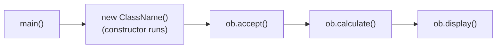

<div align="center">

# 🏗️ Chapter 11 · Constructors

*Definition and characteristics · Default and parameterised constructors · Constructor overloading · The `this` keyword · Constructor vs method*

[⬅ Back to Index](../README.md)

</div>

---

## 📑 Contents

1. [What is a constructor?](#1-what-is-a-constructor)
2. [Characteristics of a constructor](#2-characteristics-of-a-constructor)
3. [Types of constructors](#3-types-of-constructors)
4. [Constructor overloading](#4-constructor-overloading)
5. [The `this` keyword](#5-the-this-keyword)
6. [Constructor vs method](#6-constructor-vs-method)
7. [How to answer a class-based (constructor) question](#7-how-to-answer-a-class-based-question)
8. [Predict the output](#8-predict-the-output)
9. [Find the errors](#9-find-the-errors)
10. [One-line facts](#10-one-line-facts)
11. [Test yourself](#-test-yourself)
12. [Programs in this chapter](#-programs-in-this-chapter)

---

## 1. What is a constructor?

A **constructor** is a **special member method** of a class that has the **same name as the class** and **no return type**, and is **invoked automatically** when an object of the class is created. It is used to **initialise the data members** of the object.

```java
class Student
{
    String name;
    int roll;

    Student()                 // constructor
    {
        name = "";
        roll = 0;
    }
}
...
Student s = new Student();    // the constructor runs automatically here
```

**Use of constructors:** to give initial values to the data members of every object as soon as it is created, so that no object is left in an undefined state.

---

## 2. Characteristics of a constructor

1. It has the **same name as the class**.
2. It has **no return type**, not even `void`.
3. It is **called automatically** when an object is created using `new`; it cannot be called like an ordinary method (`s.Student()` is invalid).
4. It is used to **initialise** the data members.
5. It is generally declared **`public`** so that objects can be created from anywhere.
6. It can be **overloaded** (a class can have several constructors with different parameter lists).
7. If no constructor is written, the compiler supplies a **default constructor** automatically.
8. A constructor **cannot be `static`** and is not inherited.

> [!WARNING]
> If you write `void Student() { … }`, it is **no longer a constructor** — it becomes an ordinary method that happens to have the class name, and it is not called automatically.

---

## 3. Types of constructors

### 3.1 Default (non-parameterised) constructor
A constructor that takes **no parameters**. It initialises every object with the **same** values.

```java
Student()
{
    name = "Not assigned";
    roll = 0;
}
```

**Compiler-supplied default constructor:** if a class has **no constructor at all**, Java automatically provides one with no parameters and an empty body. It leaves the data members with their **default values** (`0`, `0.0`, `false`, `'\u0000'`, `null`).

> [!IMPORTANT]
> The compiler supplies the default constructor **only if the class has no constructor of its own**. Once you write *any* constructor (say a parameterised one), `new Student()` gives a compile-time error unless you also write `Student()` yourself.

### 3.2 Parameterised constructor
A constructor that **takes parameters**, so that different objects can be initialised with **different values** at the time of creation.

```java
Student(String n, int r)
{
    name = n;
    roll = r;
}
...
Student s1 = new Student("Riya", 7);
Student s2 = new Student("Aman", 12);
```

| Basis | Default (non-parameterised) constructor | Parameterised constructor |
|---|---|---|
| Parameters | None | One or more |
| Initial values | Same for every object | Can differ for each object |
| Supplied by compiler? | Yes, if no constructor is written | Never |
| Object creation | `new Student()` | `new Student("Riya", 7)` |

> [!NOTE]
> The **copy constructor** (a constructor that takes an object of the same class) is **not** in the ICSE syllabus.

---

## 4. Constructor overloading

**Constructor overloading** means defining **more than one constructor in the same class**, each with a **different parameter list** (number, type or order). The appropriate constructor is chosen automatically according to the arguments given with `new`.

```java
class Rectangle
{
    double length, breadth;

    Rectangle()                    { length = 1; breadth = 1; }
    Rectangle(double s)            { length = s; breadth = s; }
    Rectangle(double l, double b)  { length = l; breadth = b; }
}
...
Rectangle r1 = new Rectangle();         // 1 x 1
Rectangle r2 = new Rectangle(5);        // 5 x 5
Rectangle r3 = new Rectangle(8, 3);     // 8 x 3
```

**Advantage:** objects can be created and initialised in different ways, according to the information available.

---

## 5. The `this` keyword

**`this`** is a reference to the **current object** — the object whose method or constructor is being executed.

**Use 1 — resolving name conflicts (shadowing):** when a parameter (local variable) has the **same name as a data member**, the parameter hides the data member inside that method. `this.member` refers to the data member.

```java
Book(String title, double price)
{
    this.title = title;      // data member = parameter
    this.price = price;
}
```

> [!WARNING]
> Without `this`, `title = title;` simply assigns the parameter to itself — the data member stays `null`. The program compiles but gives a **logical error**.

---

## 6. Constructor vs method

| Basis | Constructor | Method |
|---|---|---|
| Name | Same as the class | Any valid identifier |
| Return type | None (not even `void`) | Must have one (`void`, `int`, …) |
| Called | Automatically, when the object is created with `new` | Explicitly, through an object or class name |
| Number of calls per object | Exactly once, at creation | Any number of times |
| Purpose | To initialise the object | To perform operations / define behaviour |
| Supplied by compiler | Yes (default), if none is written | Never |
| `static` | Not allowed | Allowed |

---

## 7. How to answer a class-based question

ICSE Section B always has a question of the form *"Define a class … with the following specifications"*. To score full marks:

1. Use the **exact class name**, **data member names and types** given.
2. Write the **constructor** exactly as asked (default → initialise all members; parameterised → assign the parameters).
3. Write each method with the **exact prototype** given (`void accept()`, `void calculate()`, …).
4. Use the **correct slab logic** (flat-rate vs slab-by-slab) — read the table carefully.
5. Write **`main()`** that creates an object and calls the methods **in the right order** (accept → calculate → display).
6. Add the **variable description table** if required.



---

## 8. Predict the output

**Example 1**
```java
class Demo
{
    int x;
    Demo()       { x = 5; System.out.print("A "); }
    Demo(int n)  { x = n; System.out.print("B "); }
    public static void main(String[] args)
    {
        Demo d1 = new Demo();
        Demo d2 = new Demo(9);
        Demo d3 = d1;
        d3.x += d2.x;
        System.out.println(d1.x + " " + d2.x);
    }
}
```

<details>
<summary><b>Show answer</b></summary>

Constructors print `A` then `B`. `d3` refers to the same object as `d1`, so `d1.x` = 5 + 9 = 14.
**Output:** `A B 14 9`
</details>

**Example 2**
```java
class P
{
    int a, b;
    P(int a, int b)
    {
        a = a;
        this.b = b;
    }
    public static void main(String[] args)
    {
        P p = new P(3, 4);
        System.out.println(p.a + " " + p.b);
    }
}
```

<details>
<summary><b>Show answer</b></summary>

`a = a;` assigns the parameter to itself; the data member `a` keeps its default 0. **Output:** `0 4`
</details>

---

## 9. Find the errors

```java
class Item
{
    String name;
    double price;
    void Item(String n, double p) { name = n; price = p; }   // (1)
    Item(String n) { name = n; return 0; }                    // (2)
    public static void main(String[] args)
    {
        Item a = new Item();                                  // (3)
        Item b = new Item("Pen");
        b.Item("Pencil");                                     // (4)
    }
}
```

<details>
<summary><b>Show corrections</b></summary>

1. With `void`, this is a method, not a constructor — remove `void`: `Item(String n, double p)`.
2. A constructor cannot return a value — remove `return 0;`.
3. The class already has a constructor, so no default constructor is supplied — add `Item() { … }` or pass arguments.
4. A constructor cannot be called through an object — use `new Item("Pencil")`.

</details>

---

## 10. One-line facts

- A constructor has the **same name as the class** and **no return type**.
- It is invoked **automatically** when an object is created with `new`.
- The compiler provides a **default constructor** only when the class has **no** constructor.
- A constructor with parameters is a **parameterised constructor**.
- Several constructors with different parameter lists = **constructor overloading**.
- `this` refers to the **current object**.
- A constructor **cannot be static** and cannot return a value.

---

## 🧠 Test Yourself

### Part A — Multiple choice

1. Which is a valid constructor of class `Car`?
   <br>(a) `void Car() { }` (b) `Car() { }` (c) `int Car() { return 0; }` (d) `static Car() { }`
2. A class has only `Car(String model)`. Which statement compiles?
   <br>(a) `Car c = new Car();` (b) `Car c = new Car("i20");` (c) both (d) neither
3. *Assertion (A):* Every class in Java has at least one constructor.
   <br>*Reason (R):* If no constructor is defined, the compiler supplies a default constructor.
   <br>(a) Both true; R explains A (b) Both true; R doesn't explain A (c) A true, R false (d) A false, R true
4. What is printed?
   ```java
   class T { int n; T() { n = 10; } T(int x) { n = x * 2; }
   public static void main(String[] a) { T t1 = new T(), t2 = new T(t1.n); System.out.println(t1.n + t2.n); } }
   ```
   (a) 20 (b) 30 (c) 1020 (d) 40
5. How many times is a constructor called for `Box b1 = new Box(); Box b2 = b1; Box b3 = new Box();`?
   <br>(a) 1 (b) 2 (c) 3 (d) 0
6. The keyword used to refer to the current object is (a) `new` (b) `super` (c) `this` (d) `self`
7. *Assertion (A):* Constructors can be overloaded.
   <br>*Reason (R):* Constructors have no return type.
   <br>(a) Both true; R explains A (b) Both true; R doesn't explain A (c) A true, R false (d) A false, R true

### Part B — Short answer questions

1. Define a constructor. State two of its characteristics.
2. Differentiate between a default and a parameterised constructor.
3. What is constructor overloading? Give an example.
4. Give two differences between a constructor and a method.
5. When does the compiler **not** provide a default constructor?
6. What is the use of the keyword `this`? Give an example.
7. Name the data member values set by the compiler-supplied default constructor for `int`, `double`, `String`, `boolean`.

<details>
<summary><b>✅ Answers — Part A</b></summary>

| Q | Ans | Reason |
|---|---|---|
| 1 | (b) | No return type, not static |
| 2 | (b) | No default constructor is supplied once a constructor is defined |
| 3 | (a) | — |
| 4 | (b) | 10 + 20 |
| 5 | (b) | `b2 = b1` creates no object |
| 6 | (c) | — |
| 7 | (b) | Both are true, but overloading is possible because parameter lists differ, not because there is no return type |

</details>

<details>
<summary><b>✅ Answers — Part B</b></summary>

1. A member method with the same name as the class and no return type, called automatically when an object is created, to initialise it. It has no return type; it is invoked automatically with `new`.
2. A default constructor has no parameters and gives the same initial values to every object; a parameterised constructor takes parameters so that each object can be initialised with different values.
3. Having more than one constructor in a class with different parameter lists, e.g. `Rectangle()`, `Rectangle(double s)`, `Rectangle(double l, double b)`.
4. A constructor has the class name and no return type, and is called automatically once per object; a method has any name, a return type, and is called explicitly any number of times.
5. When the class already defines at least one constructor.
6. `this` refers to the current object; it is used to distinguish data members from parameters with the same name: `this.price = price;`
7. `0`, `0.0`, `null`, `false`.

</details>

---

## 💻 Programs in this chapter

<!-- PROGRAMS -->

| No. | Program | |
|:---:|---|:---:|
| **Q212** | [Non-Parameterised (Default) Constructor](Pupil.java) |  |
| **Q213** | [Parameterised Constructor](Staff.java) |  |
| **Q214** | [Constructor Overloading: Rectangle with Three Constructors](Rectangle.java) |  |
| **Q215** | [The this Keyword in a Constructor](Book.java) |  |
| **Q216** | [Constructor Overloading: Class Time](Time.java) |  |
| **Q217** | [Class ElectricBill](ElectricBill.java) | 📝 ICSE 2017 |
| **Q218** | [Class ShowRoom](ShowRoom.java) | 📝 ICSE 2019 |
| **Q219** | [Class RailwayTicket](RailwayTicket.java) | 📝 ICSE 2018 |
| **Q220** | [Class BookFair](BookFair.java) | 📝 ICSE 2016 |
| **Q221** | [Class ParkingLot](ParkingLot.java) | 📝 ICSE 2015 |
| **Q222** | [Class movieMagic](movieMagic.java) | 📝 ICSE 2014 |
| **Q223** | [Class FruitJuice](FruitJuice.java) |  |
| **Q224** | [Class Mobike](Mobike.java) |  |
| **Q225** | [Class CabService](CabService.java) |  |
| **Q226** | [Class Employee: Annual Income Tax](Employee.java) |  |
| **Q227** | [Class Student: Stream Allocation](Student.java) |  |
| **Q228** | [Class Library: Fine for Late Return](Library.java) |  |
| **Q229** | [Class Hotel: Room Bill](Hotel.java) |  |
| **Q230** | [Class Telephone: Bill from Meter Readings](Telephone.java) |  |
| **Q231** | [Class Courier: Charges per 500 g](Courier.java) |  |
| **Q232** | [Class CloudStorage](CloudStorage.java) |  |
| **Q233** | [Class Eshop: Discount on Online Purchase](Eshop.java) |  |
| **Q234** | [Class BankDeposit: Maturity with Compound Interest](BankDeposit.java) |  |
| **Q235** | [Class BusConveyance](BusConveyance.java) |  |
| **Q236** | [Class CinemaTicket](CinemaTicket.java) |  |
| **Q237** | [Class Quiz: A Small Quiz Game](Quiz.java) | 🌟 *Extra* |

<!-- /PROGRAMS -->
