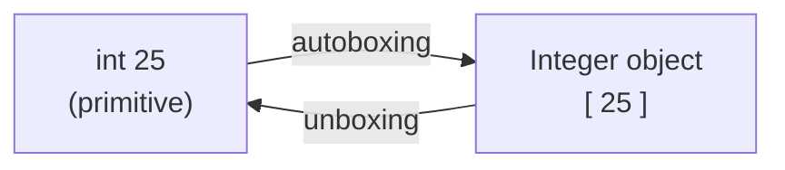

<div align="center">

# 📚 Chapter 12 · Library Classes

*Wrapper classes · Class as a composite type · Primitive vs composite data types · Autoboxing and unboxing · Methods of the wrapper classes*

[⬅ Back to Index](../README.md)

</div>

---

## 📑 Contents

1. [Library classes and packages](#1-library-classes-and-packages)
2. [Class as a composite type](#2-class-as-a-composite-type)
3. [Wrapper classes](#3-wrapper-classes)
4. [Autoboxing and unboxing](#4-autoboxing-and-unboxing)
5. [String-to-number conversion methods](#5-string-to-number-conversion-methods)
6. [Methods of the `Character` class](#6-methods-of-the-character-class)
7. [Predict the output](#7-predict-the-output)
8. [Find the errors](#8-find-the-errors)
9. [Differentiate between](#9-differentiate-between)
10. [One-line facts](#10-one-line-facts)
11. [Test yourself](#-test-yourself)
12. [Programs in this chapter](#-programs-in-this-chapter)

---

## 1. Library classes and packages

**Library classes** are the **pre-defined classes** supplied with Java (the Java Class Library / API). They are grouped into **packages**:

| Package | Example classes |
|---|---|
| `java.lang` (imported by default) | `String`, `Math`, `System`, `Integer`, `Long`, `Float`, `Double`, `Character`, `Boolean` |
| `java.util` | `Scanner` |
| `java.io` | `BufferedReader`, `InputStreamReader` |

---

## 2. Class as a composite type

A class groups together data members of various types (primitive and/or other classes) and methods. Hence a class is a **composite (user-defined / reference) data type**. Once a class is defined, its name can be used to declare variables, exactly like `int` or `double`.

```java
class Date
{
    int dd, mm, yy;           // composite type made from three ints
}
...
Date birthday = new Date();   // Date is used as a data type
```

| Basis | Primitive data type | Composite data type |
|---|---|---|
| Defined by | Java language (built-in) | Programmer or Java library (class) |
| Number of values | One | Many (one for each data member) |
| Size | Fixed | Depends on its members |
| Contains methods? | No | Yes |
| Stores | The value | A reference to an object |
| Created with `new`? | No | Yes (objects) |
| Example | `int`, `char`, `boolean` | `String`, `Scanner`, `Date`, arrays |

---

## 3. Wrapper classes

A **wrapper class** is a library class that **wraps (encloses) a value of a primitive data type inside an object**. Every primitive type has a corresponding wrapper class in `java.lang`.

| Primitive type | Wrapper class |
|---|---|
| `byte` | `Byte` |
| `short` | `Short` |
| `int` | **`Integer`** |
| `long` | `Long` |
| `float` | `Float` |
| `double` | `Double` |
| `char` | **`Character`** |
| `boolean` | `Boolean` |

> [!TIP]
> Only two wrapper names differ from their primitive names by more than a capital letter: **`Integer`** (for `int`) and **`Character`** (for `char`).

**Need for wrapper classes:**
1. To convert **strings into numbers** (`Integer.parseInt("25")`) — needed when numbers arrive as text.
2. To provide useful **utility methods** (`Character.isDigit()`, `Character.toUpperCase()`).
3. Some parts of Java work only with **objects**, not with primitive values; wrappers let primitives be treated as objects.

---

## 4. Autoboxing and unboxing

- **Autoboxing:** the **automatic conversion of a primitive value into an object of its wrapper class** by the compiler.
- **Unboxing:** the **automatic conversion of a wrapper class object into its primitive value**.

```java
Integer obj = 25;          // autoboxing: int → Integer
Double d = 3.5;            // autoboxing: double → Double
Character c = 'J';         // autoboxing: char → Character

int n = obj;               // unboxing: Integer → int
double sum = obj + d;      // unboxing inside an expression → 28.5
```



| Basis | Autoboxing | Unboxing |
|---|---|---|
| Converts | Primitive → wrapper object | Wrapper object → primitive |
| Example | `Integer x = 10;` | `int y = x;` |

---

## 5. String-to-number conversion methods

| Method | Return type | Example | Result |
|---|---|---|---|
| `Integer.parseInt(String s)` | `int` | `Integer.parseInt("452") + 8` | `460` |
| `Long.parseLong(String s)` | `long` | `Long.parseLong("9830012345")` | `9830012345` |
| `Float.parseFloat(String s)` | `float` | `Float.parseFloat("2.5")` | `2.5` |
| `Double.parseDouble(String s)` | `double` | `Double.parseDouble("3.75") * 2` | `7.5` |

```java
String a = "20", b = "30";
System.out.println(a + b);                                   // 2030  (string joining)
System.out.println(Integer.parseInt(a) + Integer.parseInt(b)); // 50  (numeric addition)
```

> [!WARNING]
> If the string is not a valid number, these methods throw a **`NumberFormatException`** at run time:
> `Integer.parseInt("12a")`, `Integer.parseInt("4.5")`, `Integer.parseInt(" 45")` (space!), `Integer.parseInt("")`.
> `Double.parseDouble("45")` is fine → `45.0`.

**Converting a number to a string:** `String.valueOf(25)` → `"25"` (String class, Chapter 15), or `"" + 25`.

---

## 6. Methods of the `Character` class

| Method | Return type | Returns `true` / result when… | Example → result |
|---|---|---|---|
| `Character.isDigit(char ch)` | `boolean` | `ch` is a digit `0`–`9` | `isDigit('7')` → `true` |
| `Character.isLetter(char ch)` | `boolean` | `ch` is a letter | `isLetter('$')` → `false` |
| `Character.isLetterOrDigit(char ch)` | `boolean` | `ch` is a letter or a digit | `isLetterOrDigit('_')` → `false` |
| `Character.isLowerCase(char ch)` | `boolean` | `ch` is a lowercase letter | `isLowerCase('a')` → `true` |
| `Character.isUpperCase(char ch)` | `boolean` | `ch` is an uppercase letter | `isUpperCase('5')` → `false` |
| `Character.isWhitespace(char ch)` | `boolean` | `ch` is a space, tab, new line, etc. | `isWhitespace('\t')` → `true` |
| `Character.toLowerCase(char ch)` | `char` | lowercase form of `ch` (unchanged if not an uppercase letter) | `toLowerCase('Q')` → `q` |
| `Character.toUpperCase(char ch)` | `char` | uppercase form of `ch` (unchanged if not a lowercase letter) | `toUpperCase('7')` → `7` |

> [!IMPORTANT]
> `toUpperCase()` / `toLowerCase()` return a **`char`**, so `int x = Character.toUpperCase('a');` stores **65**, and `System.out.println(Character.toUpperCase('a') + 1);` prints **66** (char + int → int).

**Common uses**
```java
if (Character.isUpperCase(ch)) up++;                 // counting
int value = ch - '0';                                // digit character → its value (when isDigit(ch))
char t = Character.isUpperCase(ch) ? Character.toLowerCase(ch) : Character.toUpperCase(ch);   // toggle case
```

---

## 7. Predict the output

```java
System.out.println(Integer.parseInt("15") + Integer.parseInt("5") + "5");    // (1)
System.out.println("15" + 5 + Double.parseDouble("2.5"));                    // (2)
System.out.println(Character.isLetter('9') || Character.isDigit('9'));      // (3)
System.out.println(Character.toUpperCase('b') + 'a');                        // (4)
System.out.println((char) (Character.toLowerCase('Z') - 1));                 // (5)
Integer x = 7; int y = x * x + Long.parseLong("3") > 50 ? 1 : 0;             // (6)
System.out.println(y);
```

<details>
<summary><b>Show answers with working</b></summary>

| # | Working | Output |
|---|---|---|
| 1 | 15 + 5 = 20, then `20 + "5"` | `205` |
| 2 | `"15" + 5` = `"155"`, then + 2.5 | `1552.5` |
| 3 | false \|\| true | `true` |
| 4 | `'B'` (66) + `'a'` (97) | `163` |
| 5 | `'z'` (122) − 1 = 121 → `'y'` | `y` |
| 6 | 49 + 3 = 52 > 50 → 1 | `1` |

</details>

---

## 8. Find the errors

```java
int a = Integer.parseInt(45);                 // (1)
double d = Double.parseDouble("3.5", "2");    // (2)
boolean b = Character.isDigit("7");           // (3)
char c = Character.toUpperCase("x");          // (4)
String s = Character.toLowerCase('A');        // (5)
```

<details>
<summary><b>Show corrections</b></summary>

1. `parseInt` takes a String → `Integer.parseInt("45")`
2. `parseDouble` takes one argument → `Double.parseDouble("3.5")`
3. `isDigit` takes a char → `Character.isDigit('7')`
4. `toUpperCase(char)` takes a char → `Character.toUpperCase('x')`
5. It returns a `char` → `char s = Character.toLowerCase('A');` (or `String s = "" + Character.toLowerCase('A');`)

</details>

---

## 9. Differentiate between

| Pair | Difference |
|---|---|
| `int` vs `Integer` | Primitive type storing a value vs wrapper class whose object wraps an int |
| Autoboxing vs unboxing | Primitive → object vs object → primitive |
| `parseInt()` vs `String.valueOf()` | String → int vs number → String |
| `isLetter()` vs `isLetterOrDigit()` | Letters only vs letters and digits |
| `isUpperCase()` vs `toUpperCase()` | Tests and returns `boolean` vs converts and returns `char` |
| Primitive vs composite type | Built-in single value vs class grouping several values and methods |

---

## 10. One-line facts

- Wrapper classes are in the **`java.lang`** package.
- The wrapper class of `char` is **`Character`**; of `int` is **`Integer`**.
- `Integer.parseInt()` returns an **`int`**; `Double.parseDouble()` returns a **`double`**.
- An invalid number string causes **`NumberFormatException`**.
- The `isXxx()` methods of `Character` return **`boolean`**; `toUpperCase()`/`toLowerCase()` return **`char`**.
- Converting a primitive to its wrapper object automatically is **autoboxing**.
- A class is a **composite** data type.

---

## 🧠 Test Yourself

### Part A — Multiple choice

1. What is printed? `System.out.println(Integer.parseInt("10") + Integer.parseInt("10") + "10");`
   <br>(a) 101010 (b) 30 (c) 2010 (d) 1020
2. Which call causes a `NumberFormatException`?
   <br>(a) `Double.parseDouble("7")` (b) `Integer.parseInt("-7")` (c) `Integer.parseInt("7.0")` (d) `Long.parseLong("70")`
3. *Assertion (A):* `Character.isLetterOrDigit('_')` returns false.
   <br>*Reason (R):* The underscore is neither a letter nor a digit.
   <br>(a) Both true; R explains A (b) Both true; R doesn't explain A (c) A true, R false (d) A false, R true
4. `char ch = 'm'; System.out.print(Character.toUpperCase(ch) + 1);` prints
   <br>(a) N (b) M1 (c) 78 (d) m1
5. Which statement shows **unboxing**?
   <br>(a) `Integer a = 5;` (b) `Integer a = 5; int b = a;` (c) `Double d = 2.0;` (d) `Character c = 'x';`
6. Which returns `true`? (a) `Character.isUpperCase('7')` (b) `Character.isWhitespace('\n')` (c) `Character.isDigit('A')` (d) `Character.isLetter(' ')`
7. The return type of `Character.toLowerCase('A')` is (a) String (b) int (c) char (d) boolean
8. `String s = "3" + 4; int k = Integer.parseInt(s) + 6;` gives `k` = (a) 13 (b) 40 (c) 346 (d) 7

### Part B — Short answer questions

1. What is a wrapper class? Name the wrapper classes of `char` and `double`.
2. Define autoboxing and unboxing with one example each.
3. Give the output: `System.out.println(Character.isLetter('A') + " " + Character.toLowerCase('A'));`
4. Write a statement to convert the string `"2025"` into an integer and add 1 to it.
5. What is the difference between `Character.isUpperCase()` and `Character.toUpperCase()`?
6. Why is a class called a composite data type?
7. Name the exception thrown by `Integer.parseInt("1,000")`.

<details>
<summary><b>✅ Answers — Part A</b></summary>

| Q | Ans | Reason |
|---|---|---|
| 1 | (c) | 10 + 10 = 20, then `"20" + "10"` |
| 2 | (c) | `"7.0"` is not an integer string |
| 3 | (a) | — |
| 4 | (c) | `'M'` (77) + 1 = 78 |
| 5 | (b) | Assigning a wrapper object to a primitive unboxes it |
| 6 | (b) | — |
| 7 | (c) | — |
| 8 | (b) | `"34"` → 34 + 6 = 40 |

</details>

<details>
<summary><b>✅ Answers — Part B</b></summary>

1. A library class that wraps a primitive value in an object. `Character`, `Double`.
2. Autoboxing: automatic conversion of a primitive into its wrapper object — `Integer i = 5;`. Unboxing: automatic conversion of a wrapper object into a primitive — `int k = i;`.
3. `true a`
4. `int y = Integer.parseInt("2025") + 1;`
5. `isUpperCase()` checks whether a character is an uppercase letter and returns `boolean`; `toUpperCase()` converts a character to uppercase and returns `char`.
6. Because it is made up of (composed of) several data members of primitive and/or other class types, and it can be used to create variables like a data type.
7. `NumberFormatException`.

</details>

---

## 💻 Programs in this chapter

<!-- PROGRAMS -->

| No. | Program | |
|:---:|---|:---:|
| **Q238** | [Type of a Character using Character Methods](Q_238.java) |  |
| **Q239** | [Count Uppercase, Lowercase, Digits, Spaces and Special Characters](Q_239.java) |  |
| **Q240** | [Change the Case of a Character](Q_240.java) |  |
| **Q241** | [Adding Numbers Entered as Strings](Q_241.java) |  |
| **Q242** | [Output of the Wrapper Class Methods](Q_242.java) |  |
| **Q243** | [Autoboxing and Unboxing](Q_243.java) |  |
| **Q244** | [Sum of the Digits Present in an Alphanumeric String](Q_244.java) |  |
| **Q245** | [Build a Number from the Digits in a String](Q_245.java) |  |
| **Q246** | [Remove Characters that are not Letters or Digits](Q_246.java) |  |
| **Q247** | [Validate a 10-Digit Mobile Number](Q_247.java) |  |
| **Q248** | [Percentage from Marks Entered as Strings](Q_248.java) |  |
| **Q249** | [Password Strength Checker](Q_249.java) | 🌟 *Extra* |

<!-- /PROGRAMS -->
