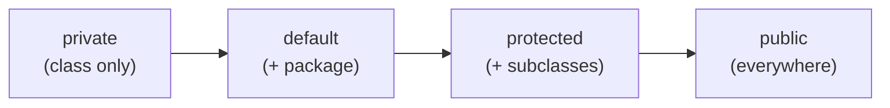

<div align="center">

# 🔒 Chapter 13 · Encapsulation

*Encapsulation and data hiding · Access specifiers and their visibility · Scope of variables: class, instance, argument and local variables*

[⬅ Back to Index](../README.md)

</div>

---

## 📑 Contents

1. [Encapsulation](#1-encapsulation)
2. [Access specifiers](#2-access-specifiers)
3. [Visibility rules](#3-visibility-rules)
4. [Scope of variables](#4-scope-of-variables)
5. [Class variables vs instance variables](#5-class-variables-vs-instance-variables)
6. [Identify the variables — solved](#6-identify-the-variables--solved)
7. [Predict the output](#7-predict-the-output)
8. [Find the errors](#8-find-the-errors)
9. [One-line facts](#9-one-line-facts)
10. [Test yourself](#-test-yourself)
11. [Programs in this chapter](#-programs-in-this-chapter)

---

## 1. Encapsulation

**Encapsulation** is the **wrapping up of data and the methods that operate on that data into a single unit — the class**, while **restricting direct access** to the data from outside the class.

**Data hiding:** declaring data members `private` so that they can be read or changed **only through the public methods** of the class. These methods can **validate** the data before changing it.

```java
class Student
{
    private int marks;                  // hidden data

    public void setMarks(int m)         // controlled write access (setter / mutator)
    {
        if (m >= 0 && m <= 100)
            marks = m;
    }

    public int getMarks()               // controlled read access (getter / accessor)
    {
        return marks;
    }
}
```

**Advantages of encapsulation**
1. **Data security** — data cannot be corrupted from outside (e.g. marks cannot be set to −5).
2. **Control** — the class decides how its data is read or changed.
3. **Flexibility and maintainability** — the internal code can change without affecting other classes.
4. **Modularity** — each class is a self-contained unit.

> [!NOTE]
> **Encapsulation vs abstraction:** encapsulation *binds and hides* the data (implementation level); abstraction *shows only the essential features* (design level). Encapsulation is one way of achieving abstraction.

---

## 2. Access specifiers

**Access specifiers (access modifiers)** are keywords that control the **visibility (accessibility)** of a class and its members from other classes.

| Access specifier | Keyword | Meaning |
|---|---|---|
| **private** | `private` | Accessible **only within the same class** |
| **default** (package-private) | *(no keyword)* | Accessible within the **same package** |
| **protected** | `protected` | Accessible within the same package **and** in **subclasses** (even in other packages) |
| **public** | `public` | Accessible from **everywhere** |

---

## 3. Visibility rules

| Accessed from → | Same class | Same package (other class) | Subclass in another package | Other class in another package |
|---|:---:|:---:|:---:|:---:|
| `private` | ✅ | ❌ | ❌ | ❌ |
| default | ✅ | ✅ | ❌ | ❌ |
| `protected` | ✅ | ✅ | ✅ | ❌ |
| `public` | ✅ | ✅ | ✅ | ✅ |



> [!TIP]
> Order from **most restrictive to least restrictive**: `private` → default → `protected` → `public`. A common exam line: *"private members are accessible only within the class in which they are declared."*

> [!WARNING]
> Access specifiers apply to **data members and methods** (and classes), **never to local variables**. `private int x;` inside a method is a compile-time error.

---

## 4. Scope of variables

The **scope** of a variable is the **part of the program in which the variable can be used (is visible)**. Its **lifetime** is how long it exists in memory.

| Kind of variable | Declared | Scope | Lifetime | Default value |
|---|---|---|---|---|
| **Class variable** (static variable) | In the class, with `static`, outside methods | Whole class; accessed as `ClassName.var` | From class loading till the program ends; **one copy shared** by all objects | Yes |
| **Instance variable** (data member) | In the class, without `static`, outside methods | Whole class (through an object) | As long as the object exists; **one copy per object** | Yes |
| **Argument variable** (parameter) | In the method header | Only inside that method | While the method runs | No (gets the argument's value) |
| **Local variable** | Inside a method or block | From the declaration to the end of that **block** | While the block runs | **No** — must be initialised before use |

```java
class Shop
{
    static int customers = 0;          // class variable
    String item;                       // instance variable
    double price;                      // instance variable

    double bill(int qty)               // qty → argument variable
    {
        double total = price * qty;    // total → local variable
        for (int i = 1; i <= 1; i++)   // i → local to the for loop only
        {
            customers++;
        }
        return total;
    }
}
```

**Shadowing:** if a local variable or parameter has the **same name** as an instance variable, it **hides** the instance variable inside that method. Use `this.name` to refer to the instance variable.

---

## 5. Class variables vs instance variables

| Basis | Class (static) variable | Instance variable |
|---|---|---|
| Keyword | `static` | none |
| Copies | One copy for the whole class | One copy for each object |
| Accessed using | Class name (`Shop.customers`) | Object (`s1.item`) |
| Memory allotted | When the class is loaded | When an object is created |
| Use | Data common to all objects (counter, rate) | Data specific to each object |

> [!IMPORTANT]
> A change in a class variable made through one object is seen by **all** objects, because they share a single copy.

---

## 6. Identify the variables — solved

```java
public class Employee
{
    private static double bonusRate = 0.1;
    private String name;
    private double salary;

    public double annualPay(int months)
    {
        double pay = salary * months;
        return pay + pay * bonusRate;
    }
}
```

| Variable | Kind | Access |
|---|---|---|
| `bonusRate` | Class variable | private |
| `name`, `salary` | Instance variables | private |
| `months` | Argument (parameter) variable | — |
| `pay` | Local variable | — |
| `annualPay()` | Method | public |

---

## 7. Predict the output

```java
class Counter
{
    static int total = 0;
    int mine = 0;

    void hit()
    {
        total++;
        mine++;
    }

    public static void main(String[] args)
    {
        Counter a = new Counter();
        Counter b = new Counter();
        a.hit(); a.hit(); b.hit();
        System.out.println(a.mine + " " + b.mine + " " + Counter.total);
    }
}
```

<details>
<summary><b>Show answer</b></summary>

`mine` is per object (a: 2, b: 1); `total` is shared (3). **Output:** `2 1 3`
</details>

---

## 8. Find the errors

```java
class Box
{
    private double side;
    void set(double side) { side = side; }        // (1)
    double vol() { private double v = side * side * side; return v; }   // (2)
    void show() { int k; System.out.println(k); }  // (3)
}
class Test
{
    public static void main(String[] args)
    {
        Box b = new Box();
        b.side = 5;                                 // (4)
    }
}
```

<details>
<summary><b>Show corrections</b></summary>

1. Shadowing — use `this.side = side;` (otherwise the data member is never set — a logical error).
2. Local variables cannot have access specifiers → `double v = side * side * side;`
3. A local variable must be initialised before use → `int k = 0;`
4. `side` is `private` in `Box` → not accessible from `Test`; use a public setter `b.set(5);`

</details>

---

## 9. One-line facts

- Encapsulation = **data + methods in one unit** with restricted access.
- **Data hiding** is achieved using the `private` access specifier.
- `private` members are accessible **only within their own class**.
- Members with **no access specifier** have **default (package)** access.
- `protected` members are accessible in the same package and in **subclasses**.
- A **static** variable is a class variable — **one copy** shared by all objects.
- **Local variables** have no default value and no access specifier.
- The scope of a loop variable declared in `for` is **only the loop**.

---

## 🧠 Test Yourself

### Part A — Multiple choice

1. Which access specifier makes a member visible in subclasses of another package but **not** in unrelated classes there?
   <br>(a) private (b) default (c) protected (d) public
2. Which is **not** allowed?
   <br>(a) `private int a;` as a data member (b) `public void f()` (c) `public int x = 5;` inside a method (d) `static int count;` as a data member
3. *Assertion (A):* Data hiding prevents invalid values from being stored in an object.
   <br>*Reason (R):* Private data can be changed only through methods, which can validate the values.
   <br>(a) Both true; R explains A (b) Both true; R doesn't explain A (c) A true, R false (d) A false, R true
4. Three objects of a class are created. How many copies exist of a `static int n` and of an instance `int m`?
   <br>(a) 1 and 1 (b) 3 and 3 (c) 1 and 3 (d) 3 and 1
5. ```java
   class A { int x = 10; void f(int x) { x = x + 5; System.out.print(x + " " + this.x); } }
   ```
   `new A().f(1);` prints (a) 6 10 (b) 15 15 (c) 6 6 (d) 15 10
6. The scope of a parameter is
   (a) the whole class (b) the whole program (c) the method in which it is declared (d) the block after the method
7. *Assertion (A):* A local variable declared inside a `for` loop cannot be used after the loop.
   *Reason (R):* The scope of a local variable ends with the block in which it is declared.
   (a) Both true; R explains A (b) Both true; R doesn't explain A (c) A true, R false (d) A false, R true

### Part B — Short answer questions

1. Define encapsulation. How is data hiding achieved in Java?
2. Name the four access levels in order of increasing visibility.
3. Differentiate between a class variable and an instance variable.
4. What is the scope of (i) a local variable (ii) a parameter (iii) an instance variable?
5. What are getter and setter methods? Why are they used?
6. Identify the class, instance, argument and local variables:
   `class Car { static int made; String model; void sell(double price) { double gst = price * 0.28; } }`
7. What is shadowing? How is it resolved?

<details>
<summary><b>✅ Answers — Part A</b></summary>

| Q | Ans | Reason |
|---|---|---|
| 1 | (c) | — |
| 2 | (c) | Local variables cannot have access specifiers |
| 3 | (a) | — |
| 4 | (c) | — |
| 5 | (a) | The parameter `x` (1 + 5 = 6) shadows the data member (10) |
| 6 | (c) | — |
| 7 | (a) | — |

</details>

<details>
<summary><b>✅ Answers — Part B</b></summary>

1. Wrapping up data and the methods that act on it into a single unit (class) with restricted access. Data hiding is achieved by declaring data members `private` and giving access only through public methods.
2. private → default → protected → public.
3. A class variable is declared `static`; only one copy exists and it is shared by all objects; accessed with the class name. An instance variable has a separate copy in every object and is accessed through an object.
4. (i) The block in which it is declared (ii) the method in which it is declared (iii) the whole class.
5. Public methods that read (getter/accessor) and change (setter/mutator) private data members; they give controlled access and allow validation.
6. Class variable: `made`; instance variable: `model`; argument: `price`; local: `gst`.
7. When a local variable or parameter has the same name as a data member, it hides the data member inside the method. It is resolved using `this.member`.

</details>

---

## 💻 Programs in this chapter

<!-- PROGRAMS -->

| No. | Program | |
|:---:|---|:---:|
| **Q250** | [Private Data with Public Getter and Setter Methods](Student.java) |  |
| **Q251** | [Access Specifiers: private, default, protected and public](Account.java) |  |
| **Q252** | [Kinds of Variables: Class, Instance, Local and Argument](Q_252.java) |  |
| **Q253** | [Counting Objects with a Static (Class) Variable](Visitor.java) |  |
| **Q254** | [BankAccount with a Private, Validated Balance](BankAccount.java) |  |

<!-- /PROGRAMS -->
