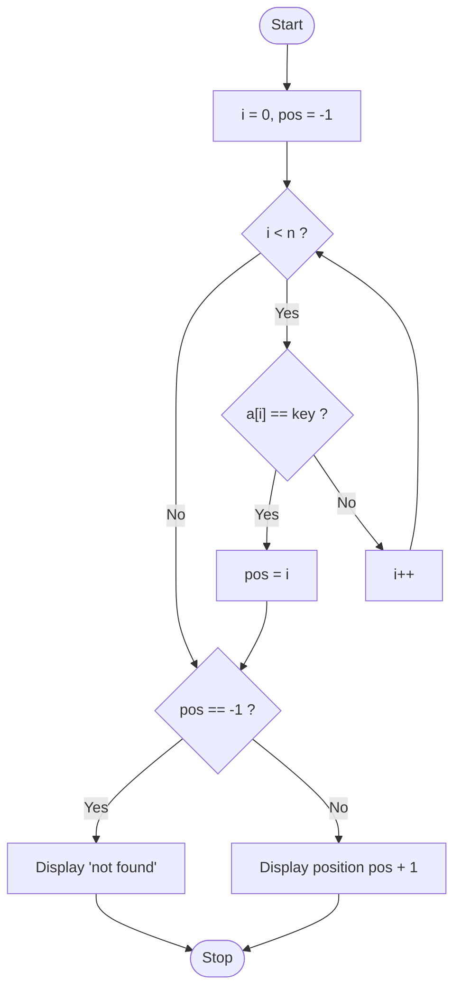
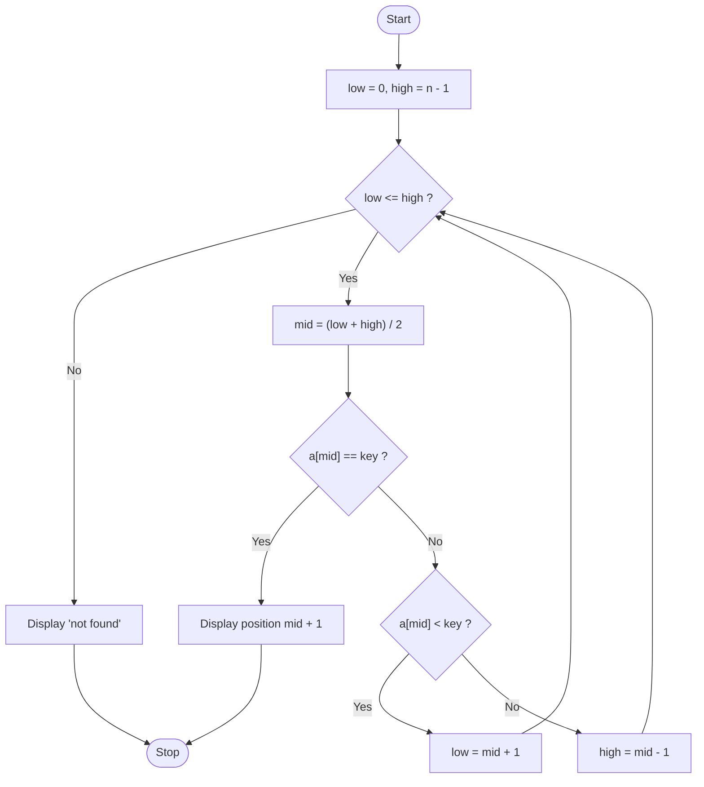
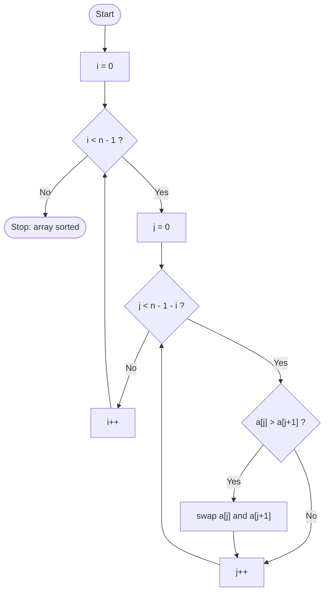
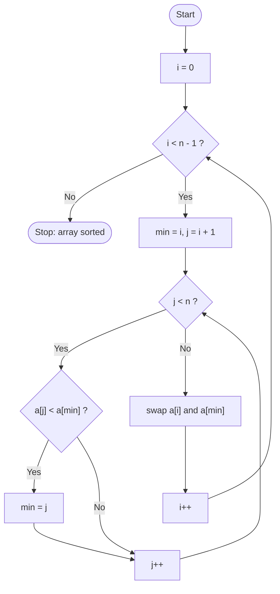

<div align="center">

# 🗃️ Chapter 14 · Arrays

*Single and double dimensional arrays · Declaration, initialisation and input · `length` · Linear and binary search · Bubble and selection sort · Row, column and diagonal operations*

[⬅ Back to Index](../README.md)

</div>

---

## 📑 Contents

1. [What is an array?](#1-what-is-an-array)
2. [Single dimensional arrays](#2-single-dimensional-arrays)
3. [Memory and the `length` property](#3-memory-and-the-length-property)
4. [Array as a composite (reference) type](#4-array-as-a-composite-reference-type)
5. [Linear search](#5-linear-search)
6. [Binary search](#6-binary-search)
7. [Bubble sort](#7-bubble-sort)
8. [Selection sort](#8-selection-sort)
9. [Comparisons: searching and sorting](#9-comparisons-searching-and-sorting)
10. [Double dimensional arrays](#10-double-dimensional-arrays)
11. [Predict the output](#11-predict-the-output)
12. [Find the errors](#12-find-the-errors)
13. [One-line facts](#13-one-line-facts)
14. [Test yourself](#-test-yourself)
15. [Programs in this chapter](#-programs-in-this-chapter)

---

## 1. What is an array?

An **array** is a **collection of a fixed number of elements of the same data type**, stored in **contiguous memory locations** and referred to by a **common name**. Each element is accessed using an **index (subscript)**, which starts from **0**.

**Need for arrays:** to store and process 50 marks, 50 separate variables would be needed. With an array, one name and a loop are enough:
```java
int marks[] = new int[50];
for (int i = 0; i < 50; i++)
    marks[i] = sc.nextInt();
```

**Types of arrays**

| Type | Shape | Example |
|---|---|---|
| **Single dimensional (1D)** | A list (one subscript) | `int a[] = new int[5];` |
| **Double dimensional (2D)** | A table of rows and columns (two subscripts) | `int m[][] = new int[3][4];` |

---

## 2. Single dimensional arrays

### 2.1 Declaration and creation
```java
int a[];            // declaration (a reference; no memory for elements yet)
a = new int[5];     // creation (memory for 5 ints, all set to 0)
int b[] = new int[5];         // both together
double[] c = new double[10];  // brackets may also be written after the type
```

### 2.2 Initialisation
```java
int a[] = {12, 5, 8, 19, 3};               // size is taken as 5 automatically
char vowels[] = {'a', 'e', 'i', 'o', 'u'};
String days[] = {"Mon", "Tue", "Wed"};
```

> [!WARNING]
> An initialiser list can be used **only at the time of declaration**: `int a[]; a = {1, 2, 3};` is a **syntax error**. Also `int a[5] = {…};` is invalid in Java — the size is never written in the declaration.

### 2.3 Accepting data and accessing elements
```java
for (int i = 0; i < a.length; i++)
    a[i] = sc.nextInt();           // input

for (int i = 0; i < a.length; i++)
    System.out.print(a[i] + " ");  // output
```

| Element | a[0] | a[1] | a[2] | a[3] | a[4] |
|---|---|---|---|---|---|
| Value | 12 | 5 | 8 | 19 | 3 |

- First index = **0**; last index = **length − 1**.
- Accessing `a[5]` (or `a[-1]`) causes **`ArrayIndexOutOfBoundsException`** at run time.

**Default values of array elements:** `0` (int/long/short/byte), `0.0` (float/double), `'\u0000'` (char), `false` (boolean), `null` (String/objects).

---

## 3. Memory and the `length` property

`arrayName.length` gives the **number of elements** of an array. It is a **property (data member), not a method** — no brackets.

```java
int a[] = new int[8];
System.out.println(a.length);   // 8
```

> [!IMPORTANT]
> `a.length` (array, no brackets) vs `s.length()` (String, method with brackets) is a favourite exam trap.

**Memory occupied = number of elements × size of the data type**

| Declaration | Calculation | Bytes |
|---|---|---|
| `int a[] = new int[10];` | 10 × 4 | 40 |
| `double d[] = new double[5];` | 5 × 8 | 40 |
| `char c[] = new char[20];` | 20 × 2 | 40 |
| `long m[][] = new long[3][4];` | 12 × 8 | 96 |
| `boolean f[] = new boolean[8];` | (JVM dependent) | — |

---

## 4. Array as a composite (reference) type

An array is a **composite / non-primitive** data type: it is made up of many elements, and the array variable holds a **reference** to the memory block (created using `new`).

```java
int a[] = {1, 2, 3};
int b[] = a;        // b refers to the SAME array — no copy is made
b[0] = 99;
System.out.println(a[0]);   // 99
```

When an array is **passed to a method**, the reference is passed, so changes made to its elements inside the method **are reflected** in the caller (call by reference behaviour).

---

## 5. Linear search

**Linear (sequential) search** compares the search key with **each element one by one, from the first element**, until a match is found or the array ends. The array **need not be sorted**.

```java
int pos = -1;
for (int i = 0; i < n; i++)
{
    if (a[i] == key)
    {
        pos = i;
        break;
    }
}
```



**Dry run:** `a = {14, -3, 27, 8}`, key = 27 → comparisons with 14 ✗, −3 ✗, 27 ✓ → found at index 2 (position 3) after **3 comparisons**.

---

## 6. Binary search

**Binary search** works only on a **sorted** array. It compares the key with the **middle element**; if they are not equal, it searches **only the half** in which the key can lie, repeatedly halving the search range.

```java
int low = 0, high = n - 1, pos = -1;
while (low <= high)
{
    int mid = (low + high) / 2;
    if (a[mid] == key)      { pos = mid; break; }
    else if (a[mid] < key)  low = mid + 1;     // search the right half
    else                    high = mid - 1;    // search the left half
}
```



**Dry run:** `a = {3, 9, 14, 21, 30, 42, 57, 66}`, key = 57

| Step | low | high | mid | a[mid] | Action |
|:---:|:---:|:---:|:---:|:---:|---|
| 1 | 0 | 7 | 3 | 21 | 21 < 57 → low = 4 |
| 2 | 4 | 7 | 5 | 42 | 42 < 57 → low = 6 |
| 3 | 6 | 7 | 6 | 57 | **found** at index 6 |

**Dry run (unsuccessful):** same array, key = 10

| Step | low | high | mid | a[mid] | Action |
|:---:|:---:|:---:|:---:|:---:|---|
| 1 | 0 | 7 | 3 | 21 | 21 > 10 → high = 2 |
| 2 | 0 | 2 | 1 | 9 | 9 < 10 → low = 2 |
| 3 | 2 | 2 | 2 | 14 | 14 > 10 → high = 1 |
| 4 | 2 | 1 | — | — | low > high → **not found** |

> [!TIP]
> For an array **sorted in descending order**, reverse the two comparisons: if `a[mid] > key` then `low = mid + 1`.

---

## 7. Bubble sort

**Bubble sort** repeatedly compares **adjacent elements** and **swaps them if they are in the wrong order**. After each pass, the **largest** remaining element "bubbles up" to its correct place at the **end** of the unsorted part. For n elements, **n − 1 passes** are needed.

```java
for (int i = 0; i < n - 1; i++)              // passes
{
    for (int j = 0; j < n - 1 - i; j++)      // comparisons in pass i
    {
        if (a[j] > a[j + 1])                 // use < for descending order
        {
            int t = a[j];
            a[j] = a[j + 1];
            a[j + 1] = t;
        }
    }
}
```



**Pass-by-pass dry run:** `{5, 1, 4, 2, 8}` (ascending)

| Pass | Array after the pass | Element fixed |
|:---:|---|---|
| Start | 5 1 4 2 8 | — |
| 1 | 1 4 2 5 **8** | 8 |
| 2 | 1 2 4 **5 8** | 5 |
| 3 | 1 2 **4 5 8** | 4 |
| 4 | 1 **2 4 5 8** | 2 (and 1) |

Pass 1 in detail: (5,1) swap → 1 5 4 2 8; (5,4) swap → 1 4 5 2 8; (5,2) swap → 1 4 2 5 8; (5,8) no swap.

---

## 8. Selection sort

**Selection sort** divides the array into a sorted and an unsorted part. In each pass, it **selects the smallest element** of the unsorted part and **swaps it with the first element** of the unsorted part. n − 1 passes are needed, with **at most one swap per pass**.

```java
for (int i = 0; i < n - 1; i++)
{
    int min = i;
    for (int j = i + 1; j < n; j++)
        if (a[j] < a[min])                   // use > (max) for descending order
            min = j;
    int t = a[i];
    a[i] = a[min];
    a[min] = t;
}
```



**Pass-by-pass dry run:** `{64, 25, 12, 22, 11}`

| Pass | Smallest in unsorted part | Swap | Array after the pass |
|:---:|:---:|---|---|
| 1 | 11 | a[0] ↔ a[4] | **11** 25 12 22 64 |
| 2 | 12 | a[1] ↔ a[2] | **11 12** 25 22 64 |
| 3 | 22 | a[2] ↔ a[3] | **11 12 22** 25 64 |
| 4 | 25 | none needed (a[3] ↔ a[3]) | **11 12 22 25 64** |

**Sorting strings alphabetically:** replace `a[j] > a[j + 1]` with `s[j].compareTo(s[j + 1]) > 0` (Chapter 15).

---

## 9. Comparisons: searching and sorting

| Basis | Linear search | Binary search |
|---|---|---|
| Array must be sorted? | No | **Yes** |
| Method | Compares each element in turn | Compares with the middle element, halves the range |
| Speed for large arrays | Slow | Fast |
| Maximum comparisons (n = 1000) | 1000 | about 10 |
| Works on | Any array | Sorted arrays only |

| Basis | Bubble sort | Selection sort |
|---|---|---|
| Compares | Adjacent elements | Each element with the current minimum |
| Swaps per pass | Possibly many | At most one |
| After pass k | Largest k elements fixed at the **end** | Smallest k elements fixed at the **beginning** |
| Total passes | n − 1 | n − 1 |

---

## 10. Double dimensional arrays

A **double dimensional (2D) array** stores data in **rows and columns** (a matrix). An element is accessed as `a[row][column]`.

```java
int a[][] = new int[3][4];                     // 3 rows, 4 columns, 12 elements
int b[][] = { {1, 2, 3}, {4, 5, 6} };          // 2 rows, 3 columns

for (int i = 0; i < 3; i++)                    // input row-wise
    for (int j = 0; j < 4; j++)
        a[i][j] = sc.nextInt();

for (int i = 0; i < 3; i++)                    // display in matrix format
{
    for (int j = 0; j < 4; j++)
        System.out.print(a[i][j] + "\t");
    System.out.println();
}
```

- `a.length` → number of **rows**; `a[0].length` → number of **columns**.

**Standard 2D operations**

| Task | Logic |
|---|---|
| Sum of row i | `for (j…) rs += a[i][j];` |
| Sum of column j | `for (i…) cs += a[i][j];` |
| Left (principal) diagonal (square matrix) | elements where `i == j` → `a[i][i]` |
| Right diagonal | elements where `i + j == n - 1` → `a[i][n - 1 - i]` |
| Boundary elements | `i == 0 \|\| i == m - 1 \|\| j == 0 \|\| j == n - 1` |
| Upper triangle (including diagonal) | `j >= i` |
| Lower triangle (including diagonal) | `j <= i` |
| Transpose | `t[j][i] = a[i][j]` |

**Example:** for
```
1 2 3
4 5 6
7 8 9
```
left diagonal = 1 + 5 + 9 = **15**; right diagonal = 3 + 5 + 7 = **15**; row 2 sum = **15**; column 3 sum = 3 + 6 + 9 = **18**.

> [!NOTE]
> Sorting and searching techniques in the syllabus are applied only to **single dimensional** arrays.

---

## 11. Predict the output

**Example 1**
```java
int a[] = {4, 8, 2, 7, 5};
int s = 0;
for (int i = 1; i < a.length; i += 2)
    s += a[i] * a[i - 1];
System.out.println(s + " " + a[a.length - 1] + " " + a[a[2]]);
```

<details>
<summary><b>Show answer</b></summary>

i = 1: 8 × 4 = 32; i = 3: 7 × 2 = 14 → s = 46. `a[4]` = 5. `a[a[2]]` = `a[2]` = 2.
**Output:** `46 5 2`
</details>

**Example 2**
```java
int x[] = {1, 2, 3, 4, 5};
for (int i = 0; i < x.length - 1; i++)
    x[i + 1] = x[i + 1] + x[i];
System.out.println(x[4]);
```

<details>
<summary><b>Show dry run</b></summary>

x becomes {1, 3, 6, 10, 15} (running total). **Output:** `15`
</details>

**Example 3**
```java
char c[] = {'J', 'A', 'V', 'A'};
for (int i = c.length - 1; i >= 0; i -= 2)
    System.out.print(c[i]);
System.out.println(c.length);
```

<details>
<summary><b>Show answer</b></summary>

i = 3 → `A`, i = 1 → `A`, then length 4. **Output:** `AA4`
</details>

**Example 4** — after the **second pass** of bubble sort (ascending), what is the array `{9, 4, 7, 1, 6}`?

<details>
<summary><b>Show answer</b></summary>

Pass 1: 4 7 1 6 **9**; Pass 2: 4 1 6 **7 9**. **Answer:** `4 1 6 7 9`
</details>

**Example 5** — how many comparisons does binary search make to find 30 in `{5, 10, 15, 20, 25, 30, 35}`?

<details>
<summary><b>Show answer</b></summary>

mid = 3 (20) → low = 4; mid = 5 (30) → found. **2 comparisons.**
</details>

---

## 12. Find the errors

```java
int a[5] = {1, 2, 3, 4, 5};                       // (1)
int b[] = new int[];                              // (2)
for (int i = 1; i <= b.length(); i++)             // (3)
    b[i] = i;
double d[] = {1.5, 2.5}; int k = d[0];            // (4)
String s[] = new String[3]; System.out.println(s[0].length());   // (5)
```

<details>
<summary><b>Show corrections</b></summary>

1. Size cannot be written in the declaration → `int a[] = {1, 2, 3, 4, 5};`
2. Size is required with `new` → `new int[5];`
3. `length` is a property; indices go from 0 to length − 1 → `for (int i = 0; i < b.length; i++)`
4. `double` cannot be stored in `int` without a cast → `int k = (int) d[0];`
5. `s[0]` is `null` (default) → `NullPointerException`; assign strings first.

</details>

---

## 13. One-line facts

- Array index starts at **0**; the last index is **length − 1**.
- `length` for arrays is a **property** (no brackets).
- Accessing an invalid index throws **`ArrayIndexOutOfBoundsException`**.
- **Binary search** needs a **sorted** array; linear search does not.
- **Bubble sort** compares **adjacent** elements; **selection sort** selects the **minimum** and swaps once per pass.
- Both sorts need **n − 1 passes** for n elements.
- In a 2D array, `a.length` = rows and `a[0].length` = columns.
- The left diagonal has `i == j`; the right diagonal has `i + j == n − 1`.
- An array is a **composite (reference)** data type.

---

## 🧠 Test Yourself

### Part A — Multiple choice

1. `int a[] = new int[10];` How many bytes, and what is the index of the last element?
   <br>(a) 40, 10 (b) 40, 9 (c) 10, 9 (d) 20, 9
2. Which needs the data to be sorted? (a) Linear search (b) Binary search (c) Bubble sort (d) Selection sort
3. `int x[] = {3, 6, 9}; int y[] = x; y[1] = 0; System.out.println(x[1] + x.length);` prints
   <br>(a) `63` (b) `3` (c) `9` (d) `03`
4. *Assertion (A):* Selection sort performs at most n − 1 swaps for n elements.
   <br>*Reason (R):* In each pass, selection sort swaps only once, after finding the minimum.
   <br>(a) Both true; R explains A (b) Both true; R doesn't explain A (c) A true, R false (d) A false, R true
5. In binary search on `{2, 4, 6, 8, 10, 12, 14}` for key 14, the values of `mid` are
   <br>(a) 3, 5, 6 (b) 3, 4, 5, 6 (c) 4, 6 (d) 3, 6
6. After the **first pass** of selection sort (ascending) on `{7, 3, 9, 1, 5}`, the array is
   <br>(a) 1 3 9 7 5 (b) 3 7 1 5 9 (c) 1 7 3 9 5 (d) 3 7 9 1 5
7. For `int m[][] = new int[4][6];`, `m.length` and `m[2].length` are
   <br>(a) 6, 4 (b) 4, 6 (c) 24, 6 (d) 4, 4
8. *Assertion (A):* `int a[] = {1, 2, 3}; a[3] = 4;` causes a compile-time error.
   <br>*Reason (R):* The highest valid index of `a` is 2.
   <br>(a) Both true; R explains A (b) Both true; R doesn't explain A (c) A false, R true (d) Both false
9. Which element lies on the **right** diagonal of a 5 × 5 matrix? (a) `a[1][1]` (b) `a[1][3]` (c) `a[3][3]` (d) `a[2][1]`
10. The maximum number of comparisons in a linear search of 100 elements is (a) 7 (b) 50 (c) 100 (d) 99

### Part B — Short answer questions

1. Define an array. State one advantage of using arrays.
2. Differentiate between linear search and binary search (two points).
3. Differentiate between bubble sort and selection sort (two points).
4. Write statements to (i) declare and initialise an array of 5 vowels (ii) find the number of elements of an array `arr`.
5. Show the array `{20, 15, 30, 5}` after each pass of bubble sort in descending order.
6. What is `ArrayIndexOutOfBoundsException`? Give an example.
7. Write the condition for the elements of (i) the left diagonal (ii) the boundary of an m × n matrix.
8. Calculate the memory required by `double prices[][] = new double[5][4];`

<details>
<summary><b>✅ Answers — Part A</b></summary>

| Q | Ans | Reason |
|---|---|---|
| 1 | (b) | 10 × 4 = 40 bytes; indices 0–9 |
| 2 | (b) | — |
| 3 | (b) | `y` and `x` share the array, so `x[1]` = 0; 0 + 3 = **3** |
| 4 | (a) | — |
| 5 | (a) | mid = 3 (8 < 14, low = 4), mid = 5 (12 < 14, low = 6), mid = 6 → found |
| 6 | (a) | The minimum 1 (at index 3) is swapped with the first element 7 → `1 3 9 7 5` |
| 7 | (b) | — |
| 8 | (c) | It compiles; the error occurs at **run time** (exception). R is true |
| 9 | (b) | 1 + 3 = 4 = n − 1 |
| 10 | (c) | — |

</details>

<details>
<summary><b>✅ Answers — Part B</b></summary>

1. A collection of a fixed number of elements of the same type stored in contiguous locations under one name and accessed by index. Advantage: many values can be processed using one name and a loop.
2. Linear search works on unsorted arrays and checks every element in turn; binary search needs a sorted array and halves the search range each time, so it is much faster for large arrays.
3. Bubble sort compares adjacent elements and may swap many times in a pass; selection sort finds the minimum of the unsorted part and swaps only once per pass.
4. (i) `char v[] = {'a', 'e', 'i', 'o', 'u'};` (ii) `int n = arr.length;`
5. Pass 1: 20 30 15 5 → Pass 2: 30 20 15 5 → Pass 3: 30 20 15 5 (already sorted).
6. A runtime error thrown when an index outside 0 to length − 1 is used, e.g. `int a[] = new int[3]; a[3] = 7;`
7. (i) `i == j` (ii) `i == 0 || i == m - 1 || j == 0 || j == n - 1`
8. 5 × 4 = 20 elements × 8 bytes = **160 bytes**.

</details>

---

## 💻 Programs in this chapter

<!-- PROGRAMS -->

| No. | Program | |
|:---:|---|:---:|
| **Q255** | [Linear Search](Q_255.java) |  |
| **Q256** | [Binary Search](Q_256.java) |  |
| **Q257** | [Bubble Sort in Ascending Order](Q_257.java) |  |
| **Q258** | [Selection Sort in Ascending Order](Q_258.java) |  |
| **Q259** | [Bubble Sort in Descending Order](Q_259.java) |  |
| **Q260** | [Selection Sort in Descending Order](Q_260.java) |  |
| **Q261** | [Largest, Smallest, Sum and Average of Array Elements](Q_261.java) |  |
| **Q262** | [Sum and Count of Even and Odd Elements](Q_262.java) |  |
| **Q263** | [Count of Positive, Negative and Zero Elements](Q_263.java) |  |
| **Q264** | [Elements Greater than the Average](Q_264.java) |  |
| **Q265** | [Reverse an Array in Place](Q_265.java) |  |
| **Q266** | [Second Largest Element](Q_266.java) |  |
| **Q267** | [Frequency of Each Element](Q_267.java) |  |
| **Q268** | [Remove Duplicate Elements](Q_268.java) |  |
| **Q269** | [Merge Two Arrays](Q_269.java) |  |
| **Q270** | [Split an Array into Even and Odd Arrays](Q_270.java) |  |
| **Q271** | [Swap the First Half with the Second Half](Q_271.java) |  |
| **Q272** | [Rotate an Array Left and Right by One Position](Q_272.java) |  |
| **Q273** | [Insert an Element at a Given Position](Q_273.java) |  |
| **Q274** | [Delete an Element from a Given Position](Q_274.java) |  |
| **Q275** | [Prime Elements of an Array](Q_275.java) |  |
| **Q276** | [Topper from Parallel Arrays of Names and Marks](Q_276.java) |  |
| **Q277** | [Telephone Directory: Search a Name in Parallel Arrays](Q_277.java) |  |
| **Q278** | [Totals and Grades from Three Subject Arrays](Q_278.java) |  |
| **Q279** | [Sort Students by Marks Keeping Names Aligned](Q_279.java) |  |
| **Q280** | [Bubble Sort followed by Binary Search](Q_280.java) |  |
| **Q281** | [First n Primes and First n Fibonacci Numbers in Arrays](Q_281.java) |  |
| **Q282** | [Running Total (Cumulative Sum) Array](Q_282.java) |  |
| **Q283** | [Count of Perfect Squares in an Array](Q_283.java) |  |
| **Q284** | [Interchange the Largest and Smallest Elements](Q_284.java) |  |
| **Q285** | [Star Bar Chart of Ratings](Q_285.java) | 🌟 *Extra* |
| **Q286** | [Dice Roll Frequency Simulation](Q_286.java) | 🌟 *Extra* |
| **Q287** | [Input and Display a Matrix](Q_287.java) |  |
| **Q288** | [Row-wise and Column-wise Sums](Q_288.java) |  |
| **Q289** | [Sum of the Left and Right Diagonals](Q_289.java) |  |
| **Q290** | [Largest and Smallest Element of a Matrix with Positions](Q_290.java) |  |
| **Q291** | [Transpose of a Matrix](Q_291.java) |  |
| **Q292** | [Addition and Subtraction of Two Matrices](Q_292.java) |  |
| **Q293** | [Symmetric Matrix Check](Q_293.java) |  |
| **Q294** | [Boundary Elements and their Sum](Q_294.java) |  |
| **Q295** | [Upper and Lower Triangular Parts of a Matrix](Q_295.java) |  |
| **Q296** | [Even and Odd Elements of a Matrix](Q_296.java) |  |
| **Q297** | [Row with the Largest Sum](Q_297.java) |  |
| **Q298** | [Marks Matrix: Totals and Averages of Students](Q_298.java) |  |
| **Q299** | [Matrix Multiplication](Q_299.java) | 🌟 *Extra* |
| **Q300** | [Magic Square Check](Q_300.java) | 🌟 *Extra* |
| **Q301** | [Tic-Tac-Toe Winner Checker](Q_301.java) | 🌟 *Extra* |

<!-- /PROGRAMS -->
