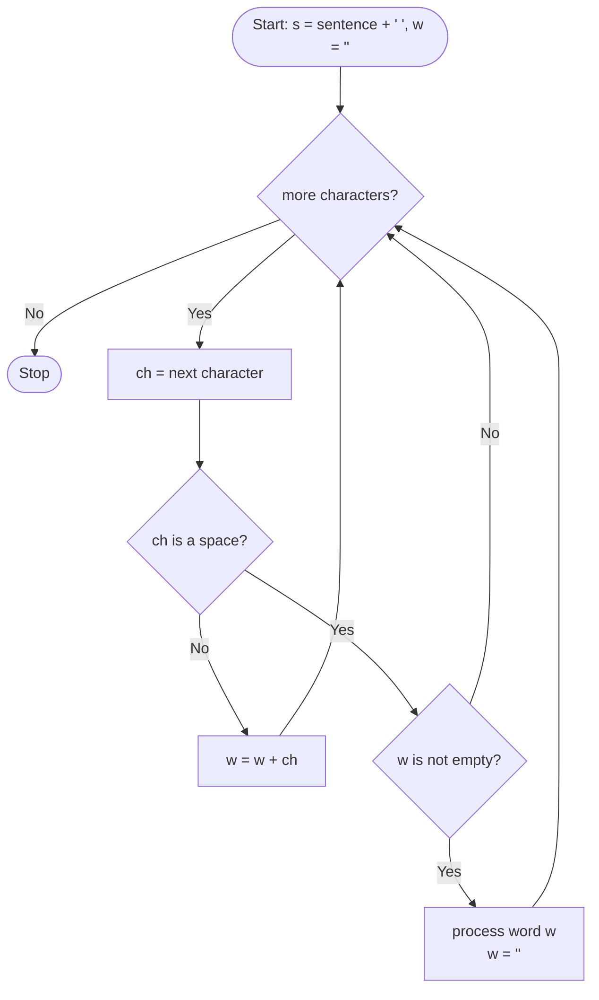

<div align="center">

# 🔤 Chapter 15 · String Handling

*The String class · Immutability · String methods with return types · `compareTo()` working · String arrays · Sorting and searching strings · Word extraction*

[⬅ Back to Index](../README.md)

</div>

---

## 📑 Contents

1. [The String class](#1-the-string-class)
2. [Creating strings and immutability](#2-creating-strings-and-immutability)
3. [String methods — complete table](#3-string-methods--complete-table)
4. [`indexOf()` and `substring()` in detail](#4-indexof-and-substring-in-detail)
5. [How `compareTo()` works](#5-how-compareto-works)
6. [`==` vs `equals()`](#6--vs-equals)
7. [Joining strings: `+` and `concat()`](#7-joining-strings--and-concat)
8. [char vs String](#8-char-vs-string)
9. [Extracting words from a sentence](#9-extracting-words-from-a-sentence)
10. [String arrays — sorting and searching](#10-string-arrays--sorting-and-searching)
11. [Predict the output](#11-predict-the-output)
12. [Find the errors](#12-find-the-errors)
13. [Differentiate between](#13-differentiate-between)
14. [One-line facts](#14-one-line-facts)
15. [Test yourself](#-test-yourself)
16. [Programs in this chapter](#-programs-in-this-chapter)

---

## 1. The String class

A **string** is a **sequence of characters** enclosed in double quotes, e.g. `"ICSE 2027"`. In Java, strings are objects of the **`String`** class of the **`java.lang`** package. `String` is therefore a **composite (reference)** data type.

Each character of a string has an **index**, starting from **0**:

| Index | 0 | 1 | 2 | 3 | 4 | 5 | 6 | 7 |
|---|---|---|---|---|---|---|---|---|
| `"COMPUTER"` | C | O | M | P | U | T | E | R |

`length()` = 8; valid indices are 0 to 7.

---

## 2. Creating strings and immutability

```java
String s1 = "Java";               // string literal
String s2 = new String("Java");   // using new
String s3 = "";                   // empty string, length 0
```

**Immutability:** a `String` object **cannot be changed** after it is created. Methods such as `toUpperCase()`, `replace()`, `trim()` and `concat()` **do not modify** the original — they **return a new String**.

```java
String s = "java";
s.toUpperCase();          // result discarded — s is still "java"
s = s.toUpperCase();      // s now refers to a new object "JAVA"
```

> [!WARNING]
> Writing `s.trim();` alone as a statement has **no effect** on `s`. Always assign the result: `s = s.trim();`. This is a very common logical error.

---

## 3. String methods — complete table

*(Examples use `s = "Computer"`.)*

| Method | Return type | Purpose | Example | Result |
|---|---|---|---|---|
| `length()` | `int` | Number of characters | `s.length()` | `8` |
| `charAt(int i)` | `char` | Character at index i | `s.charAt(3)` | `'p'` |
| `indexOf(char ch)` | `int` | Index of the first occurrence of ch; −1 if absent | `s.indexOf('u')` | `4` |
| `indexOf(char ch, int start)` | `int` | First occurrence of ch from index start | `"banana".indexOf('a', 2)` | `3` |
| `indexOf(String str)` | `int` | Index where str first begins | `s.indexOf("put")` | `3` |
| `lastIndexOf(char ch)` | `int` | Index of the last occurrence | `"banana".lastIndexOf('a')` | `5` |
| `substring(int start)` | `String` | From start to the end | `s.substring(3)` | `"puter"` |
| `substring(int start, int end)` | `String` | From start to **end − 1** | `s.substring(0, 4)` | `"Comp"` |
| `toUpperCase()` | `String` | All letters in uppercase | `s.toUpperCase()` | `"COMPUTER"` |
| `toLowerCase()` | `String` | All letters in lowercase | `s.toLowerCase()` | `"computer"` |
| `trim()` | `String` | Removes leading and trailing spaces (not inner ones) | `"  a b  ".trim()` | `"a b"` |
| `concat(String str)` | `String` | Joins str at the end | `s.concat("s")` | `"Computers"` |
| `replace(char old, char new)` | `String` | Replaces every old char with new | `"ICSE".replace('C', 'K')` | `"IKSE"` |
| `replace(String old, String new)` | `String` | Replaces every old substring | `"good food".replace("oo", "e")` | `"ged fed"` |
| `equals(String str)` | `boolean` | Same characters, case sensitive | `s.equals("computer")` | `false` |
| `equalsIgnoreCase(String str)` | `boolean` | Same characters, ignoring case | `s.equalsIgnoreCase("COMPUTER")` | `true` |
| `compareTo(String str)` | `int` | Dictionary comparison: 0 / negative / positive | `"BAT".compareTo("BALL")` | `8` |
| `compareToIgnoreCase(String str)` | `int` | Same, ignoring case | `"a".compareToIgnoreCase("B")` | `-1` |
| `startsWith(String str)` | `boolean` | Begins with str? | `s.startsWith("Com")` | `true` |
| `endsWith(String str)` | `boolean` | Ends with str? | `s.endsWith("ER")` | `false` |
| `String.valueOf(any)` | `String` | Converts a number/char/boolean to a String | `String.valueOf(25) + 5` | `"255"` |

> [!IMPORTANT]
> **Return types are frequently asked:** `charAt()` → `char`; `indexOf()`, `lastIndexOf()`, `length()`, `compareTo()` → `int`; `equals()`, `startsWith()`, `endsWith()` → `boolean`; all the others → `String`.

**Runtime errors:** `charAt(i)` or `substring(…)` with an index outside the string causes **`StringIndexOutOfBoundsException`**. Calling any method on a `null` String causes **`NullPointerException`**.

---

## 4. `indexOf()` and `substring()` in detail

```
 index:  0  1  2  3  4  5  6  7  8  9  10 11
 s    =  B  A  N  A  N  A     S  P  L  I  T
```

| Expression | Result | Reason |
|---|---|---|
| `s.indexOf('A')` | `1` | first A |
| `s.lastIndexOf('A')` | `5` | last A |
| `s.indexOf('A', 2)` | `3` | first A from index 2 |
| `s.indexOf("NA")` | `2` | — |
| `s.indexOf('Z')` | `-1` | not present |
| `s.substring(7)` | `"SPLIT"` | index 7 to the end |
| `s.substring(2, 5)` | `"NAN"` | indices 2, 3, 4 |
| `s.substring(3, 3)` | `""` | start = end → empty string |
| `s.substring(0, s.indexOf(' '))` | `"BANANA"` | first word |
| `s.substring(s.lastIndexOf(' ') + 1)` | `"SPLIT"` | last word |

> [!TIP]
> `substring(start, end)` returns **end − start** characters. Remember: "start included, end excluded".

---

## 5. How `compareTo()` works

`s1.compareTo(s2)` compares the two strings **character by character** (using Unicode values):

1. At the **first position where the characters differ**, it returns `s1.charAt(i) − s2.charAt(i)`.
2. If one string is a **prefix** of the other, it returns **`s1.length() − s2.length()`**.
3. If they are identical, it returns **0**.

| Expression | Working | Result | Meaning |
|---|---|---|---|
| `"APPLE".compareTo("APPLY")` | 'E' − 'Y' = 69 − 89 | `-20` | APPLE comes first |
| `"BAT".compareTo("BALL")` | 'T' − 'L' = 84 − 76 | `8` | BAT comes after BALL |
| `"CAT".compareTo("CATALOG")` | prefix: 3 − 7 | `-4` | CAT comes first |
| `"apple".compareTo("APPLE")` | 'a' − 'A' = 97 − 65 | `32` | lowercase comes after uppercase |
| `"Zebra".compareTo("apple")` | 'Z' − 'a' = 90 − 97 | `-7` | uppercase Z comes before lowercase a |
| `"ICSE".compareTo("ICSE")` | identical | `0` | equal |

> [!NOTE]
> Because all uppercase letters (65–90) come before lowercase letters (97–122), `compareTo()` puts `"Zebra"` before `"apple"`. Use **`compareToIgnoreCase()`** for true dictionary order.

In sorting: `if (a[j].compareTo(a[j + 1]) > 0)` → swap (ascending order).

---

## 6. `==` vs `equals()`

| Basis | `==` | `equals()` |
|---|---|---|
| Type | Relational operator | Method of the String class |
| Compares | **References** (whether both refer to the same object) | **Contents** (characters) |
| Works on | Primitives and references | Objects |
| `new String("hi") == new String("hi")` | `false` | — |
| `new String("hi").equals(new String("hi"))` | — | `true` |

> [!WARNING]
> Never compare strings typed by the user with `==`. Use `equals()` or `equalsIgnoreCase()`.

---

## 7. Joining strings: `+` and `concat()`

```java
String a = "Hello", b = "World";
String c = a + " " + b;          // "Hello World"
String d = a.concat(" ").concat(b);  // "Hello World"
```

| Basis | `+` operator | `concat()` method |
|---|---|---|
| Nature | Operator | Method |
| Operands | Any type (converted to String) | Only a String argument |
| Example | `"A" + 5` → `"A5"` | `"A".concat(5)` → **error**; use `"A".concat("5")` |

**Mixing numbers and strings with `+`** (left to right): `1 + 2 + "3"` → `"33"`; `"1" + 2 + 3` → `"123"`.

---

## 8. char vs String

| Basis | `char` | `String` |
|---|---|---|
| Type | Primitive | Class (reference) |
| Holds | Exactly one character | Zero or more characters |
| Quotes | Single `'A'` | Double `"A"` |
| Size | 2 bytes | Depends on the length |
| Compare | `==` | `equals()` |
| Convert | `String s = "" + ch;` or `String.valueOf(ch)` | `char ch = s.charAt(0);` |

---

## 9. Extracting words from a sentence

The standard ICSE technique (safe with extra spaces):

```java
String s = sc.nextLine().trim() + " ";     // add a space so the last word is also processed
String w = "";
for (int i = 0; i < s.length(); i++)
{
    char ch = s.charAt(i);
    if (ch != ' ')
        w = w + ch;                       // build the word
    else if (w.length() > 0)              // a word has ended (skip repeated spaces)
    {
        // ... process the word w ...
        w = "";
    }
}
```



**Counting words with extra spaces:** a word begins wherever a non-space character follows a space (or is at index 0).

---

## 10. String arrays — sorting and searching

```java
String names[] = {"Rohit", "anjali", "Kabir"};
```

**Bubble sort (alphabetical):**
```java
for (int i = 0; i < n - 1; i++)
    for (int j = 0; j < n - 1 - i; j++)
        if (names[j].compareToIgnoreCase(names[j + 1]) > 0)
        {
            String t = names[j];
            names[j] = names[j + 1];
            names[j + 1] = t;
        }
```

**Linear search:** `if (names[i].equalsIgnoreCase(key))`.
**Binary search on a sorted String array:** compare with `key.compareTo(names[mid])` — negative → search left, positive → search right.

---

## 11. Predict the output

```java
String s = "Computer Applications";
System.out.println(s.indexOf('t') + s.lastIndexOf('t'));                 // (1)
System.out.println(s.substring(9, 12).toUpperCase());                     // (2)
System.out.println(s.charAt(s.length() - 1) + 1);                         // (3)
System.out.println(s.replace('p', 'P').substring(0, 4));                  // (4)
System.out.println("ICSE".compareTo("ISC") + " " + "ab".compareTo("abcd"));  // (5)
System.out.println(s.startsWith("Comp") && s.endsWith("S"));             // (6)
String t = "  hi  ";  t.trim();  System.out.println("[" + t + "]");      // (7)
System.out.println(String.valueOf(10) + 20 + 30);                         // (8)
```

<details>
<summary><b>Show answers with working</b></summary>

| # | Working | Output |
|---|---|---|
| 1 | first 't' at 5, last 't' at 16 (Applica**t**ions); 5 + 16 | `21` |
| 2 | characters 9, 10, 11 = "App" | `APP` |
| 3 | last char 's' (115) + 1 | `116` |
| 4 | "ComPuter APPlications" → first 4 | `ComP` |
| 5 | 'C' − 'S' = 67 − 83 = −16; prefix 2 − 4 = −2 | `-16 -2` |
| 6 | true && false (case sensitive) | `false` |
| 7 | result of `trim()` not assigned | `[  hi  ]` |
| 8 | "10" + 20 + 30 | `102030` |

</details>

---

## 12. Find the errors

```java
String s = 'Java';                         // (1)
char c = s.charAt(4);                       // (2)
int n = s.length;                           // (3)
if (s == "JAVA") System.out.println(1);     // (4)
String t = s.toUppercase();                 // (5)
boolean b = s.indexOf('a');                 // (6)
```

<details>
<summary><b>Show corrections</b></summary>

1. Strings need double quotes → `"Java"`
2. Valid indices are 0–3 → `s.charAt(3)` (otherwise `StringIndexOutOfBoundsException`)
3. For a String, `length()` is a method → `s.length()`
4. Use `equals()`/`equalsIgnoreCase()` to compare contents → `s.equalsIgnoreCase("JAVA")`
5. Method name is `toUpperCase()` (capital C)
6. `indexOf()` returns an `int` → `int b = s.indexOf('a');`

</details>

---

## 13. Differentiate between

| Pair | Difference |
|---|---|
| `equals()` vs `==` | Compares contents vs compares references |
| `equals()` vs `compareTo()` | Returns `boolean` (equal or not) vs `int` (order: negative/0/positive) |
| `indexOf()` vs `charAt()` | Character → its index vs index → its character |
| `length` vs `length()` | Array property vs String method |
| `toUpperCase()` (String) vs `Character.toUpperCase()` | Whole string, returns String vs one character, returns char |
| `replace(char, char)` vs `substring()` | Replaces characters vs extracts a part |
| `trim()` vs removing all spaces | Removes only leading and trailing spaces vs all spaces |
| `next()` vs `nextLine()` | One word vs whole line |

---

## 14. One-line facts

- `String` belongs to `java.lang` and is **immutable**.
- String indices begin at **0**; the last index is `length() − 1`.
- `substring(a, b)` returns characters from index a to **b − 1**.
- `indexOf()` returns **−1** when the character is not found.
- `compareTo()` returns **0** for equal strings.
- `equals()` is **case sensitive**; `equalsIgnoreCase()` is not.
- `trim()` removes spaces only at the **two ends**.
- `String.valueOf()` converts a number into a **String**.
- `"" + ch` converts a `char` into a String.

---

## 🧠 Test Yourself

### Part A — Multiple choice

1. `"MISSISSIPPI".indexOf('S') + "MISSISSIPPI".lastIndexOf('S')` is (a) 8 (b) 9 (c) 7 (d) 10
2. What is printed? `String s = "ICSE"; s.toLowerCase(); System.out.println(s.concat("!"));`
   <br>(a) icse! (b) ICSE! (c) ICSE (d) Error
3. *Assertion (A):* `"Apple".compareTo("apple")` returns a negative value.
   <br>*Reason (R):* The Unicode value of 'A' is smaller than that of 'a'.
   <br>(a) Both true; R explains A (b) Both true; R doesn't explain A (c) A true, R false (d) A false, R true
4. `"Programming".substring(3, 7)` returns (a) "gram" (b) "gramm" (c) "ogra" (d) "ramm"
5. Which returns a `char`? (a) `s.indexOf('a')` (b) `s.charAt(0)` (c) `s.substring(0, 1)` (d) `String.valueOf('a')`
6. `"good".replace('o', "0")` causes (a) "g00d" (b) a compile-time error (c) "g0od" (d) a runtime error
7. `String a = "Hi"; String b = "Hi"; String c = new String("Hi");` Which is **true**?
   <br>(a) `a == c` (b) `a.equals(c)` and `a != c` (c) `b != a` (d) `c.equals("hi")`
8. What is printed? `System.out.println("abc".compareTo("abd") + "xyz".length());`
   <br>(a) 2 (b) −1 (c) −13 (d) 4
9. `"  A  B  ".trim().length()` is (a) 2 (b) 4 (c) 6 (d) 8
10. What is printed? `String s = "JAVA"; for (int i = 0; i < s.length(); i += 2) System.out.print(s.charAt(i) + 1);`
    <br>(a) KW (b) 7587 (c) J1V1 (d) 7586

### Part B — Short answer questions

1. What is meant by "strings are immutable"?
2. Write the return types of: `length()`, `charAt()`, `indexOf()`, `equals()`, `substring()`, `compareTo()`.
3. Give the output: `"COMPUTER".substring(2, 5) + "COMPUTER".charAt(7)`
4. Evaluate: (i) `"MANGO".compareTo("MAN")` (ii) `"cat".compareTo("dog")`
5. Write a statement to extract the last word of a sentence `s`.
6. Differentiate between `equals()` and `==` with an example.
7. Write statements to (i) count the occurrences of 'a' in `s` (ii) check whether `s` is a palindrome.
8. What does `trim()` do? Does it remove spaces between words?

<details>
<summary><b>✅ Answers — Part A</b></summary>

| Q | Ans | Working |
|---|---|---|
| 1 | (a) | M0 I1 S2 S3 I4 S5 S6 I7 P8 P9 I10: first S at 2, last S at 6 → 2 + 6 = 8 |
| 2 | (b) | `toLowerCase()` result discarded |
| 3 | (a) | 'A' − 'a' = −32 |
| 4 | (a) | indices 3–6: g r a m |
| 5 | (b) | — |
| 6 | (b) | Arguments must both be char or both be String |
| 7 | (b) | — |
| 8 | (a) | −1 + 3 = 2 |
| 9 | (b) | `"A  B"` |
| 10 | (b) | 'J' + 1 = 75, 'V' + 1 = 87 → `7587` |

</details>

<details>
<summary><b>✅ Answers — Part B</b></summary>

1. A String object cannot be changed after creation; methods that seem to modify it return a new String instead.
2. `int`, `char`, `int`, `boolean`, `String`, `int`.
3. `"MPU" + 'R'` → `MPUR`
4. (i) prefix: 5 − 3 = `2` (ii) 'c' − 'd' = `-1`
5. `String last = s.trim().substring(s.trim().lastIndexOf(' ') + 1);`
6. `==` compares references and `equals()` compares contents: `new String("A") == new String("A")` is false, but `new String("A").equals(new String("A"))` is true.
7. (i) `int c = 0; for (int i = 0; i < s.length(); i++) if (s.charAt(i) == 'a') c++;`
   (ii) `String r = ""; for (int i = s.length() - 1; i >= 0; i--) r = r + s.charAt(i); boolean pal = r.equals(s);`
8. It removes the leading and trailing spaces of a string. No — spaces between words remain.

</details>

---

## 💻 Programs in this chapter

<!-- PROGRAMS -->

| No. | Program | |
|:---:|---|:---:|
| **Q302** | [Palindrome Word](Q_302.java) |  |
| **Q303** | [Pig Latin](Q_303.java) |  |
| **Q304** | [Uppercase Conversion and Double-Letter Sequences](Q_304.java) |  |
| **Q305** | [Capitalise the First Letter of Each Word](Q_305.java) |  |
| **Q306** | [Initials of a Name](Q_306.java) |  |
| **Q307** | [Names in Alphabetical Order using Bubble Sort](Q_307.java) |  |
| **Q308** | [Names in Alphabetical Order using Selection Sort](Q_308.java) |  |
| **Q309** | [Linear Search for a Name](Q_309.java) |  |
| **Q310** | [Count the Words in a Sentence](Q_310.java) |  |
| **Q311** | [Longest Word in a Sentence](Q_311.java) |  |
| **Q312** | [Reverse Each Word of a Sentence](Q_312.java) |  |
| **Q313** | [Reverse the Order of Words](Q_313.java) |  |
| **Q314** | [Toggle the Case of Each Letter](Q_314.java) |  |
| **Q315** | [Frequency of Each Letter](Q_315.java) |  |
| **Q316** | [Letters of a Word in Alphabetical Order](Q_316.java) |  |
| **Q317** | [Special Word or Palindrome Word](Q_317.java) |  |
| **Q318** | [Count the Palindrome Words in a Sentence](Q_318.java) |  |
| **Q319** | [Frequency of a Given Word in a Sentence](Q_319.java) |  |
| **Q320** | [Replace a Word with Another Word](Q_320.java) |  |
| **Q321** | [Remove the Vowels from a Sentence](Q_321.java) |  |
| **Q322** | [Word Pattern: B, BL, BLU, BLUE, BLUEJ](Q_322.java) |  |
| **Q323** | [Word Pattern: JAVA, AVA, VA, A](Q_323.java) |  |
| **Q324** | [Overloading Joystring()](Q_324.java) | 📝 ICSE 2015 |
| **Q325** | [Overloading count(): Vowels and a Given Character](Q_325.java) |  |
| **Q326** | [Count the Words Beginning with a Vowel](Q_326.java) |  |
| **Q327** | [Names Starting or Ending with Given Letters](Q_327.java) |  |
| **Q328** | [Output of the String Class Methods](Q_328.java) |  |
| **Q329** | [Output of compareTo(), compareToIgnoreCase() and equals()](Q_329.java) |  |
| **Q330** | [Count Pairs of Consecutive Letters](Q_330.java) |  |
| **Q331** | [Word with the Maximum Number of Vowels](Q_331.java) |  |
| **Q332** | [Swap the First and Last Letters of Each Word](Q_332.java) |  |
| **Q333** | [Display Each Word with its Length](Q_333.java) |  |
| **Q334** | [Username and Domain from an Email Address](Q_334.java) |  |
| **Q335** | [Number in Words, Digit by Digit](Q_335.java) |  |
| **Q336** | [Characters at Alternate Positions](Q_336.java) |  |
| **Q337** | [Encode a Sentence by Shifting Letters by 2](Q_337.java) |  |
| **Q338** | [Remove Extra Spaces from a Sentence](Q_338.java) |  |
| **Q339** | [Words that Begin and End with a Vowel](Q_339.java) |  |
| **Q340** | [Words of a Sentence in Alphabetical Order](Q_340.java) |  |
| **Q341** | [First Non-Repeating Character](Q_341.java) |  |
| **Q342** | [Anagram Check](Q_342.java) |  |
| **Q343** | [Pangram Check](Q_343.java) | 🌟 *Extra* |
| **Q344** | [Login Check using concat() and equalsIgnoreCase()](Q_344.java) |  |
| **Q345** | [Words that Come First and Last Alphabetically](Q_345.java) |  |
| **Q346** | [Number to Roman Numerals](Q_346.java) | 🌟 *Extra* |
| **Q347** | [Caesar Cipher: Encrypt and Decrypt](Q_347.java) | 🌟 *Extra* |
| **Q348** | [Word Scramble Game](Q_348.java) | 🌟 *Extra* |
| **Q349** | [Run-Length Encoding](Q_349.java) | 🌟 *Extra* |
| **Q350** | [24-Hour Time to 12-Hour Time](Q_350.java) | 🌟 *Extra* |

<!-- /PROGRAMS -->
