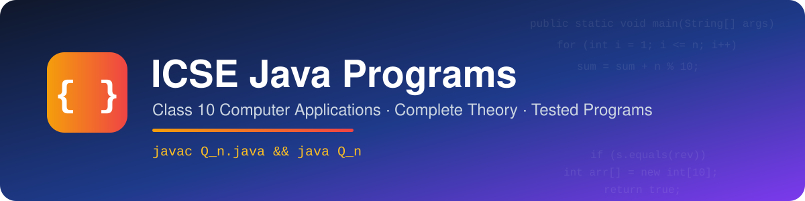

<div align="center">




**A complete revision kit for ICSE Class 10 Computer Applications (Java)** — every chapter of the syllabus with board-level theory, harder self-test questions and **131** fully tested programs.

</div>

---

## 📖 About

This repository follows the **ICSE Class 10 Computer Applications (86)** syllabus chapter by chapter. Each chapter folder contains:

- 📘 **`Theory.md`** — the complete theory in standard textbook language: definitions, comparison tables, flowcharts, predict-the-output questions with dry runs, error finding, library method tables and exam tips, ending with a set of **hard MCQs and short questions** (answers hidden in collapsible sections).
- 💻 **`Q_n.java`** files — one program per file, numbered continuously across the whole repository, the most frequently asked ones first in each chapter.

### Program conventions

| | |
|---|---|
| ☕ **Standard Java** | Plain Java with a `main` method (not BlueJ), no packages — every file runs on its own |
| ⌨️ **Input** | `Scanner` object always named `sc`; `import java.util.Scanner;` is the only import |
| 📝 **Header** | Program number, chapter and the full exam-style question (patterns are drawn exactly) |
| 📋 **Variable table** | Name of the Variable · Data Type · Purpose / Description, at the bottom of every file |
| 🌟 **[Extra]** | Creative programs slightly beyond the syllabus, still solved with syllabus-level Java |
| ✅ **Tested** | Every file compiled with `javac` on JDK 21 and run on normal and edge-case inputs |

### ▶️ How to run

```bash
cd 07-Iterative-Constructs
javac Q_82.java
java Q_82
```

---

## 🗺️ Chapter overview

| # | Chapter | Theory | Programs | Range |
|:---:|---|:---:|:---:|:---:|
| 01 | ☕ [Introduction to OOP and Java](#chapter-01) | [📘 Read](01-Introduction-to-OOP-and-Java/Theory.md) | **5** | Q1 – Q5 |
| 02 | 🔢 [Values and Data Types](#chapter-02) | [📘 Read](02-Values-and-Data-Types/Theory.md) | **8** | Q6 – Q13 |
| 03 | ➗ [Operators in Java](#chapter-03) | [📘 Read](03-Operators-in-Java/Theory.md) | **10** | Q14 – Q23 |
| 04 | ⌨️ [Input in Java](#chapter-04) | [📘 Read](04-Input-in-Java/Theory.md) | **8** | Q24 – Q31 |
| 05 | 📐 [Mathematical Library Methods](#chapter-05) | [📘 Read](05-Mathematical-Library-Methods/Theory.md) | **14** | Q32 – Q45 |
| 06 | 🔀 [Conditional Constructs in Java](#chapter-06) | [📘 Read](06-Conditional-Constructs/Theory.md) | **32** | Q46 – Q77 |
| 07 | 🔁 [Iterative Constructs in Java](#chapter-07) | [📘 Read](07-Iterative-Constructs/Theory.md) | **54** | Q78 – Q131 |
| | **Total** | | **131** | |

> [!NOTE]
> 🚧 Work in progress — 7 of 15 chapters published so far.

---

## 📚 Index

<a id="chapter-01"></a>

### ☕ Chapter 01 · Introduction to OOP and Java

📘 **[Theory, MCQs and short questions](01-Introduction-to-OOP-and-Java/Theory.md)** · 💻 5 programs

| No. | Program | |
|:---:|---|:---:|
| **Q1** | [Display Student Details using print() and println()](01-Introduction-to-OOP-and-Java/Q_1.java) |  |
| **Q2** | [Marks Table using Tab and New-Line Escape Sequences](01-Introduction-to-OOP-and-Java/Q_2.java) |  |
| **Q3** | [Quotation and File Path using Escape Sequences](01-Introduction-to-OOP-and-Java/Q_3.java) |  |
| **Q4** | [Class Box: Creating an Object and Finding its Volume](01-Introduction-to-OOP-and-Java/Q_4.java) |  |
| **Q5** | [Class Car: Two Objects, Same Behaviour, Different States](01-Introduction-to-OOP-and-Java/Q_5.java) |  |

<div align="right"><a href="#-chapter-overview">⬆ back to overview</a></div>

<a id="chapter-02"></a>

### 🔢 Chapter 02 · Values and Data Types

📘 **[Theory, MCQs and short questions](02-Values-and-Data-Types/Theory.md)** · 💻 8 programs

| No. | Program | |
|:---:|---|:---:|
| **Q6** | [ASCII Code of an Entered Character](02-Values-and-Data-Types/Q_6.java) |  |
| **Q7** | [Character for an Entered ASCII Code](02-Values-and-Data-Types/Q_7.java) |  |
| **Q8** | [Implicit Type Conversion](02-Values-and-Data-Types/Q_8.java) |  |
| **Q9** | [Explicit Type Casting](02-Values-and-Data-Types/Q_9.java) |  |
| **Q10** | [Swap Two Numbers using a Third Variable](02-Values-and-Data-Types/Q_10.java) |  |
| **Q11** | [Swap Two Numbers without a Third Variable](02-Values-and-Data-Types/Q_11.java) |  |
| **Q12** | [Next and Previous Character](02-Values-and-Data-Types/Q_12.java) |  |
| **Q13** | [Uppercase to Lowercase using ASCII Arithmetic](02-Values-and-Data-Types/Q_13.java) |  |

<div align="right"><a href="#-chapter-overview">⬆ back to overview</a></div>

<a id="chapter-03"></a>

### ➗ Chapter 03 · Operators in Java

📘 **[Theory, MCQs and short questions](03-Operators-in-Java/Theory.md)** · 💻 10 programs

| No. | Program | |
|:---:|---|:---:|
| **Q14** | [Area and Perimeter of a Rectangle](03-Operators-in-Java/Q_14.java) |  |
| **Q15** | [Area and Circumference of a Circle](03-Operators-in-Java/Q_15.java) |  |
| **Q16** | [Temperature Conversion: Celsius and Fahrenheit](03-Operators-in-Java/Q_16.java) |  |
| **Q17** | [Simple Interest and Amount](03-Operators-in-Java/Q_17.java) |  |
| **Q18** | [Convert Seconds into Hours, Minutes and Seconds](03-Operators-in-Java/Q_18.java) |  |
| **Q19** | [Convert Days into Years, Months and Days](03-Operators-in-Java/Q_19.java) |  |
| **Q20** | [Prefix and Postfix Increment and Decrement](03-Operators-in-Java/Q_20.java) |  |
| **Q21** | [Larger of Two Numbers using the Ternary Operator](03-Operators-in-Java/Q_21.java) |  |
| **Q22** | [Shorthand (Compound Assignment) Operators](03-Operators-in-Java/Q_22.java) |  |
| **Q23** | [Total, Average and Percentage of Five Subjects](03-Operators-in-Java/Q_23.java) |  |

<div align="right"><a href="#-chapter-overview">⬆ back to overview</a></div>

<a id="chapter-04"></a>

### ⌨️ Chapter 04 · Input in Java

📘 **[Theory, MCQs and short questions](04-Input-in-Java/Theory.md)** · 💻 8 programs

| No. | Program | |
|:---:|---|:---:|
| **Q24** | [Input using Every Scanner Method](04-Input-in-Java/Q_24.java) |  |
| **Q25** | [Volume and Surface Area of a Cuboid](04-Input-in-Java/Q_25.java) |  |
| **Q26** | [Final Velocity: Input through Parameters](04-Input-in-Java/Q_26.java) |  |
| **Q27** | [Distance Travelled: Input by Initialisation](04-Input-in-Java/Q_27.java) |  |
| **Q28** | [Reading a Full Name with nextLine() after nextInt()](04-Input-in-Java/Q_28.java) |  |
| **Q29** | [Bill Amount after a 10% Discount](04-Input-in-Java/Q_29.java) |  |
| **Q30** | [Distance Conversion: Kilometres to Metres, Centimetres and Miles](04-Input-in-Java/Q_30.java) |  |
| **Q31** | [Gross and Net Salary of an Employee](04-Input-in-Java/Q_31.java) |  |

<div align="right"><a href="#-chapter-overview">⬆ back to overview</a></div>

<a id="chapter-05"></a>

### 📐 Chapter 05 · Mathematical Library Methods

📘 **[Theory, MCQs and short questions](05-Mathematical-Library-Methods/Theory.md)** · 💻 14 programs

| No. | Program | |
|:---:|---|:---:|
| **Q32** | [Results of All Math Class Methods](05-Mathematical-Library-Methods/Q_32.java) |  |
| **Q33** | [Hypotenuse of a Right-Angled Triangle](05-Mathematical-Library-Methods/Q_33.java) |  |
| **Q34** | [Area of a Triangle using Heron's Formula](05-Mathematical-Library-Methods/Q_34.java) |  |
| **Q35** | [Roots of a Quadratic Equation](05-Mathematical-Library-Methods/Q_35.java) |  |
| **Q36** | [Distance between Two Points](05-Mathematical-Library-Methods/Q_36.java) |  |
| **Q37** | [Compound Interest using Math.pow()](05-Mathematical-Library-Methods/Q_37.java) |  |
| **Q38** | [Largest and Smallest of Three Numbers using Math.max() and Math.min()](05-Mathematical-Library-Methods/Q_38.java) |  |
| **Q39** | [Round off a Number to Two Decimal Places](05-Mathematical-Library-Methods/Q_39.java) |  |
| **Q40** | [Perfect Square Check using Math.sqrt()](05-Mathematical-Library-Methods/Q_40.java) |  |
| **Q41** | [Rolling a Pair of Dice using Math.random()](05-Mathematical-Library-Methods/Q_41.java) |  |
| **Q42** | [Evaluating Mathematical Formulas as Java Expressions](05-Mathematical-Library-Methods/Q_42.java) |  |
| **Q43** | [Volume and Surface Area of a Sphere](05-Mathematical-Library-Methods/Q_43.java) |  |
| **Q44** | [Integer Part, Fractional Part, Ceiling and Floor](05-Mathematical-Library-Methods/Q_44.java) |  |
| **Q45** | [Four-Digit OTP Generator](05-Mathematical-Library-Methods/Q_45.java) | 🌟 *Extra* |

<div align="right"><a href="#-chapter-overview">⬆ back to overview</a></div>

<a id="chapter-06"></a>

### 🔀 Chapter 06 · Conditional Constructs in Java

📘 **[Theory, MCQs and short questions](06-Conditional-Constructs/Theory.md)** · 💻 32 programs

| No. | Program | |
|:---:|---|:---:|
| **Q46** | [Electricity Bill (Slab System)](06-Conditional-Constructs/Q_46.java) |  |
| **Q47** | [Income Tax by Age, Gender and Slab](06-Conditional-Constructs/Q_47.java) |  |
| **Q48** | [Discount on Laptop or Desktop Purchase](06-Conditional-Constructs/Q_48.java) |  |
| **Q49** | [Menu-Driven Program: Area of Circle, Square or Rectangle](06-Conditional-Constructs/Q_49.java) |  |
| **Q50** | [Simple Calculator using switch](06-Conditional-Constructs/Q_50.java) |  |
| **Q51** | [Menu-Driven Temperature Conversion](06-Conditional-Constructs/Q_51.java) |  |
| **Q52** | [Day of the Week using switch](06-Conditional-Constructs/Q_52.java) |  |
| **Q53** | [Name of the Month and Number of Days](06-Conditional-Constructs/Q_53.java) |  |
| **Q54** | [Season of the Year using Fall-Through in switch](06-Conditional-Constructs/Q_54.java) |  |
| **Q55** | [Vowel or Consonant using switch](06-Conditional-Constructs/Q_55.java) |  |
| **Q56** | [Grade from Percentage](06-Conditional-Constructs/Q_56.java) |  |
| **Q57** | [Courier Charges by Weight and Type](06-Conditional-Constructs/Q_57.java) |  |
| **Q58** | [Telephone Bill with Monthly Rent](06-Conditional-Constructs/Q_58.java) |  |
| **Q59** | [Commission on Sales](06-Conditional-Constructs/Q_59.java) |  |
| **Q60** | [Fixed Deposit Interest by Period](06-Conditional-Constructs/Q_60.java) |  |
| **Q61** | [Taxi Fare by Distance](06-Conditional-Constructs/Q_61.java) |  |
| **Q62** | [Leap Year Check](06-Conditional-Constructs/Q_62.java) |  |
| **Q63** | [Largest of Three Numbers using Nested if](06-Conditional-Constructs/Q_63.java) |  |
| **Q64** | [Triangle Validity and Type by Sides](06-Conditional-Constructs/Q_64.java) |  |
| **Q65** | [Odd or Even Number](06-Conditional-Constructs/Q_65.java) |  |
| **Q66** | [Positive, Negative or Zero](06-Conditional-Constructs/Q_66.java) |  |
| **Q67** | [Eligibility to Vote](06-Conditional-Constructs/Q_67.java) |  |
| **Q68** | [Uppercase, Lowercase, Digit or Special Character](06-Conditional-Constructs/Q_68.java) |  |
| **Q69** | [Buzz Number](06-Conditional-Constructs/Q_69.java) |  |
| **Q70** | [Divisibility by 5 and 11](06-Conditional-Constructs/Q_70.java) |  |
| **Q71** | [Profit or Loss and its Percentage](06-Conditional-Constructs/Q_71.java) |  |
| **Q72** | [Quadrant of a Point](06-Conditional-Constructs/Q_72.java) |  |
| **Q73** | [Menu with an Exit Option using System.exit(0)](06-Conditional-Constructs/Q_73.java) |  |
| **Q74** | [Rock, Paper, Scissors against the Computer](06-Conditional-Constructs/Q_74.java) | 🌟 *Extra* |
| **Q75** | [Zodiac Sign from Date of Birth](06-Conditional-Constructs/Q_75.java) | 🌟 *Extra* |
| **Q76** | [Valid Date Checker](06-Conditional-Constructs/Q_76.java) | 🌟 *Extra* |
| **Q77** | [BMI Calculator with Category](06-Conditional-Constructs/Q_77.java) | 🌟 *Extra* |

<div align="right"><a href="#-chapter-overview">⬆ back to overview</a></div>

<a id="chapter-07"></a>

### 🔁 Chapter 07 · Iterative Constructs in Java

📘 **[Theory, MCQs and short questions](07-Iterative-Constructs/Theory.md)** · 💻 54 programs

| No. | Program | |
|:---:|---|:---:|
| **Q78** | [Prime Number](07-Iterative-Constructs/Q_78.java) |  |
| **Q79** | [Palindrome Number](07-Iterative-Constructs/Q_79.java) |  |
| **Q80** | [Armstrong Number](07-Iterative-Constructs/Q_80.java) |  |
| **Q81** | [Perfect Number](07-Iterative-Constructs/Q_81.java) |  |
| **Q82** | [Spy Number](07-Iterative-Constructs/Q_82.java) |  |
| **Q83** | [Niven (Harshad) Number](07-Iterative-Constructs/Q_83.java) |  |
| **Q84** | [Neon Number](07-Iterative-Constructs/Q_84.java) |  |
| **Q85** | [Automorphic Number](07-Iterative-Constructs/Q_85.java) |  |
| **Q86** | [Special Number (Krishnamurthy Number)](07-Iterative-Constructs/Q_86.java) |  |
| **Q87** | [Special Two-Digit Number](07-Iterative-Constructs/Q_87.java) |  |
| **Q88** | [Duck Number](07-Iterative-Constructs/Q_88.java) |  |
| **Q89** | [Pronic Number](07-Iterative-Constructs/Q_89.java) |  |
| **Q90** | [Disarium Number](07-Iterative-Constructs/Q_90.java) |  |
| **Q91** | [Kaprekar Number](07-Iterative-Constructs/Q_91.java) |  |
| **Q92** | [Tech Number](07-Iterative-Constructs/Q_92.java) |  |
| **Q93** | [Magic Number](07-Iterative-Constructs/Q_93.java) |  |
| **Q94** | [Happy Number](07-Iterative-Constructs/Q_94.java) |  |
| **Q95** | [Composite Number](07-Iterative-Constructs/Q_95.java) |  |
| **Q96** | [Emirp Number](07-Iterative-Constructs/Q_96.java) |  |
| **Q97** | [Sunny Number](07-Iterative-Constructs/Q_97.java) |  |
| **Q98** | [Evil Number](07-Iterative-Constructs/Q_98.java) |  |
| **Q99** | [Unique Number](07-Iterative-Constructs/Q_99.java) |  |
| **Q100** | [Abundant, Deficient or Perfect Number](07-Iterative-Constructs/Q_100.java) |  |
| **Q101** | [Fibonacci Series](07-Iterative-Constructs/Q_101.java) |  |
| **Q102** | [HCF and LCM of Two Numbers](07-Iterative-Constructs/Q_102.java) |  |
| **Q103** | [Factorial of a Number](07-Iterative-Constructs/Q_103.java) |  |
| **Q104** | [Sum and Product of Digits](07-Iterative-Constructs/Q_104.java) |  |
| **Q105** | [Reverse a Number and Count its Digits](07-Iterative-Constructs/Q_105.java) |  |
| **Q106** | [Largest and Smallest Digit of a Number](07-Iterative-Constructs/Q_106.java) |  |
| **Q107** | [Frequency of a Given Digit in a Number](07-Iterative-Constructs/Q_107.java) |  |
| **Q108** | [Count of Even and Odd Digits](07-Iterative-Constructs/Q_108.java) |  |
| **Q109** | [Factors of a Number and their Count](07-Iterative-Constructs/Q_109.java) |  |
| **Q110** | [Prime Factors of a Number](07-Iterative-Constructs/Q_110.java) |  |
| **Q111** | [Largest and Smallest of n Numbers](07-Iterative-Constructs/Q_111.java) |  |
| **Q112** | [Sum of Numbers until 0 is Entered](07-Iterative-Constructs/Q_112.java) |  |
| **Q113** | [Numbers from 1 to 50 not Divisible by 3 or 5 (continue)](07-Iterative-Constructs/Q_113.java) |  |
| **Q114** | [Sum of First n Natural Numbers and their Squares](07-Iterative-Constructs/Q_114.java) |  |
| **Q115** | [Sum of the Series 1 + 1/2 + 1/3 + ... + 1/n](07-Iterative-Constructs/Q_115.java) |  |
| **Q116** | [Sum of the Series x/1 + x^2/2 + x^3/3 + ... + x^n/n](07-Iterative-Constructs/Q_116.java) |  |
| **Q117** | [Sum of the Series 1 - 2 + 3 - 4 + ... n](07-Iterative-Constructs/Q_117.java) |  |
| **Q118** | [Sum of the Series a/2 + a/5 + a/8 + ... n Terms](07-Iterative-Constructs/Q_118.java) |  |
| **Q119** | [Series 1, 4, 9, 16, ... and 2, 5, 10, 17, 26, ...](07-Iterative-Constructs/Q_119.java) |  |
| **Q120** | [Series 0, 7, 26, 63, ...](07-Iterative-Constructs/Q_120.java) |  |
| **Q121** | [Series 1, 11, 111, 1111, ... and its Sum](07-Iterative-Constructs/Q_121.java) |  |
| **Q122** | [Series 1, -3, 5, -7, 9, ... and its Sum](07-Iterative-Constructs/Q_122.java) |  |
| **Q123** | [Looping Menu: Sum of Digits, Reverse, Count of Digits](07-Iterative-Constructs/Q_123.java) |  |
| **Q124** | [Decimal to Binary Conversion](07-Iterative-Constructs/Q_124.java) | 🌟 *Extra* |
| **Q125** | [Decimal to Octal Conversion](07-Iterative-Constructs/Q_125.java) | 🌟 *Extra* |
| **Q126** | [Decimal to Hexadecimal Conversion](07-Iterative-Constructs/Q_126.java) | 🌟 *Extra* |
| **Q127** | [Binary to Decimal Conversion](07-Iterative-Constructs/Q_127.java) | 🌟 *Extra* |
| **Q128** | [Collatz (Hailstone) Sequence](07-Iterative-Constructs/Q_128.java) | 🌟 *Extra* |
| **Q129** | [Number Guessing Game](07-Iterative-Constructs/Q_129.java) | 🌟 *Extra* |
| **Q130** | [Reverse-and-Add until a Palindrome](07-Iterative-Constructs/Q_130.java) | 🌟 *Extra* |
| **Q131** | [Smith Number](07-Iterative-Constructs/Q_131.java) | 🌟 *Extra* |

<div align="right"><a href="#-chapter-overview">⬆ back to overview</a></div>

---

<div align="center">

Made for ICSE Class 10 revision · Java · JDK 21

</div>
